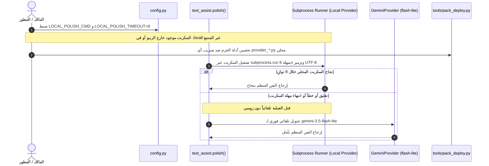

# 🛡️ الخطة الهندسية التنفيذية المعتمدة وتحصين حزم النشر (360°)

**المشروع:** منظومة التفريغ الصوتي الذكي (Gemini-3.8-Flash)  
**الفرع:** `A-test`  
**الدور:** Lead Architect & Security Inspector / SRE / DevOps  
**التاريخ المرجعي:** 2026-11-06  

---

## 1️⃣ تقييم تقرير المراجع الأمني (Auditing the Auditor)

قام المراجع الأمني (وكيل Arena.ai) بفحص ومراجعة ادعاءات وتصريحات Antigravity، وأصدر تقرير تدقيق أكد فيه:
* **صحة 6 من أصل 8 نقاط جوهرية**، وأهمها صحة وجود مقبس الحقن البرمجي `polish_fn` في `delivery.py`، دفاعية `except Exception` لحماية النص الخام، عزل طبقة التفريغ الصوتي A، وعزل `text_assist.polish()`.
* **صيدة أمنية ممتازة وموفقة جداً:** اكتشاف أن دالة `collect()` داخل `tools/pack_deploy.py` (سطور 96-98) تضم تلقائياً كافة ملفات `*.py` الموجودة في جذر المشروع، وبالتالي لو قام أي مطور بوضع سكربت محلي سري في الجذر مباشرة (مثل `provider_local.py`) فإنه قد يُحزم داخل `deploy_ready.zip` رغم تجاهله في `.gitignore`.

---

## 2️⃣ الرد الهندسي والتحصين الشامل (بروتوكول الضبة والمفتاح)

1. **سلامة توصية Antigravity الأصلية:**  
   نبهنا منذ اللحظة الأولى في كافة التقارير السابقة إلى أن السكربت الخارجي يجب أن يوضع **خارج مسار المشروع بالكامل (Air-gapped خارج الجذر في `D:\MySecrets\my_polish.py`)**، وهذا الإجراء الفيزيائي يحمي السكربت تماماً حتى بوجود هذا السلوك في أداة الحزم.
2. **التحصين الوقائي البرمجي في `tools/pack_deploy.py`:**  
   كـ Security Inspector يطبق بوابات تقفيل الثغرات 360°، لا نكتفي بالنصح، بل نقفل الثغرة برمجياً:
   * إضافة أسماء وبادئات المزودات المحلية (`provider_local.py`, `local_provider.py`, `custom_provider.py`) إلى `ROOT_PY_EXCLUDE`.
   * إضافتها إلى `SECRET_PREFIXES` داخل `pack_deploy.py` لتقوم دالة `is_forbidden(rel)` بإيقاف بناء الحزمة فوراً ورفع خطأ خروج (Exit 2) لو حاول أحد حزمها بالخطأ.
3. **توضيح مسألة `CHANGELOG_DECISIONS.md`:**  
   الملف محفوظ داخل مساحة عمل المطور المحلية (`.agents/memory/CHANGELOG_DECISIONS.md`)؛ وعدم ظهوره على ريبو GitHub العام هو سلوك أمني مقصود لحماية قرارات التطوير الداخلية من النشر العام.

---

> 📌 **تحديث دستوري:** تم تحديث واعتماد هذه الخطة بالكامل وفقاً لمخرجات دورة السمكة الذهبية الكاملة في [`05_مخرجات_دورة_السمكة_الذهبية_EGM_الكاملة.md`](./05_مخرجات_دورة_السمكة_الذهبية_EGM_الكاملة.md)؛ وتم إلغاء كلاسات الـ Router والـ 4 متغيرات، واعتماد معمارية البساطة القصوى (MVA) عبر `subprocess.run` المباشرة بـ 25 سطر كود ومتغيرين فقط، وبمهلة 8 ثوانٍ لحماية طابور المعالجة.

## 3️⃣ الخطة الهندسية المعتمدة للتنفيذ (The 4-Step Production Plan)

### تفاصيل الخطوات الأربع التنفيذية:
1. **الخطوة الأولى: تحصين `tools/pack_deploy.py` و `.gitignore`:**  
   - إضافة `.local/` و `.secrets/` إلى `.gitignore`.
   - تحديث `ROOT_PY_EXCLUDE` و `SECRET_PREFIXES` في `pack_deploy.py` لمنع أي تسريب لأي ملفات مزودات في الجذر.
2. **الخطوة الثانية: إضافة إعدادات المزود في `config.py` وتطهير السجلات في `logkit.py`:**  
   - تعريف `LOCAL_POLISH_CMD` و `LOCAL_POLISH_TIMEOUT = 8.0`.
   - إضافة حجب مسار السكربت في `logkit.redact()` لمنع تسريبه في السجلات.
   - عزل المتغيرات في `tests/conftest.py` داخل `ENV_KEYS`.
3. **الخطوة الثالثة: تطبيق دالة الاستدعاء المباشر في `text_assist.py`:**  
   - دالة `_call_local_provider(system_text, raw_text)` عبر `subprocess.run`.
   - فرض `encoding="utf-8", errors="replace"` ومهلة 8 ثوانٍ.
   - التحويل التلقائي الصامت لـ `generate()` عند غياب المزود أو فشله.
   - عدم المساس بتوقيع `polish()` الثنائي `(text, reason)` لحماية الاختبارات والتسليم.
4. **الخطوة الرابعة: كتابة اختبارات الوحدة والـ Failover:**  
   - إضافة اختبارات شاملة في `tests/test_phase4_polish.py` ومحاكاة النجاح، الـ Timeout، والـ Failover التلقائي.

