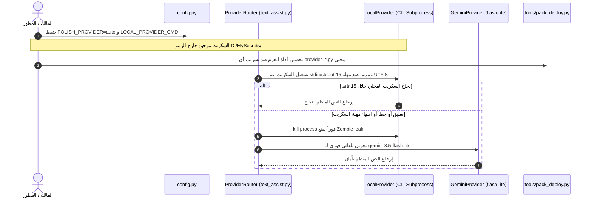

# 🛡️ الخطة الهندسية التنفيذية المعتمدة وتحصين حزم النشر (360°)

**المشروع:** منظومة التفريغ الصوتي الذكي (Gemini-3.8-Flash)  
**الفرع:** `A-test`  
**الدور:** Lead Architect & Security Inspector / SRE / DevOps  
**التاريخ المرجعي:** 2026-11-06  

---

## 1️⃣ تقييم تقرير المراجع الأمني (Auditing the Auditor)

قام المراجع الأمني (وكيل Arena.ai) بفحص ومراجعة ادعاءات وتصريحات Antigravity، وأصدر تقرير تدقيق أكد فيه:
* **صحة 6 من أصل 8 نقاط جوهرية**، وأهمها صحة وجود مقبس الحقن البرمجي `polish_fn` في `delivery.py`، دفاعية `except Exception` لحماية النص الخام، عزل طبقة التفريغ الصوتي A، وعزل `text_assist.polish()`.
* **صيدة أمنية ممتازة وموفقة جداً:** اكتشاف أن دالة `collect()` داخل `tools/pack_deploy.py` (سطور 96-98) تضم تلقائياً كافة ملفات `*.py` الموجودة في جذر المشروع، وبالتالي لو قام أي مطور بوضع سكربت محلي سري في الجذر مباشرة (مثل `provider_local.py`) فإنه قد يُحزم داخل `deploy_ready.zip` رغم تجاهله في `.gitignore`.

---

## 2️⃣ الرد الهندسي والتحصين الشامل (بروتوكول الضبة والمفتاح)

1. **سلامة توصية Antigravity الأصلية:**  
   نبهنا منذ اللحظة الأولى في كافة التقارير السابقة إلى أن السكربت الخارجي يجب أن يوضع **خارج مسار المشروع بالكامل (Air-gapped خارج الجذر في `D:\MySecrets\my_polish.py`)**، وهذا الإجراء الفيزيائي يحمي السكربت تماماً حتى بوجود هذا السلوك في أداة الحزم.
2. **التحصين الوقائي البرمجي في `tools/pack_deploy.py`:**  
   كـ Security Inspector يطبق بوابات تقفيل الثغرات 360°، لا نكتفي بالنصح، بل نقفل الثغرة برمجياً:
   * إضافة أسماء وبادئات المزودات المحلية (`provider_local.py`, `local_provider.py`, `custom_provider.py`) إلى `ROOT_PY_EXCLUDE`.
   * إضافتها إلى `SECRET_PREFIXES` داخل `pack_deploy.py` لتقوم دالة `is_forbidden(rel)` بإيقاف بناء الحزمة فوراً ورفع خطأ خروج (Exit 2) لو حاول أحد حزمها بالخطأ.
3. **توضيح مسألة `CHANGELOG_DECISIONS.md`:**  
   الملف محفوظ داخل مساحة عمل المطور المحلية (`.agents/memory/CHANGELOG_DECISIONS.md`)؛ وعدم ظهوره على ريبو GitHub العام هو سلوك أمني مقصود لحماية قرارات التطوير الداخلية من النشر العام.

---

## 3️⃣ الخطة الهندسية المعتمدة للتنفيذ (The 4-Step Production Plan)

بعد الوصول إلى الإجماع المعماري الكامل بين الوكلاء (Consensus)، هذه هي الخطوات التنفيذية الأربع المعتمدة للتطبيق المباشر على فرع `A-test`:

### تفاصيل الخطوات الأربع:
1. **الخطوة الأولى: تحصين `tools/pack_deploy.py`:**  
   تحديث قوائم `SECRET_PREFIXES` و `ROOT_PY_EXCLUDE` لمنع أي تسريب لأي ملف مزود محلي قد يوضع في الجذر مستقبلاً.
2. **الخطوة الثانية: إضافة إعدادات المزود في `config.py` وتحديث `.env.example`:**  
   تعريف `POLISH_PROVIDER` (افتراضي `gemini`)، `LOCAL_PROVIDER_CMD`، `LOCAL_PROVIDER_TIMEOUT=15`، و `POLISH_FAILOVER=1`.
3. **الخطوة الثالثة: بناء `ProviderRouter` و `LocalProvider` في `text_assist.py`:**  
   - تشغيل سطر الأوامر عبر `subprocess.Popen` بفرض `encoding="utf-8", errors="replace"`.
   - إدارة صارمة للمهلة (Timeout 15s) مع `proc.kill()` الفوري لمنع العمليات الشبحية في الرام.
   - التحويل التلقائي لـ `gemini-3.5-flash-lite` عند أي عطل.
   - إضافة تذييل شفاف في تليجرام يوضح مصدر التنظيم: `(⚡ المزود: محلي)` أو `(⚡ المزود: Google)`.
4. **الخطوة الرابعة: كتابة اختبارات الوحدة والـ Failover:**  
   إضافة اختبارات شاملة في `tests/test_phase4_polish.py` تحاكي السكربت المحلي، حالات النجاح، حالات الـ Timeout، والتحويل التلقائي الآمن دون مساس بطبقة التفريغ A.

