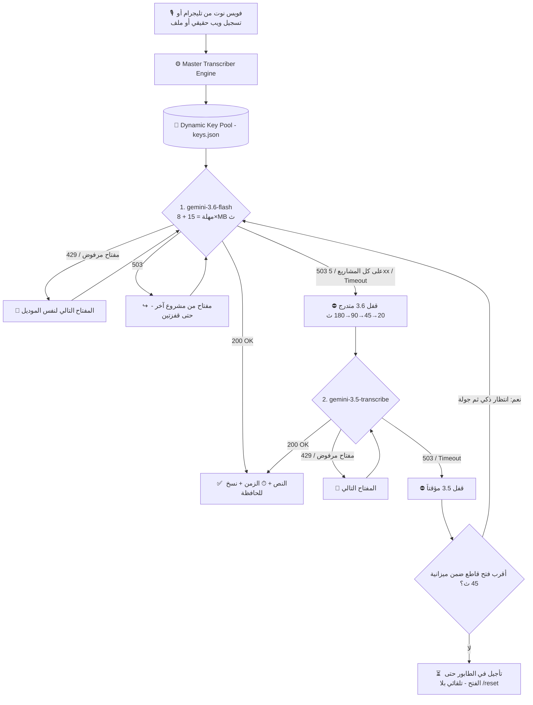

# 🎙️ منظومة التفريغ الصوتي الذكي 360° - Gemini Multi-Model AI

> **منظومة هندسية متكاملة (DevOps Resilient Architecture) لتفريغ الصوت بدقة خيالية، تدعم العامية المصرية، تحافظ على المصطلحات التقنية بالإنجليزية، وتعمل كـ بوت تليجرام وواجهة ويب صوتية حقيقية وخادم محلي في نفس الوقت 24/7 وبصفر تكلفة!**

[](https://www.python.org/)
[](https://aistudio.google.com/)
[](https://telegram.org/)
[](http://localhost:8080)
[](LICENSE)

---

## 🌟 مميزات المنظومة 360°

1. **دقة سمعية فائقة (Native Multimodal Audio):**
   - يفهم نبرة الصوت والعامية المصرية بدون اختلاق أو تخمين زائف.
   - يكتب المصطلحات البرمجية والتقنية بأحرفها الإنجليزية القياسية (`GitHub, AI, Python, Gist, IP, API, DevOps, Docker`).
2. **الموديلات المعتمدة (بدون Lite نهائياً):**
   - 🥇 **`gemini-3.6-flash` (الأساسي):** الأثبت في الاختبار الميداني — رد في 6–8 ث بدقة كاملة في العامية (20 طلب/مشروع/يوم).
   - 🥈 **`gemini-3.5-transcribe` (الاحتياطي):** محرك جوجل التخصصي للصوت، الأسرع (3–4 ث) (25 طلب/مشروع/يوم).
   - ⏸️ **`gemini-3.8-flash` معطّل** منذ 2026-10-23 (503 / Timeout متكرر مع الصوت — حادثة 01). موجود في `Config.DISABLED_MODELS`؛ لإعادته احذفه من هناك بسطر واحد.
   - 🚫 **موديل Lite مستبعد نهائياً** لضمان أعلى جودة.
3. **Failover v2 فوري وذكي (المرحلة 2 — بعد حادثة 01):**
   - كل رد من Google **يُصنَّف**: مشكلة مفتاح (429 / مفتاح مرفوض) → المفتاح التالي؛ مشكلة موديل (5xx / Timeout) → الموديل التالي + قفل الموديل مؤقتاً على الكل؛ مشكلة شبكة → لا تُلمس أي حالة.
   - **503 → قفزة لمشروع آخر قبل القفل:** الحمل قد يكون على مشروعك لا على الموديل، فنجرّب مفتاحاً من `project_group` مختلفة (حتى `MODEL_503_KEY_HOPS=2` قفزة) — لا نجرّب شقيقاً من نفس المشروع (نفس الحمل). لو الكل 503 → قفل.
   - **سلم قواطع متدرج لـ 5xx:** 20 → 45 → 90 → 180 ث حسب الضربات المتتالية (`MODEL_PAUSE_LADDER_5XX`)، وأول نجاح يصفّر العداد. Timeout يظل 90 ث. القواطع **تستمر عبر إعادة التشغيل** (`state/circuit.json` ذري، المنتهي يُهمَل).
   - **ميزانية محاولة 45 ث + انتظار ذكي:** بدل backoff أعمى ننتظر حتى أقرب فتح قاطع فقط لو تسمح الميزانية (`RETRY_BUDGET_SECONDS`)، وإلا **تُؤجَّل المهمة في الطابور** وتُعاد تلقائياً عند الفتح — بلا `/reset` يدوي ("⏳ Google مزدحمة… هأعيد المحاولة تلقائياً").
   - مهلة ديناميكية حسب حجم الملف (`15 + 8×MB` ث، سقف 90 لـ ≤8MB و180 للأكبر).
   - رسائل الخطأ مميّزة بالمصدر: `🤖 Gemini:` / `📡 تليجرام:` / `⚙️ النظام:`.
4. **مصفوفة المفاتيح الذكية (`keys.json`):**
   - 429 يومي يُقفل (المفتاح، الموديل) حتى تصفير Google (منتصف الليل Pacific)؛ 429 بالدقيقة تهدئة قصيرة.
   - مفتاح مرفوض من Google (400/401/403) يُعلَّم ❌ ويُتخطّى 24 ساعة (احذفه بـ `/remove`).
   - عدّاد استهلاك يومي حقيقي لكل (مفتاح، موديل). ⚠️ Google تحسب الكوتا لكل **مشروع** لا لكل مفتاح.
   - **مجموعات المشاريع `project_group` (المرحلة 2):** مفاتيح نفس مشروع Google تتشارك الحصة → نفاد يومي/429 على مفتاح **يعلّم كل أشقائه** فوراً (توفير محاولات محكومة بالفشل). التجميع: حقل `project_group` في `keys.json` (أمر `/project_group`)، أو وسم `project`، أو **اكتشاف تلقائي** عند نفاد مفتاحين يومياً على نفس الموديل خلال 60 ث (`state/key_groups.json`؛ تعطيل بـ `KEY_GROUP_AUTODETECT=0`). بدون أي منها كل مفتاح مستقل كما كان.
   - **دفتر الحصص:** `/status` يعرض "متبقي تقريبي اليوم ~N فويس (لكل موديل) — يتصفر بعد Xس" ووضع التدهور: `normal` / `saver` (≤30%) / `freeze` (0 — الفويسات تُقبل في الطابور وتُفرَّغ بعد التصفير، لا رفض).
5. **كشف المفاتيح التلقائي في الشات (Auto-Key Detection):**
   - ابعت أي مفتاح Gemini جديد في شات التليجرام (مع اسم مشروع أو بدونه)، البوت يكتشفه ويسجله في `keys.json` فوراً ويزيد رصيدك 45 ريكورد يومياً!
6. **شفافية كاملة أثناء التفريغ:**
   - تذييل كل رد: `⚡ الموديل | 🔑 المفتاح | ⏱ الزمن` + ما تم تخطيه ولماذا.
   - تليجرام: `typing` متجدد + رسالة "⏳ لسه شغّال…" بعد 12 ث تُحذف تلقائياً عند وصول النتيجة.
   - `/status` والويب و `/health` تعرض حالة قاطع كل موديل وآخر المحاولات وسطر التعافي الذاتي.
7. **تعافٍ ذاتي بلا تدخل (Zero-Touch Self-Healing — المرحلتان 0 و 1a من v2):**
   - **Session لكل خيط + قتل الـ socket:** أي `ReadTimeout`/`ConnectionError` → `session.close()` فوراً (لا مقابس شبحية)، TCP keepalive يكشف الاتصال نصف المفتوح خلال ~50 ث، وكل نداء له مهلة `(connect, read)`.
   - **وضع الحذر (L0):** بعد أي ReadTimeout يهبط long-poll من 30 → 10 ث لمدة 5 دقائق ثم يعود وحده؛ backoff شبكي 3→6→12→30 ث.
   - **Watchdog مستقل لا يلمس الشبكة:** يفحص النبض (`time.monotonic`) كل 10 ث؛ تجمد الاستقبال > 55 ث → **L1** خيط poller جديد (صامت)؛ 3 × L1 خلال 10 د → **L3** وضع الحماية + إشعار واحد؛ استمرار التجمد → **L3b** short-poll طوارئ دقيقتين؛ ويعود للطبيعي تلقائياً. رسائل المالك تمر عبر خيط `notifier` منفصل.
   - **409** (نسخة ثانية تعمل) يُبلّغ مرة واحدة؛ **401** (توكن باطل) يوقف الاستقبال بدل التكرار العبثي.
   - **إيقاف رشيق (SIGTERM):** عند Stop/Restart من الاستضافة يتوقف الاستقبال، وتُنتظر المهام الجارية ≤ 20 ث (`SHUTDOWN_GRACE`)، ثم خروج 0.
   - **`/health` عميق:** يرجع **503** لو خيط الاستقبال متجمد (لا ميتاً فقط) — UptimeRobot يكتشف التعليق؛ ويعرض `resilience` (الجيل، الوضع، أخطاء الشبكة، سلم الـ watchdog).
   - **تخزين حديدي:** كتابة ذرية `tmp→fsync→replace`، عزل الملفات التالفة `*.corrupt-<ts>` بدل الانهيار، سطر إقلاع (preflight) واحد يصلك على تليجرام: المفاتيح/الويب/القرص/النسخة.
   - **طابور موحّد + استئناف بعد إعادة التشغيل (1b):** كل تفريغ — من تليجرام **أو** الويب — يمر من طابور واحد (`voice_queue.py`) بعامل واحد وفاصل `QUEUE_PACING_SEC=2` ث بين المهام (يحمي RPM). كل خطوة تُسجَّل في `data/state/jobs.ndjson` (received → downloaded → transcribed → sent)؛ عند الإقلاع تُستأنف المهام غير المكتملة تلقائياً من `file_id` (P0)، ونفس الفويس المُعاد خلال 24 ساعة يُجاب من السجل بلا تفريغ جديد. **SIGTERM** ينتظر `in_flight` الموحّد — لا يقطع تفريغاً جارياً من الويب.
   - **استقبال فوري:** ريأكشن 👀 على الفويس لحظة وصوله؛ رسالة إيصال بترتيبك فقط لو في الطابور أكثر من مهمة. تُقبل الفيديوهات/`video_note` ≤ 20MB (حد تليجرام للبوتات).
   - **تأجيل بدل الفشل:** لو كل الموديلات مقفولة أو الحصة نفدت على كل المفاتيح، المهمة تُؤجَّل لموعد الفتح وتحجب ما بعدها (ترتيب الوصول — `QUEUE_SKIP_DEFERRED=0`). عند نفاد الحصة تحديداً تصلك مرة واحدة أزرار inline **[⏭ تخطَّ] [⏳ انتظر]** (الافتراضي الانتظار).
   - **مهلة قراءة بسقفين:** ملفات ≤ 8MB سقفها 90 ث، والأكبر 180 ث — فويس 15MB لا يُقطع عند 90 ث.
   - **الطبقة 4 — مشرف العملية (1c، اختياري `SUPERVISED=0` افتراضياً):** بـ `SUPERVISED=1` يعمل `python main.py` كمشرف نحيف (stdlib فقط، ≈10MB، لا يلمس الشبكة ولا يستورد شيئاً من المشروع) يطلق العامل الحقيقي `main.py --worker` ويراقب ملف نبض `state/worker.beat` (كل 5 ث). تجمد كامل للعملية (> 60 ث بلا نبض — ما لا يستطيع الـ Watchdog الخيطي علاجه) → `terminate` → `kill` → إعادة إطلاق. انهيار → backoff 5→10→20→60 ث وحد 20 إعادة/ساعة ثم يتوقف ليراه المالك. **L4:** 6 × L1 خلال 15 د أو stall > 5 د رغم L1 → العامل يكتب `state/restart_reason.json` ويخرج بكود 3 فيعيده المشرف فوراً؛ العامل الجديد يرسل "🔁 أعدت تشغيل نفسي — السبب…". بدون `SUPERVISED=1` يبقى في L3 ويُخطرك مرة واحدة. تمرين حي: `bash smoke_supervisor.sh`. تمرين Failover v2 الحي (Windows/Linux): `python smoke_failover.py` — 503 → تأجيل → تفريغ تلقائي بلا `/reset`.
7b. **خط الإنتاج Pipeline (المرحلة 3):**
   - 📚 **أرشفة تلقائية** لكل تفريغ (تليجرام والويب) في `data/transcripts/ALL.md` **قبل** الإرسال — لا يضيع فويس حتى لو سقط تليجرام. `/last` و `/find <كلمة>` للرجوع.
   - 📖 **قاموس مصطلحات** (`data/glossary.json`): `spelling` (تصحيح إملائي → الخام والمنظم، مثل جرافيك→Antigravity) و `alias` (لقب → المنظم فقط، مثل شلبي→ChatGPT). يحافظ على حروف الجر (لشلبي→لChatGPT)، تطابق بالتطبيع فقط، قواعد سياق (`فلاش لايت` لا تُلمس)، الأطول أولاً، عدّاد ضربات. الأسماء الإنجليزية المؤكدة تُحقن تلميحاً قصيراً في برومبت التفريغ.
   - 🎭 **أدوار** (7 محمية: general/devops/educational/smart_verbatim/quran_tutor/kids_tutor/medical + مخصصة في `data/roles.json`): سطر قصير في برومبت التفريغ (≤600 حرف إضافي) وتعليمات كاملة في طبقة التنظيم.
   - ✉️ **وضع الرسالتين** (`/mode dual|raw|polished`): الخام في `<pre>` رداً على الفويس، ثم **المنظم** (عبر `gemini-3.5-flash-lite` نصياً — **لا يلمس الصوت أبداً**) رداً على الخام. فشل التنظيم → تنبيه قصير والخام فوق، **بلا إعادة تفريغ**. النص الطويل (> 12000) → ملف `.md` + معاينة.
   - 🏷️ بانر `🎙️ تفريغ الفويس المسجل (Verbatim Transcription)` داخل كتلة النسخ؛ `/header both|raw|polished|off`.
7c. **الجلسات والتسمية الذكية والسياق (المرحلة 4):**
   - 📂 **جلسات مسمّاة** (`data/sessions/`): `/new_session` تبدأ فوراً باسم مؤقت؛ كل فويس يُكتب **مرتين** — في `ALL.md` وفي `session_<id>.md` (كتابة مزدوجة). الجلسة النشطة **تستمر بعد إعادة التشغيل** (`current_session.json`). `/end` حفظ صامت بلا إرسال قسري؛ `/resume <id>` ببطاقة «آخر 3 نصوص» من الملف بلا AI؛ `/export [id]` ملف `.md` (zip لو > 50MB)؛ `/merge_sessions` دمج زمني مع **أرشفة** الأصلين — **لا حذف أبداً**. الفهرس التالف/المحذوف يُعاد بناؤه من رؤوس ملفات الجلسات.
   - 🏷️ **تسمية ذكية** عبر `flash-lite` نصياً: عنوان قصير لكل فويس (`🏷️` فوق الكتلة + `### العنوان` في الأرشيف)، واقتراح اسم للجلسة من أول فويس **بقبول صامت** عند الفويس التالي؛ التعديل اليدوي (`/rename_session`) يغلب دائماً. الاسم يُنقّى من رموز الملفات ويُحدّ بـ 60 حرفاً — الملف يبقى `session_<uuid8>.md`.
   - 🧠 **سياق الفويسات المتتالية** داخل الجلسة النشطة فقط: آخر فويسين خام (≤ 800 حرف) يُحقنان في طبقة التفريغ A مع «لا تعِد كتابته». **2-Strike**: الضربات فقط من أخطاء قد يسببها السياق (BLOCKED/400/صدى السياق ≥ 60% تطابق) — 503/429/Timeout **ليست** ضربات؛ ضربتان → المحاولة التالية **بسيطة بلا سياق** + وسم `⚙️ بسيط`، ثم 3 فويسات بسيطة ويعود السياق. وضع `saver` يعطّل السياق تلقائياً. `/context on|off`.
8. **واجهتان متزامنتان في تطبيق واحد (Dual Interface):**
   - 📱 **Telegram Bot:** تفريغ الفويس نوت بكود بلوك يُنسخ بلمسة واحدة + كشف المفاتيح + أمر `/status`.
   - 🌐 **Web UI:** واجهة ويب عصرية بها تسجيل صوتي حقيقي (MediaRecorder Blob مثل تليجرام تماماً) + سحب وإفلات للملفات + إدارة المفاتيح.
   - 💻 **Desktop Tool:** أداة لتفريغ أحدث تسجيل والنسخ التلقائي للحافظة (Clipboard).

---

## 📐 الهيكلية الهندسية للمنظومة (DevOps Architecture)



---

## 🚀 دليل النشر على خوادم الاستضافة (Bot-Hosting / Cloud)

المنظومة مصممة لتعمل بـ **Python + مكتبة `requests` فقط** بدون أطر عمل ثقيلة. دليل النشر التفصيلي: [`DEPLOY.md`](DEPLOY.md).

### 1. ضبط متغيرات البيئة (Hosting Variables):
في لوحة تحكم الاستضافة، أضف المتغيرات التالية:

| المتغير (Variable) | القيمة | الوصف |
| :--- | :--- | :--- |
| **`GEMINI_API_KEYS`** | `AQ...Key1,AQ...Key2` | مفاتيح Google AI Studio مفصولة بفواصل |
| **`TELEGRAM_BOT_TOKEN`** | `123456789:ABCdef...` | توكن البوت من `@BotFather` |
| **`TELEGRAM_BOT_USERNAME`** | `@YourBot` | يوزرنيم البوت |
| **`TELEGRAM_CHAT_ID`** | `123456789` | **مطلوب** — لحصر البوت عليك فقط (فاضي = يرفض الجميع) |
| **`PORT`** | `8080` | منفذ واجهة الويب (أو `SERVER_PORT` تلقائياً على bot-hosting.net) |
| **`WEB_ACCESS_TOKEN`** | *(اختياري)* | توكن لواجهة الويب — فاضي = مفتوح |

### 2. أمر التشغيل:
```bash
python main.py
```
*(يقوم `main.py` بتشغيل واجهة الويب وبوت التليجرام معاً، مع watchdog مستقل يعيد خيط الاستقبال عند التجمد، و`/health` عميق للمراقبة (503 عند التجمد)، وسطر إقلاع على تليجرام، وإيقاف رشيق عند SIGTERM. لو المنفذ مشغول تصلك رسالة فوراً والبوت يكمل بلا ويب).*

إعدادات التعافي الاختيارية (كلها في `Config`، الافتراضيات مدروسة ولا تحتاج تغييراً): `TG_POLL_TIMEOUT=30`, `TG_POLL_TIMEOUT_CAUTIOUS=10`, `CAUTIOUS_MODE_MINUTES=5`, `TCP_KEEPALIVE=1`, `WATCHDOG_INTERVAL=10`, `STALL_MARGIN=15`, `PROTECT_AFTER_RESTARTS=3`, `SHUTDOWN_GRACE=20`, `HEALTH_STALE_AFTER=55`.

---

## 💬 أوامر بوت التليجرام

- **إرسال أي فويس نوت:** تفريغ فوري داخل كود بلوك بضغطة زر.
- **إرسال مفتاح Gemini (مثل `AQ...` أو `مشروع 3: AQ...`):** يكتشفه ويضيفه لمصفوفة المفاتيح تلقائياً.
- **`/status` أو `حالة`:** الرصيد المتبقي اليوم لكل موديل لكل مفتاح + دفتر الحصص المجمّع ووضع التدهور + مجموعات المشاريع + ساعة تصفير الكوتا بتوقيتك.
- **`/keys`:** المفاتيح مرتبة (المتاح أولاً).
- **`/remove <اسم>`** / **`/rename <قديم> <جديد>`:** إدارة المفاتيح من الشات.
- **`/project_group <مفتاح> <مجموعة>`:** يثبّت أن مفتاحين من نفس مشروع Google (حصة مشتركة؛ القفز عند 503 يذهب لمشروع آخر). بلا وسائط يعرض المجموعات الحالية؛ `-` يزيل المجموعة.
- **`/backup`:** يرسل ZIP بالبيانات العامة فقط (النصوص، الجلسات، الإعدادات) — **لا يحوي `keys.json` أبداً** (فحص مزدوج ضد التسريب).
- **`/backup_secrets confirm`:** الأسرار (`keys.json`) في ZIP منفصل، بتأكيد صريح فقط.
- **`/version`:** رقم النسخة (`VERSION`) + بصمة الكود (git sha أو SHA1 للملفات) + uptime — تعرف أي كود يعمل على الاستضافة فعلاً.
- **`/queue` أو `الطابور`:** المهام الحالية (المصدر/الحالة/زمن الانتظار/موعد فتح المؤجَّل) + إحصاءات منجز/فشل/مؤجَّل/متخطّى/مستأنَف/مكرر.
- **`/reset`:** يفتح قواطع الموديلات المقفولة مؤقتاً ويصفّر عدّاد الضربات (نادر الاستخدام بعد المرحلة 2 — التأجيل التلقائي يغني عنه).
- **`/help`:** دليل الاستخدام السريع.

**المرحلة 3 — خط الإنتاج:**
- **`/mode [dual|raw|polished]`:** وضع الإرسال (افتراضي `dual` = خام + منظم). يُحفظ في `data/settings.json`.
- **`/header [both|raw|polished|off]`:** أين يظهر بانر التفريغ الحرفي.
- **`/roles`** / **`/role <id>`:** قائمة الأدوار / تفعيل دور (يسري على الفويس القادم بلا إعادة تشغيل).
- **`/new_role <id> | <الاسم> | <تعليمات التنظيم> [| سطر التفريغ]`** / **`/role_del <id>`:** أدوار مخصصة (الأدوار السبعة المحمية لا تُحذف ولا تُستبدل).
- **`/glossary [صفحة]`:** القاموس مرتباً بالضربات (5/صفحة). **`/add_word شلبي = ChatGPT`** (لقب) أو **`/add_word جرافيك = Antigravity spelling`** (إملائي). **`/del_word <id|لفظ> confirm`**، **`/confirm_word <id> = المقصود`** للمعلّق (⏳)، **`/glossary_export`** يرسل `glossary.json`.
- **`/last`:** آخر تفريغ من الأرشيف (خام + منظم). **`/find <كلمة>`:** بحث في `ALL.md`.
- **`/polish`** (رداً على رسالة أو ملف `.md` أو بنص): تنظيم نص جاهز بالدور الحالي دون تفريغ.

**المرحلة 4 — الجلسات والسياق:**
- **`/new_session [اسم]`** / **`/end`** / **`/sessions [صفحة]`** / **`/resume <id>`** / **`/rename_session <اسم>`** / **`/reject_title`** / **`/export [id]`** / **`/merge_sessions <id1> <id2> [اسم]`**.
- **`/context [on|off]`:** وضع السياق للجلسة النشطة (full / simple / off) وعدد الضربات. **`/stats`:** إحصاء الجلسات والأرشيف.

---

## 🧪 الاختبارات والتطوير
```bash
pip install -r requirements-dev.txt
python -m pytest        # 350 اختبار (بلا شبكة: FakeTelegram + FakeClock + stub للمساعد النصي والتسمية)
python -m pyflakes *.py
```
CI يعمل تلقائياً على كل PR (Python 3.10 و 3.12). الاختبارات تعمل على Linux و Windows.

خارطة طريق v2 والتصميم الكامل (24 ملفاً، 70 حالة استثنائية): [`architecture-v2/`](architecture-v2/). المنجز: المرحلة 0 (الأساسات)، 1a (التعافي الذاتي)، 1b (الطابور الموحّد + `jobs.ndjson` + استئناف بعد إعادة التشغيل)، 1c (مشرف العملية الاختياري + L4)، 2 (Failover v2)، 3 (خط الإنتاج: أرشفة + قاموس + أدوار + رسالتين)، 4 (الجلسات + التسمية الذكية + سياق 2-Strike). التالي: المرحلة 5 (المراقبة: /logs /trace /doctor) حسب خارطة الطريق (17).

## 📊 معادلة الرصيد اليومي الفائق

$$\text{إجمالي الريكوردات اليومية} = \text{عدد المشاريع} \times 45$$

(20 لـ 3.6 Flash + 25 لـ 3.5 Transcribe — الأرقام من الاختبار الميداني وقابلة للتعديل في `Config.MODEL_DAILY_QUOTA`؛ لو أعدت تفعيل 3.8 تزيد 20.)

- **مشروعان:** 90 ريكورد يومياً مجاناً.
- **5 مشاريع:** 225 ريكورد يومياً مجاناً.
- **10 مشاريع:** 450 ريكورد يومياً مجاناً.

> ⚠️ Google تحسب الكوتا لكل **مشروع Google Cloud** وليس لكل مفتاح — مفتاحان من نفس المشروع لا يضاعفان الرصيد.
