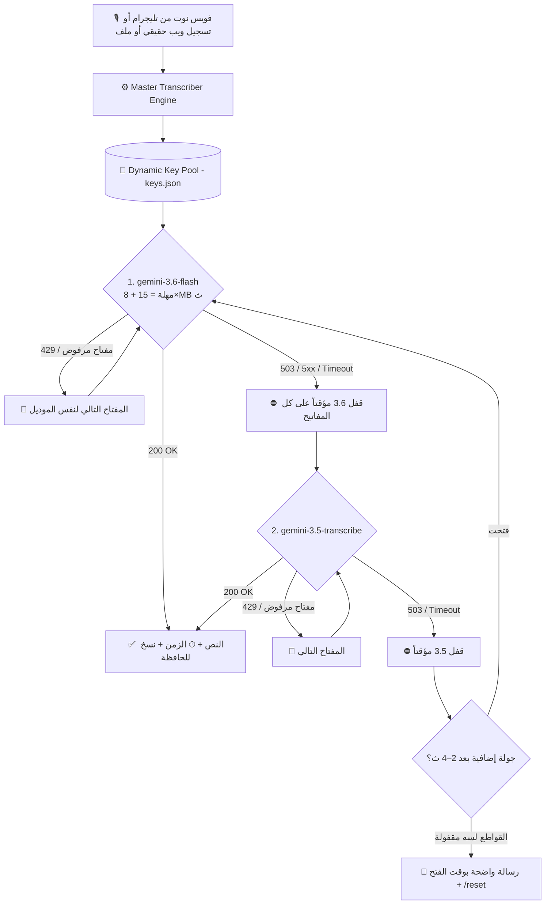

# 🎙️ منظومة التفريغ الصوتي الذكي 360° - Gemini Multi-Model AI

> **منظومة هندسية متكاملة (DevOps Resilient Architecture) لتفريغ الصوت بدقة خيالية، تدعم العامية المصرية، تحافظ على المصطلحات التقنية بالإنجليزية، وتعمل كـ بوت تليجرام وواجهة ويب صوتية حقيقية وخادم محلي في نفس الوقت 24/7 وبصفر تكلفة!**

[](https://www.python.org/)
[](https://aistudio.google.com/)
[](https://telegram.org/)
[](http://localhost:8080)
[](LICENSE)

---

## 🌟 مميزات المنظومة 360°

1. **دقة سمعية فائقة (Native Multimodal Audio):**
   - يفهم نبرة الصوت والعامية المصرية بدون اختلاق أو تخمين زائف.
   - يكتب المصطلحات البرمجية والتقنية بأحرفها الإنجليزية القياسية (`GitHub, AI, Python, Gist, IP, API, DevOps, Docker`).
2. **الموديلات المعتمدة (بدون Lite نهائياً):**
   - 🥇 **`gemini-3.6-flash` (الأساسي):** الأثبت في الاختبار الميداني — رد في 6–8 ث بدقة كاملة في العامية (20 طلب/مشروع/يوم).
   - 🥈 **`gemini-3.5-transcribe` (الاحتياطي):** محرك جوجل التخصصي للصوت، الأسرع (3–4 ث) (25 طلب/مشروع/يوم).
   - ⏸️ **`gemini-3.8-flash` معطّل** منذ 2026-10-23 (503 / Timeout متكرر مع الصوت — حادثة 01). موجود في `Config.DISABLED_MODELS`؛ لإعادته احذفه من هناك بسطر واحد.
   - 🚫 **موديل Lite مستبعد نهائياً** لضمان أعلى جودة.
3. **Failover فوري وذكي (بعد حادثة 01):**
   - كل رد من Google **يُصنَّف**: مشكلة مفتاح (429 / مفتاح مرفوض) → المفتاح التالي؛ مشكلة موديل (503 / 5xx / Timeout) → **الموديل التالي فوراً بدون تجربة باقي المفاتيح** + قفل الموديل مؤقتاً على الكل (قاطع دائرة 90–180 ث)؛ مشكلة شبكة → لا تُلمس أي حالة.
   - مهلة ديناميكية حسب حجم الملف (`15 + 8×MB` ث، بحد أقصى 90) بدل 60 ث ثابتة.
   - لو كل الموديلات واقعة في نفس اللحظة: جولتان إضافيتان بانتظار قصير ثم رسالة واضحة بوقت الفتح + `/reset`.
4. **مصفوفة المفاتيح الذكية (`keys.json`):**
   - 429 يومي يُقفل (المفتاح، الموديل) حتى تصفير Google (منتصف الليل Pacific)؛ 429 بالدقيقة تهدئة قصيرة.
   - مفتاح مرفوض من Google (400/401/403) يُعلَّم ❌ ويُتخطّى 24 ساعة (احذفه بـ `/remove`).
   - عدّاد استهلاك يومي حقيقي لكل (مفتاح، موديل). ⚠️ Google تحسب الكوتا لكل **مشروع** لا لكل مفتاح.
5. **كشف المفاتيح التلقائي في الشات (Auto-Key Detection):**
   - ابعت أي مفتاح Gemini جديد في شات التليجرام (مع اسم مشروع أو بدونه)، البوت يكتشفه ويسجله في `keys.json` فوراً ويزيد رصيدك 45 ريكورد يومياً!
6. **شفافية كاملة أثناء التفريغ:**
   - تذييل كل رد: `⚡ الموديل | 🔑 المفتاح | ⏱ الزمن` + ما تم تخطيه ولماذا.
   - تليجرام: `typing` متجدد + رسالة "⏳ لسه شغّال…" بعد 12 ث تُحذف تلقائياً عند وصول النتيجة.
   - `/status` والويب و `/health` تعرض حالة قاطع كل موديل وآخر المحاولات وسطر التعافي الذاتي.
7. **تعافٍ ذاتي بلا تدخل (Zero-Touch Self-Healing — المرحلتان 0 و 1a من v2):**
   - **Session لكل خيط + قتل الـ socket:** أي `ReadTimeout`/`ConnectionError` → `session.close()` فوراً (لا مقابس شبحية)، TCP keepalive يكشف الاتصال نصف المفتوح خلال ~50 ث، وكل نداء له مهلة `(connect, read)`.
   - **وضع الحذر (L0):** بعد أي ReadTimeout يهبط long-poll من 30 → 10 ث لمدة 5 دقائق ثم يعود وحده؛ backoff شبكي 3→6→12→30 ث.
   - **Watchdog مستقل لا يلمس الشبكة:** يفحص النبض (`time.monotonic`) كل 10 ث؛ تجمد الاستقبال > 55 ث → **L1** خيط poller جديد (صامت)؛ 3 × L1 خلال 10 د → **L3** وضع الحماية + إشعار واحد؛ استمرار التجمد → **L3b** short-poll طوارئ دقيقتين؛ ويعود للطبيعي تلقائياً. رسائل المالك تمر عبر خيط `notifier` منفصل.
   - **409** (نسخة ثانية تعمل) يُبلّغ مرة واحدة؛ **401** (توكن باطل) يوقف الاستقبال بدل التكرار العبثي.
   - **إيقاف رشيق (SIGTERM):** عند Stop/Restart من الاستضافة يتوقف الاستقبال، وتُنتظر المهام الجارية ≤ 20 ث (`SHUTDOWN_GRACE`)، ثم خروج 0.
   - **`/health` عميق:** يرجع **503** لو خيط الاستقبال متجمد (لا ميتاً فقط) — UptimeRobot يكتشف التعليق؛ ويعرض `resilience` (الجيل، الوضع، أخطاء الشبكة، سلم الـ watchdog).
   - **تخزين حديدي:** كتابة ذرية `tmp→fsync→replace`، عزل الملفات التالفة `*.corrupt-<ts>` بدل الانهيار، سطر إقلاع (preflight) واحد يصلك على تليجرام: المفاتيح/الويب/القرص/النسخة.
   - **طابور موحّد + استئناف بعد إعادة التشغيل (1b):** كل تفريغ — من تليجرام **أو** الويب — يمر من طابور واحد (`voice_queue.py`) بعامل واحد وفاصل `QUEUE_PACING_SEC=2` ث بين المهام (يحمي RPM). كل خطوة تُسجَّل في `data/state/jobs.ndjson` (received → downloaded → transcribed → sent)؛ عند الإقلاع تُستأنف المهام غير المكتملة تلقائياً من `file_id` (P0)، ونفس الفويس المُعاد خلال 24 ساعة يُجاب من السجل بلا تفريغ جديد. **SIGTERM** ينتظر `in_flight` الموحّد — لا يقطع تفريغاً جارياً من الويب.
   - **استقبال فوري:** ريأكشن 👀 على الفويس لحظة وصوله؛ رسالة إيصال بترتيبك فقط لو في الطابور أكثر من مهمة. تُقبل الفيديوهات/`video_note` ≤ 20MB (حد تليجرام للبوتات).
   - **تأجيل بدل الفشل:** لو كل الموديلات مقفولة أو الحصة نفدت على كل المفاتيح، المهمة تُؤجَّل لموعد الفتح وتحجب ما بعدها (ترتيب الوصول — `QUEUE_SKIP_DEFERRED=0`). عند نفاد الحصة تحديداً تصلك مرة واحدة أزرار inline **[⏭ تخطَّ] [⏳ انتظر]** (الافتراضي الانتظار).
   - **مهلة قراءة بسقفين:** ملفات ≤ 8MB سقفها 90 ث، والأكبر 180 ث — فويس 15MB لا يُقطع عند 90 ث.
8. **واجهتان متزامنتان في تطبيق واحد (Dual Interface):**
   - 📱 **Telegram Bot:** تفريغ الفويس نوت بكود بلوك يُنسخ بلمسة واحدة + كشف المفاتيح + أمر `/status`.
   - 🌐 **Web UI:** واجهة ويب عصرية بها تسجيل صوتي حقيقي (MediaRecorder Blob مثل تليجرام تماماً) + سحب وإفلات للملفات + إدارة المفاتيح.
   - 💻 **Desktop Tool:** أداة لتفريغ أحدث تسجيل والنسخ التلقائي للحافظة (Clipboard).

---

## 📐 الهيكلية الهندسية للمنظومة (DevOps Architecture)



---

## 🚀 دليل النشر على خوادم الاستضافة (Bot-Hosting / Cloud)

المنظومة مصممة لتعمل بـ **Python + مكتبة `requests` فقط** بدون أطر عمل ثقيلة. دليل النشر التفصيلي: [`DEPLOY.md`](DEPLOY.md).

### 1. ضبط متغيرات البيئة (Hosting Variables):
في لوحة تحكم الاستضافة، أضف المتغيرات التالية:

| المتغير (Variable) | القيمة | الوصف |
| :--- | :--- | :--- |
| **`GEMINI_API_KEYS`** | `AQ...Key1,AQ...Key2` | مفاتيح Google AI Studio مفصولة بفواصل |
| **`TELEGRAM_BOT_TOKEN`** | `123456789:ABCdef...` | توكن البوت من `@BotFather` |
| **`TELEGRAM_BOT_USERNAME`** | `@YourBot` | يوزرنيم البوت |
| **`TELEGRAM_CHAT_ID`** | `123456789` | **مطلوب** — لحصر البوت عليك فقط (فاضي = يرفض الجميع) |
| **`PORT`** | `8080` | منفذ واجهة الويب (أو `SERVER_PORT` تلقائياً على bot-hosting.net) |
| **`WEB_ACCESS_TOKEN`** | *(اختياري)* | توكن لواجهة الويب — فاضي = مفتوح |

### 2. أمر التشغيل:
```bash
python main.py
```
*(يقوم `main.py` بتشغيل واجهة الويب وبوت التليجرام معاً، مع watchdog مستقل يعيد خيط الاستقبال عند التجمد، و`/health` عميق للمراقبة (503 عند التجمد)، وسطر إقلاع على تليجرام، وإيقاف رشيق عند SIGTERM. لو المنفذ مشغول تصلك رسالة فوراً والبوت يكمل بلا ويب).*

إعدادات التعافي الاختيارية (كلها في `Config`، الافتراضيات مدروسة ولا تحتاج تغييراً): `TG_POLL_TIMEOUT=30`, `TG_POLL_TIMEOUT_CAUTIOUS=10`, `CAUTIOUS_MODE_MINUTES=5`, `TCP_KEEPALIVE=1`, `WATCHDOG_INTERVAL=10`, `STALL_MARGIN=15`, `PROTECT_AFTER_RESTARTS=3`, `SHUTDOWN_GRACE=20`, `HEALTH_STALE_AFTER=55`.

---

## 💬 أوامر بوت التليجرام

- **إرسال أي فويس نوت:** تفريغ فوري داخل كود بلوك بضغطة زر.
- **إرسال مفتاح Gemini (مثل `AQ...` أو `مشروع 3: AQ...`):** يكتشفه ويضيفه لمصفوفة المفاتيح تلقائياً.
- **`/status` أو `حالة`:** الرصيد المتبقي اليوم لكل موديل لكل مفتاح + ساعة تصفير الكوتا بتوقيتك.
- **`/keys`:** المفاتيح مرتبة (المتاح أولاً).
- **`/remove <اسم>`** / **`/rename <قديم> <جديد>`:** إدارة المفاتيح من الشات.
- **`/backup`:** يرسل ZIP بالبيانات العامة فقط (النصوص، الجلسات، الإعدادات) — **لا يحوي `keys.json` أبداً** (فحص مزدوج ضد التسريب).
- **`/backup_secrets confirm`:** الأسرار (`keys.json`) في ZIP منفصل، بتأكيد صريح فقط.
- **`/version`:** رقم النسخة (`VERSION`) + بصمة الكود (git sha أو SHA1 للملفات) + uptime — تعرف أي كود يعمل على الاستضافة فعلاً.
- **`/queue` أو `الطابور`:** المهام الحالية (المصدر/الحالة/زمن الانتظار/موعد فتح المؤجَّل) + إحصاءات منجز/فشل/مؤجَّل/متخطّى/مستأنَف/مكرر.
- **`/reset`:** يفتح قواطع الموديلات المقفولة مؤقتاً (لو عايز تجرّب موديل متخطّى حالاً).
- **`/help`:** دليل الاستخدام السريع.

---

## 🧪 الاختبارات والتطوير
```bash
pip install -r requirements-dev.txt
python -m pytest        # 221 اختبار (بلا شبكة: FakeTelegram + FakeClock)
python -m pyflakes *.py
```
CI يعمل تلقائياً على كل PR (Python 3.10 و 3.12). الاختبارات تعمل على Linux و Windows.

خارطة طريق v2 والتصميم الكامل (24 ملفاً، 70 حالة استثنائية): [`architecture-v2/`](architecture-v2/). المنجز: المرحلة 0 (الأساسات)، 1a (التعافي الذاتي)، 1b (الطابور الموحّد + `jobs.ndjson` + استئناف بعد إعادة التشغيل). التالي: 1c (التشغيل المُشرَف `SUPERVISED=1` اختياري).

## 📊 معادلة الرصيد اليومي الفائق

$$\text{إجمالي الريكوردات اليومية} = \text{عدد المشاريع} \times 45$$

(20 لـ 3.6 Flash + 25 لـ 3.5 Transcribe — الأرقام من الاختبار الميداني وقابلة للتعديل في `Config.MODEL_DAILY_QUOTA`؛ لو أعدت تفعيل 3.8 تزيد 20.)

- **مشروعان:** 90 ريكورد يومياً مجاناً.
- **5 مشاريع:** 225 ريكورد يومياً مجاناً.
- **10 مشاريع:** 450 ريكورد يومياً مجاناً.

> ⚠️ Google تحسب الكوتا لكل **مشروع Google Cloud** وليس لكل مفتاح — مفتاحان من نفس المشروع لا يضاعفان الرصيد.
