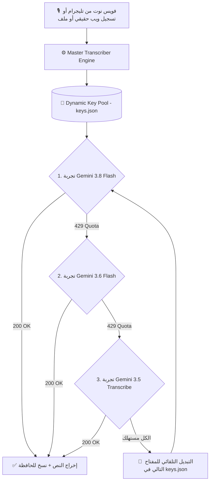

# 🎙️ منظومة التفريغ الصوتي الذكي 360° - Gemini Multi-Model AI

> **منظومة هندسية متكاملة (DevOps Resilient Architecture) لتفريغ الصوت بدقة خيالية، تدعم العامية المصرية، تحافظ على المصطلحات التقنية بالإنجليزية، وتعمل كـ بوت تليجرام وواجهة ويب صوتية حقيقية وخادم محلي في نفس الوقت 24/7 وبصفر تكلفة!**

[](https://www.python.org/)
[](https://aistudio.google.com/)
[](https://telegram.org/)
[](http://localhost:8080)
[](LICENSE)

---

## 🌟 مميزات المنظومة 360°

1. **دقة سمعية فائقة (Native Multimodal Audio):**
   - يفهم نبرة الصوت والعامية المصرية بدون اختلاق أو تخمين زائف.
   - يكتب المصطلحات البرمجية والتقنية بأحرفها الإنجليزية القياسية (`GitHub, AI, Python, Gist, IP, API, DevOps, Docker`).
2. **الثلاثي الفائز المعتمد فقط (Strict Top 3 Models - لا وجود لـ Lite نهائياً):**
   - 🥇 **`gemini-3.8-flash`:** الموديل الأذكى عالمياً في فهم السياق والنبرة (20 طلب/مشروع).
   - 🥈 **`gemini-3.6-flash`:** التوأم فائق السرعة بنفس الدقة (20 طلب/مشروع).
   - 🥉 **`gemini-3.5-transcribe`:** محرك جوجل التخصصي للتفريغ الصوتي المباشر (25 طلب/مشروع).
   - 🚫 **موديل Lite مستبعد ومحذوف نهائياً** لضمان أعلى جودة بدون تشويه.
3. **مصفوفة المفاتيح الذكية (`keys.json` & Auto-Cooldown):**
   - إدارة ديناميكية لحالة كل مفتاح (`active` أو `exhausted`).
   - عند وصول أي مفتاح لكود 429، يتم وضعه في فترة تهدئة (Cooldown) تلقائياً، والتحويل الفوري للمفتاح التالي بدون أي توقف.
   - يعاد تنشيط المفتاح تلقائياً بمجرد انتهاء فترة التهدئة.
4. **كشف المفاتيح التلقائي في الشات (Auto-Key Detection):**
   - ابعت أي مفتاح Gemini جديد في شات التليجرام (مع اسم مشروع أو بدونه)، البوت يكتشفه ويسجله في `keys.json` فوراً ويزيد رصيدك 65 ريكورد يومياً!
5. **واجهتان متزامنتان في تطبيق واحد (Dual Interface):**
   - 📱 **Telegram Bot:** تفريغ الفويس نوت بكود بلوك يُنسخ بلمسة واحدة + كشف المفاتيح + أمر `/status`.
   - 🌐 **Web UI:** واجهة ويب عصرية بها تسجيل صوتي حقيقي (MediaRecorder Blob مثل تليجرام تماماً) + سحب وإفلات للملفات + إدارة المفاتيح.
   - 💻 **Desktop Tool:** أداة لتفريغ أحدث تسجيل والنسخ التلقائي للحافظة (Clipboard).

---

## 📐 الهيكلية الهندسية للمنظومة (DevOps Architecture)



---

## 🚀 دليل النشر على خوادم الاستضافة (Bot-Hosting / Cloud)

المنظومة مصممة لتعمل بـ **Python Standard Library (Pure Requests)** بدون تعقيدات أو أطر عمل ثقيلة.

### 1. ضبط متغيرات البيئة (Hosting Variables):
في لوحة تحكم الاستضافة، أضف المتغيرات التالية:

| المتغير (Variable) | القيمة | الوصف |
| :--- | :--- | :--- |
| **`GEMINI_API_KEYS`** | `AQ...Key1,AQ...Key2` | مفاتيح Google AI Studio مفصولة بفواصل |
| **`TELEGRAM_BOT_TOKEN`** | `123456789:ABCdef...` | توكن البوت من `@BotFather` |
| **`TELEGRAM_BOT_USERNAME`** | `@YourBot` | يوزرنيم البوت |
| **`TELEGRAM_CHAT_ID`** | `123456789` | **مطلوب** — لحصر البوت عليك فقط (فاضي = يرفض الجميع) |
| **`PORT`** | `8080` | منفذ واجهة الويب (أو `SERVER_PORT` تلقائياً على bot-hosting.net) |
| **`WEB_ACCESS_TOKEN`** | *(اختياري)* | توكن لواجهة الويب — فاضي = مفتوح |

### 2. أمر التشغيل:
```bash
python main.py
```
*(يقوم `main.py` بتشغيل واجهة الويب في خيط خلفي وبوت التليجرام في نفس الوقت).*

---

## 💬 أوامر بوت التليجرام

- **إرسال أي فويس نوت:** تفريغ فوري داخل كود بلوك بضغطة زر.
- **إرسال مفتاح Gemini (مثل `AQ...` أو `مشروع 3: AQ...`):** يكتشفه ويضيفه لمصفوفة المفاتيح تلقائياً.
- **`/status` أو `حالة`:** يعرض تقرير شامل بالمفاتيح النشطة، فترات التهدئة، والرصيد المتاح.
- **`/help`:** دليل الاستخدام السريع.

---

## 📊 معادلة الرصيد اليومي الفائق

$$\text{إجمالي الريكوردات اليومية} = \text{عدد المفاتيح} \times 65$$

- **مشروعين:** 130 ريكورد فائق الذكاء يومياً مجاناً.
- **5 مشاريع:** 325 ريكورد يومياً مجاناً.
- **10 مشاريع:** 650 ريكورد يومياً مجاناً.
