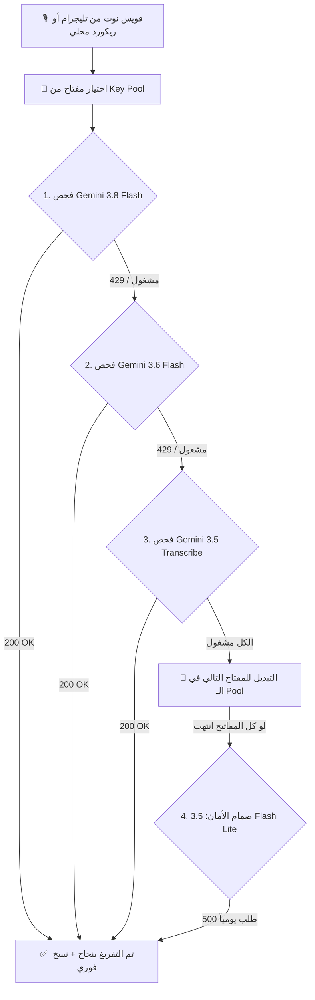

# 🎙️ منظومة التفريغ الصوتي الذكي - Gemini Multi-Model AI

> **نظام متكامل وفائق السرعة لتفريغ الصوت بدقة خيالية، يدعم العامية المصرية، يحافظ على المصطلحات التقنية بالإنجليزية، ويعمل محلياً وعلى خوادم الاستضافة (24/7 Hosting) مجاناً 100%!**

[](https://www.python.org/)
[](https://aistudio.google.com/)
[](https://telegram.org/)
[](LICENSE)

---

## 🌟 مميزات المنظومة

1. **دقة سمعية فائقة (Native Multimodal Audio):**
   - يفهم نبرة الصوت والعامية المصرية بدون اختلاق أو تخمين زائف.
   - يكتب المصطلحات البرمجية والتقنية بأحرفها الإنجليزية اللاتينية القياسية (`GitHub, AI, Python, Gist, IP, API`).
2. **المصفوفة الهندسية الثلاثية (The Winning Trio):**
   - **`gemini-3.8-flash`:** الموديل الأذكى عالمياً في فهم السياق والنبرة.
   - **`gemini-3.6-flash`:** التوأم فائق السرعة بنفس الدقة.
   - **`gemini-3.5-transcribe`:** محرك جوجل التخصصي للتفريغ الصوتي المباشر.
3. **ميزة تدوير المفاتيح التلقائي (Key Pool & Auto-Failover):**
   - يدعم إدخال قائمة مفاتيح من مشاريع متعددة لنفس الحساب.
   - عند وصول أي مفتاح للحد الأقصى (429)، ينتقل فوراً للمفتاح التالي بدون توقف.
4. **طريقتين للاستخدام:**
   - 📱 **من الموبايل:** عبر بوت تليجرام خفيف وسريع، يرسل التفريغ داخل كود بلوك يُنسخ بلمسة واحدة.
   - 💻 **من الكمبيوتر:** عبر سكريبت يفرغ أحدث تسجيل وينسخه تلقائياً في الـ Clipboard (الحافظة).

---

## 📐 الهيكلية الهندسية (Failover Architecture)



---

## 🚀 دليل النشر على خوادم الاستضافة (Deployment on Bot-Hosting / VPS)

المنظومة مهيأة للعمل على منصات الاستضافة المجانية والمدفوعة مثل **[bot-hosting.net](https://bot-hosting.net/)** أو Railway أو Render.

### 1. ضبط متغيرات البيئة (Environment Variables):
في لوحة تحكم الاستضافة (Hosting Settings / Variables)، أضف المتغيرات التالية:

| المتغير (Variable) | القيمة (Value) | الوصف |
| :--- | :--- | :--- |
| **`GEMINI_API_KEYS`** | `key1,key2,key3...` | مفاتيح Google AI Studio مفصولة بفواصل للتدوير |
| **`TELEGRAM_BOT_TOKEN`** | `8158611188:AAGbrz...` | توكن بوت التليجرام من `@BotFather` |
| **`TELEGRAM_BOT_USERNAME`** | `@Zizo00ZIZO_bot` | يوزرنيم البوت |
| **`TELEGRAM_CHAT_ID`** | `1124247595` | الـ ID الخاص بك لقصر البوت عليك فقط ومنع التطفل |

### 2. أمر التشغيل (Startup Command):
```bash
python main.py
```

---

## 💻 التشغيل المحلي على جهاز الكمبيوتر

1. انسخ ملف `.env.example` إلى `keys.txt` أو `.env` وضع مفاتيحك الخاصة.
2. ثبت المكتبات المطلوبة:
   ```bash
   pip install -r requirements.txt
   ```
3. للتشغيل المباشر:
   - لتشغيل البوت: شغل `تشغيل_بوت_تليجرام_للتفريغ.bat`
   - لتفريغ أحدث تسجيل على الكمبيوتر ونسخه للحافظة: شغل `تفريغ_أحدث_تسجيل_صوتي.bat`

---

## 📊 رخصة المشروع (License)
هذا المشروع مفتوح المصدر ومتاح تحت ترخيص [MIT License](LICENSE).
