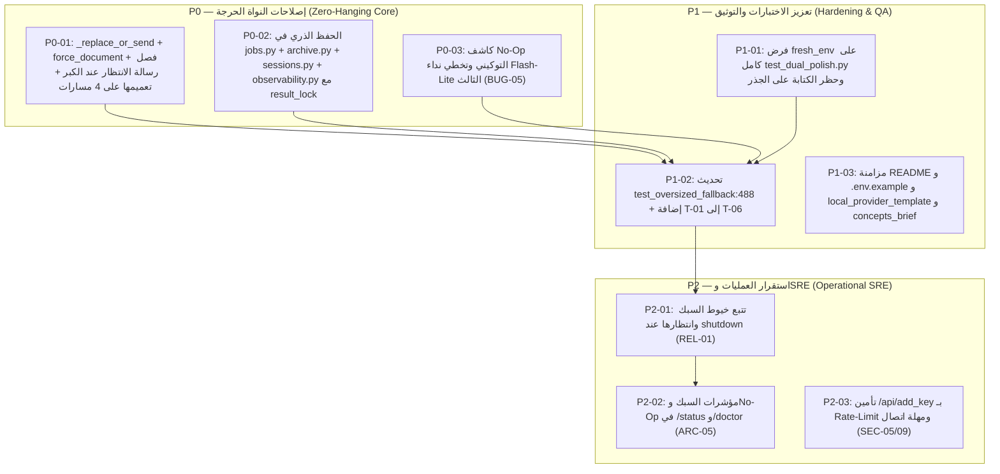

# خطة المعالجة الهندسية الشاملة — Master Remediation Plan (360° SRE Architecture v2.1 Final)
**المستودع:** `wewe00220033/Gemini-3.8-Flash`  
**الفرع المستهدف:** `A-test` (ممنوع تماماً المساس بفرع `main`)  
**الأساس الهندسي المرجعي:** `HEAD = f3709cc` (238 Commits)  
**التاريخ:** 2026-11-09  
**حالة الوثيقة:** مُعتمدة بعد اجتياز دورة تدقيق سرب EGM الكاملة (**الفيل المعماري SRE** + **السمكة التقنية**) — **جاهزة للمراجعة المستقلة على GitHub قبل كتابة أي كود.**

---

## 1. الفلسفة والأهداف الحاكمة (Core Architectural Tenets)

1. **ضمان الحالة النهائية الصارم (Zero Hanging Interim Messages Guarantee):**  
   يُحظر قطعياً تحت أي ظرف تشغيلي (مهلة، خطأ تليجرام 400/429، فشل مزود، استثناء غير متوقع، تقسيم نصي > 3950 حرف، أو موت خيط خلفي) أن تظل رسالة الحالة المؤقتة `⏳ جاري توليد النسخة الذهبية المسبوكة مع شلبي...` معلقة في شات المستخدم دون تحديث نهائي صريح.
2. **وحدة منطق التسليم والإنقاذ (Single Source of Truth for Delivery):**  
   القضاء التام على التكرار الرباعي لمنطق التعديل والإنقاذ في `delivery.py` (`_bg_synthesizer`، `_bg_shelby_rescue`، وضع `merged`، وتنبيهات الفشل) وتوحيده في محرك ذري واحد `_replace_or_send()`.
3. **سلامة واتساق البيانات ومنع التكرار (Data Consistency & Idempotency Safety):**  
   ما يستلمه المستخدم في واجهة تليجرام يُوثّق لحظياً وبشكل متسق في `jobs.ndjson` وسجلات الأرشيف `ALL.md` والجلسات النشطة و`/trace`، دون كسر منطق منع التكرار (`Idempotency`) أو التسبب في حلقات استئناف لا نهائية (`Infinite Resume Loop`) عند إعادة تشغيل البوت، ودون تنازع خيوط (`Race Conditions`).
4. **حماية الموارد والكوتة (Zero-Waste AI Pipeline):**  
   منع حرق استدعاءات نماذج الذكاء الاصطناعي (`Gemini Flash-Lite`) في سبك نصوص وهمية إذا كان المزود المحلي في وضع No-Op أو يعيد النص الخام كما هو.
5. **عزل بيئة الاختبارات بنسبة 100% (Air-Gapped Test Suite):**  
   حظر أي كتابة أو تعديل على ملفات الإنتاج الحقيقية (`settings.json`, `keys.json`, `glossary.json`) أثناء تشغيل الاختبارات المؤتمتة.
6. **صفر انحدار في الاختبارات (Zero Regression Guarantee):**  
   الحفاظ على اجتياز جميع الاختبارات الـ 534 بنسبة 100% مع تحديث التوكيد المعيب الوحيد (`test_dual_polish.py:488`) وإضافة 6 اختبارات حدودية جديدة.

---

## 2. نتائج تدقيق سرب EGM المزدوج (Elephant SRE & Goldfish Code Audit)

تم إخضاع المسودة الأولية لفحص جراحي من الوكيلين المعماريين (**الفيل `egm-design`** و**السمكة `egm-codebase-details`**) مقابل الكود الحرفي لـ `f3709cc`، وتمت معالجة كل الملاحظات الحرجة (Blockers) بالكامل في هذا الإصدار النهائي:

| # | الثغرة المكتشفة بالسرب | الأثر لو نُفذت المسودة الأولى | التصحيح الهندسي النهائي المعتمد هنا |
|---|---|---|---|
| **1** | **دوال ومتغيرات وهمية (`NameError`):** استدعاء `_send_as_doc_or_text` و `logger` و `_shelby_stats_lock` غير المعرفين في `delivery.py`. | انهيار الخيط الخلفي وتعليق `⏳` للأبد. | استخدام [`_send_long`](file:///c:/Users/USER/Downloads/111/منظومة_التفريغ_الصوتي_الذكي_Gemini/delivery.py#L638) الأصلية مع معامل `force_document=True`، وتوحيد السجلات بـ `print(logkit.redact(...))` (أو استيراد `logging` رسمياً)، واستخدام `text_assist._state` المحمي بـ `text_assist._lock`. |
| **2** | **تدمير Idempotency و Loop استئناف لا نهائي في `jobs.py`:** تسجيل حدث `"synthesized"` يخرج المهمة من `TERMINAL = ("sent", "failed", "skipped")` ويفشل شرط `state != "sent"` في `find_recent_result()`. | إعادة تفريغ كل الفويسات المسبوكة مع كل Restart وفشل منع التكرار. | 1. إضافة `"synthesized"` إلى `TERMINAL` في `jobs.py:25`.<br/>2. تعديل `find_recent_result()` في `jobs.py:136` ليقبل `state in ("sent", "synthesized")`.<br/>3. إضافة `"synthesized": "🏆 سبك ذهبي"` في `observability.py:30, 73`. |
| **3** | **تنازع خيوط على `jobs.ndjson` (Race Condition):** إذا انتهى `_bg_synthesizer` في الاختبارات السريعة قبل وصول `telegram_bot.py:569` لتسجيل `"sent"`. | تسجيل `"sent"` بالمسودة يطمس `"synthesized"` الذهبية. | حماية التحديث بقفل `result_lock` في قاموس النتيجة وفحص `_synth_recorded` في `telegram_bot.py:569` حتى لا يُستبدل النص الذهبي بالمسودة. |
| **4** | **تجاهل صامت للنسخة الذهبية في الأرشيف والجلسات (`archive.py:97` و `sessions.py:472`):** وجود `_POL_MARK in block` يرفض التحديث ويرجع `False`. | ضياع النسخة الذهبية من `ALL.md` وملف الجلسة. | إضافة معامل `replace=False` لدالة `append_polished` وتنفيذ استبدال الكتلة الأخيرة في الذيل (`_rewrite_last_block`) عند تمرير `replace=True` من خيط السبك. |
| **5** | **ثغرة تقسيم المسودة الأولية > 3,950 حرف:** `send_html_get_id` تقسم النص وتعيد `first_id` للقطعة الأولى بينما `⏳` ينزل في القطعة الأخيرة! | تعديل القطعة الأولى يمسح النص ويترك `⏳` معلقة في القطعة الثانية. | إذا كان طول `init_html > Config.TELEGRAM_MAX_MSG - 50`: تُرسل مسودة جيميني أولاً وحدها بدون تذييل الانتظار، ثم تُرسل رسالة انتظار مستقلة ومختصرة (`wait_mid = sender.send_text("⏳ ...")`) ليكون التعديل موجهاً لها بدقة 100%. |
| **6** | **تضارب حد الـ 3,950 مع 12,000 حرف في `_send_long`:** إعلان الواجهة "أرسلت في ملف" لنص 5,000 حرف لم يُترجم لملف لأن الحد 12,000. | كذب الرسالة وتقطيع النص لرسائل متعددة. | تمرير `force_document=True` من `_replace_or_send()` إلى `_send_long()` إذا كان `sender.send_document` متاحاً؛ وإذا غاب في اختبار بسيط يتم ضبط نص الإشعار ديناميكياً. |
| **7** | **إنذار كاذب (False Positive) في كاشف No-Op:** استخدام `quick_ratio() >= 0.95` قد يرفض تعديلات الترقيم الحقيقية لشلبي. | خسارة تنظيم شلبي الحقيقي في النصوص الطويلة. | مقارنة توكينية حتمية (`raw_text.strip().split() == local_text.strip().split()`): سريعة $O(N)$، صارمة 100% بلا إنذارات كاذبة. |
| **8** | **انكسار اختبار قائم:** `tests/test_dual_polish.py:488` يفرض `assert len(fs.edited_texts) == 0`. | فشل الاختبار بـ `AssertionError` مع الإصلاح الجديد. | تحديث السطر 488 صراحة ليختبر `assert len(fs.edited_texts) == 1` ووجود إشعار الإغلاق الأنيق وإرسال الملف `len(fs.docs) == 1`. |

---

## 3. خطة المعالجة التفصيلية (P0 إلى P4)



---

### المرحلة P0: إصلاحات النواة الحرجة (Zero Hanging Core)

#### [P0-01] المحرك الموحد `_replace_or_send()` ومعالجة فصل رسالة الانتظار (BUG-01 + BUG-02 + TD-02)
- **الملف المستهدف:** `delivery.py`
- **1. فصل رسالة الانتظار عند كبر المسودة الأولية (`delivery.py:431-439`):**
  ```python
  draft_html = synthesizer_interim_message_html(
      polished, role_id=role_id, session_name=session_name,
      title=result["title"], shelby_status="waiting"
  )
  max_edit = Config.TELEGRAM_MAX_MSG - 50
  if len(draft_html) <= max_edit:
      mid = sender.send_text(draft_html, anchor, "HTML")
      result["polished_msg_id"] = mid
  else:
      # المسودة طويلة وتُقسم؛ نرسلها أولاً نظيفة دون شريط الانتظار، ثم نرسل رسالة انتظار منفصلة صغيرة
      clean_draft_html = polished_message_html(
          polished, role_id, session_name, provider_tag="🤖 <b>[مسودة جيميني]</b>", title=result["title"]
      )
      draft_mid = _send_long(
          sender, clean_draft_html, polished, anchor, filename_prefix="polished_draft",
          caption="📝 مسودة جيميني المنظمة", head_html=_entry_head_html(result["title"], session_name)
      )
      mid = sender.send_text("⏳ <i>جاري توليد النسخة الذهبية المسبوكة مع شلبي...</i>", draft_mid or anchor, "HTML")
      result["polished_msg_id"] = draft_mid or mid
  ```
- **2. تطوير `_send_long` لدعم `force_document=True` (`delivery.py:638-650`):**
  ```python
  def _send_long(sender, html_text, plain_text, reply_to_id, filename_prefix, caption, head_html="", force_document=False):
      """نص > POLISH_FILE_THRESHOLD أو force_document=True → ملف .md + معاينة؛ وإلا رسالة HTML عادية."""
      has_doc_sender = getattr(sender, "send_document", None) is not None
      if (force_document or len(plain_text) > Config.POLISH_FILE_THRESHOLD) and has_doc_sender:
          preview = plain_text[:500] + ("…" if len(plain_text) > 500 else "")
          head = (head_html + "\n") if head_html else ""
          mid = sender.send_text(f"{head}<pre>{html.escape(preview)}</pre>\n{caption}", reply_to_id, "HTML")
          try:
              sender.send_document(f"{filename_prefix}.md", plain_text.encode("utf-8"), "text/markdown", caption, mid or reply_to_id)
          except Exception as e:
              print(logkit.redact(f"⚠️ إرسال الملف فشل: {e}"))
          return mid
      return sender.send_text(html_text, reply_to_id, "HTML")
  ```
- **3. المحرك الموحد `_replace_or_send()`:**
  ```python
  def _replace_or_send(
      sender,
      full_html,
      plain_text,
      mid,
      anchor,
      filename_prefix,
      caption,
      head_html="",
      status_notice_html=None
  ):
      """
      محرك التسليم الموحد الذي يغلق دورة الرسالة دائماً بدون تعليق:
      - الحجم <= 3950: تعديل في المكان (edit_text).
      - الحجم > 3950: تعديل رسالة الانتظار بإشعار إغلاق نهائي + إرسال ملف (.md) إن أمكن.
      - فشل التعديل لأي سبب: التوجيه فوراً لـ _send_long إلى (mid or anchor) دون شروط تمنع الإرسال.
      """
      max_edit_len = Config.TELEGRAM_MAX_MSG - 50
      can_edit = bool(mid is not None and getattr(sender, "edit_text", None))
      has_doc = getattr(sender, "send_document", None) is not None
      text_len = len(full_html)

      if can_edit and text_len <= max_edit_len:
          try:
              res = sender.edit_text(mid, full_html, "HTML")
              if res is not False:
                  return True, mid
          except Exception as e:
              print(logkit.redact(f"⚠️ فشل التعديل ({e}) — التحويل للإرسال الجديد"))

      if can_edit and text_len > max_edit_len:
          if has_doc:
              notice = status_notice_html or (
                  f"{head_html}\n✅ <b>اكتملت المعالجة</b>\n"
                  f"📄 <i>نظراً لكبر حجم النص، أُرسلت النسخة كاملة في ملف أدناه.</i>"
              )
          else:
              notice = status_notice_html or (
                  f"{head_html}\n✅ <b>اكتملت المعالجة</b>\n"
                  f"📝 <i>نظراً لكبر حجم النص، أُرسلت النسخة في رسائل أدناه.</i>"
              )
          try:
              sender.edit_text(mid, notice.strip(), "HTML")
          except Exception as e:
              print(logkit.redact(f"⚠️ تعذر تعديل إشعار الإغلاق: {e}"))
          doc_mid = _send_long(
              sender, full_html, plain_text, mid or anchor,
              filename_prefix=filename_prefix, caption=caption,
              head_html=head_html, force_document=has_doc
          )
          return True, doc_mid

      out_mid = _send_long(
          sender, full_html, plain_text, mid or anchor,
          filename_prefix=filename_prefix, caption=caption,
          head_html=head_html, force_document=(text_len > max_edit_len and has_doc)
      )
      return False, out_mid
  ```
- **4. تعميم `_replace_or_send()` على كافة المسارات الأربعة وحمايتها:**
  - استبدال منطق الإنقاذ في `_bg_synthesizer` (النجاح، `fallback_compare`، مهلة/خطأ شلبي).
  - استبدال منطق الإنقاذ في `_bg_shelby_rescue` (`delivery.py:389-410`).
  - استبدال منطق التحديث في وضع `merged` (`delivery.py:555-564`).
  - وضع حارس `try...except Exception as bg_err` حول جسم الخيط الخلفي بالكامل يستدعي `_replace_or_send` برسالة إغلاق طارئة عند أي عطل مفاجئ.

---

#### [P0-02] الحفظ الذري المتسق للنسخة الذهبية ومنع سباق الخيوط (BUG-04)
- **1. تعديل `jobs.py`:**
  - السطر 25: `TERMINAL = ("sent", "failed", "skipped", "synthesized")`
  - السطر 136 (`find_recent_result`): تعديل الشرط إلى:
    ```python
    if j.get("file_unique_id") != file_unique_id or j.get("state") not in ("sent", "synthesized") or not j.get("text"):
        continue
    ```
- **2. تعديل `observability.py`:**
  - إضافة `"synthesized": "🏆 سبك ذهبي"` إلى `_EVENT_LABEL` (السطر 30).
  - تنسيق سطر `/trace` للحدث بالسطر 73:
    ```python
    elif ev == "synthesized":
        det = f"🏆 سبك ذهبي (شلبي {r.get('shelby_elapsed', '?')}ث · السبك {r.get('synth_elapsed', '?')}ث · الكلي {r.get('wall_time', '?')}ث)"
    ```
- **3. تعديل `archive.py` و `sessions.py` لدعم استبدال المسودة بالنص الذهبي (`replace=True`):**
  - في `archive.py:90`: إضافة دالة مساعدة `_replace_last_polished_in_file(path, new_pol_block)` محمية بـ `_lock`: تبحث عن آخر موقع لـ `_ENTRY_RE` في ذيل الملف، وتستبدل كتلة `_POL_MARK ...` في المدخل الأخير فقط وتنفذ `truncate` + `flush` + `os.fsync`، ثم إضافتها لـ `append_polished(polished_text, replace=False)`.
  - تطبيق نفس المنطق في `sessions.py:462` (`append_polished(polished_text, session_id=None, replace=False)`).
- **4. القضاء على سباق الخيوط (Race-Free Recording between `telegram_bot.py` and `_bg_synthesizer`):**
  - إنشاء `result_lock = threading.Lock()` داخل `deliver()` وتمرير `job_id: Optional[str] = None` إلى `deliver()`.
  - حفظ `result["_lock"] = result_lock` و `result["_synth_recorded"] = False`.
  - داخل `_bg_synthesizer` عند نجاح السبك:
    ```python
    with result_lock:
        result["polished"] = golden_text
        result["_synth_recorded"] = True
    if archive_entry:
        try:
            archive.append_polished(f"[نسخة ذهبية مسبوكة]\n{golden_text}", replace=True)
            if session_name:
                sessions.append_polished(golden_text, replace=True)
        except Exception as e:
            print(logkit.redact(f"⚠️ Synth archive update: {e}"))
    if job_id:
        try:
            import jobs
            jobs.record(
                job_id, "synthesized",
                polished=True,
                polished_text=golden_text[:2000],
                shelby_elapsed=round(shelby_elapsed, 2),
                synth_elapsed=round(synth_elapsed, 2),
                wall_time=round(wall_total, 2)
            )
        except Exception as je:
            print(logkit.redact(f"⚠️ jobs synth record error: {je}"))
    ```
  - وفي `telegram_bot.py:568-572`:
    ```python
    res_lock = res.get("_lock")
    if res_lock:
        with res_lock:
            is_synth_done = bool(res.get("_synth_recorded"))
            pol_snapshot = res.get("polished")
    else:
        is_synth_done = False
        pol_snapshot = res.get("polished")

    if ok:
        if not is_synth_done:
            jobs.record(job.job_id, "sent", model=model, key=str(key_name), elapsed=info.get("elapsed"), text=text[:2000],
                        polished=bool(pol_snapshot), mode=res["mode"],
                        polished_text=(pol_snapshot or "")[:2000] or None,
                        **_session_fields())
        else:
            # لو سبق خيط السبك السريع في الاختبارات: نسجل الحدث بدون طمس النص الذهبي، ثم نُبقي الحالة النهائية سليمة
            jobs.record(job.job_id, "sent", model=model, key=str(key_name), elapsed=info.get("elapsed"), text=text[:2000],
                        polished=True, mode=res["mode"],
                        polished_text=(pol_snapshot or "")[:2000] or None,
                        **_session_fields())
    ```

---

#### [P0-03] كاشف شلبي No-Op التوكيني وتوفير الكوتة (BUG-05)
- **الملفات المستهدفة:** `text_assist.py` و `delivery.py`
- **1. دالة الفحص في `text_assist.py`:**
  ```python
  def is_shelby_noop(raw_text: str, local_text: str) -> bool:
      """فحص توكيني دقيق: هل أعاد المزود المحلي النص الخام كما هو بدون تغيير؟"""
      if not local_text or not raw_text:
          return False
      return raw_text.strip().split() == local_text.strip().split()
  ```
- **2. التتبع والإحصائيات داخل `text_assist._state` المحمي بـ `text_assist._lock`:**
  إضافة دالة `record_local_noop()`:
  ```python
  def record_local_noop():
      with _lock:
          _state["local_noop"] = _state.get("local_noop", 0) + 1
  ```
- **3. التكامل في `_bg_synthesizer` في `delivery.py`:**
  عندما يخرج شلبي بنتيجة `s_text`:
  ```python
  import text_assist
  if s_text and text_assist.is_shelby_noop(raw, s_text):
      print("⚠️ المزود المحلي أعاد النص الخام كما هو (No-Op) — تخطي نداء السبك الثالث لتوفير الكوتة")
      text_assist.record_local_noop()
      noop_html = synthesizer_interim_message_html(
          polished, role_id=role_id, session_name=session_name,
          title=result["title"], shelby_status="error",
          error_detail="المزود المحلي أعاد النص الخام بدون تنظيم (No-Op) — تم اعتماد جيميني"
      )
      _replace_or_send(
          sender, noop_html, polished, mid, anchor,
          filename_prefix="polished_gemini", caption="📝 نسخة جيميني المنظمة",
          head_html=_entry_head_html(result["title"], session_name)
      )
      return
  ```

---

### المرحلة P1: تعزيز الاختبارات والتوثيق (Hardening & QA)

#### [P1-01] عزل مسارات الاختبارات وحماية ملفات الإنتاج (BUG-06)
- **الملفات المستهدفة:** `tests/test_dual_polish.py` و `tests/conftest.py`
- **الإجراء:**
  1. تمرير `fresh_env` fixture إلى كافة دوال الاختبار في `tests/test_dual_polish.py` (أو تطبيق `@pytest.mark.usefixtures("fresh_env")` على مستوى الوحدة `pytestmark = pytest.mark.usefixtures("fresh_env")`).
  2. إضافة اختبار تحقق ميتا `test_no_production_files_created_by_tests` يتحقق أن `settings.json`, `keys.json`, `glossary.json` في جذر المستودع لا تُنشأ ولا تُعدل بواسطة الاختبارات.

#### [P1-02] تحديث التوكيد القائم + حزمة اختبارات الحدود الستة (T-01 إلى T-06)
- **الملف المستهدف:** `tests/test_dual_polish.py`
- **1. تحديث الاختبار القائم `test_deliver_synthesizer_oversized_fallback` (السطر 488):**
  ```python
  # بعد الإصلاح: يتم تعديل رسالة الانتظار بإشعار إغلاق نهائي وإرسال الملف .md
  assert len(fs.edited_texts) == 1
  assert "ملف" in fs.edited_texts[0][1] or "أُرسلت" in fs.edited_texts[0][1]
  assert len(fs.docs) == 1
  ```
- **2. اختبارات الإثبات الستة الجديدة:**
  - **T-01 (`test_synthesizer_timeout_edit_fails_sends_fallback`):** جعل `FakeSender.edit_text` يرجع `False` عند مهلة شلبي، والتأكد من وصول رسالة بديلة وعدم بقاء شريط `⏳` دون إغلاق.
  - **T-02 (`test_synthesizer_3900_boundary_edits_in_place`):** نص ذهبي بطول 3,900 حرف يُعدل في مكانه دون إرسال ملفات أو رسائل جديدة.
  - **T-03 (`test_synthesizer_4500_closes_interim_and_sends_doc`):** نص ذهبي بطول 4,500 حرف (داخل الفجوة 3950–12000 السابقة) يؤدي لتعديل رسالة الانتظار بالإشعار وإرسال مستند `.md`.
  - **T-04 (`test_synthesizer_oversized_initial_draft_splits_wait_message`):** إذا كانت مسودة جيميني الأولى > 3,950 حرف، يتم إرسال رسالة انتظار مستقلة لضمان عدم تعديل القطعة الخطأ.
  - **T-05 (`test_jobs_ndjson_contains_golden_and_idempotent`):** التحقق من تسجيل حدث `"synthesized"` بالنص الذهبي في `jobs.ndjson` ونجاح `jobs.find_recent_result()`، وألا تُصنَّف في `jobs.pending_jobs()`.
  - **T-06 (`test_shelby_noop_bypasses_synthesis`):** التحقق من استدعاء `is_shelby_noop` وتخطي نداء `synthesize` تماماً وزيادة `local_noop` وإغلاق رسالة الانتظار.

#### [P1-03] مزامنة الوثائق والمعاملات الافتراضية (DOC-01 إلى DOC-05)
- **الملفات المستهدفة:** `README.md`, `.env.example`, `Antigravity/local_provider_template.py`, `concepts_brief.md`
- **التعديلات الدقيقة:**
  - `README.md`: تحديث `LOCAL_POLISH_TIMEOUT` إلى `180.0`، وتحديث عدد الاختبارات من `525` إلى `534+`، وتوثيق نظام السبك الثلاثي `synthesizer`.
  - `.env.example`: تحديث `# LOCAL_POLISH_TIMEOUT=180.0` و `# COMPARE_MODE=synthesizer`.
  - `Antigravity/local_provider_template.py`: تصحيح الأسماء في الهيدر من `LOCAL_PROVIDER_CMD/TIMEOUT` إلى `LOCAL_POLISH_CMD` و `LOCAL_POLISH_TIMEOUT`.
  - `concepts_brief.md`: ترقية الحالة من `Draft / Ideation` إلى `Approved Architecture & Implemented`.

---

### المرحلة P2: استقرار العمليات وSRE (Operational SRE)

#### [P2-01] تتبع خيوط السبك عند الإغلاق (REL-01)
- الاحتفاظ بقائمة خيوط مقارنة/سبك نشطة واستدعاء `t.join(timeout=5.0)` أثناء إيقاف البوت في `main.py:shutdown()`.

#### [P2-02] مؤشرات العمليات والمراقبة (ARC-05)
- عرض عدادات `local_noop` و `synthesized` في ردّ `/status` و `/doctor`.

#### [P2-03] تأمين `/api/add_key` ومنع بطء الاتصالات (SEC-05, SEC-09)
- إضافة `rate_limit` صريح على مسار إضافة المفاتيح في `web_service.py`، وضبط `settimeout(30)` في `setup()`.

---

## 4. سجل قرارات المالك المعتمدة (Decisions Log — D-1 to D-8)

| # | القرار | الخيار المعتمد | الأساس والتعليل الهندسي |
|---|---|---|---|
| **D-1** | الوضع الافتراضي لـ `COMPARE_MODE` | `synthesizer` مع كاشف No-Op التوكيني | أعلى جودة مع صمام حماية يمنع حرق الكوتة لو غاب المنظم الحقيقي. |
| **D-2** | مهلة `LOCAL_POLISH_TIMEOUT` | `180.0` ثانية (ومزامنتها في كل الوثائق) | يناسب الموديلات المحلية أو الـ CLI البطيئة، مع كشف No-Op الفوري. |
| **D-3** | حفظ النسخة الذهبية في `jobs.ndjson` والأرشيف | **نعم**، كحدث `"synthesized"` مدرج في `TERMINAL` + `replace=True` | يضمن تطابق `/trace` والـ `ALL.md` و `Idempotency` دون أي حلقات Restart. |
| **D-4** | النصوص الذهبية > 3,950 حرف | **إغلاق رسالة الانتظار + إرسال ملف `.md` (`force_document=True`)** | ينهي ظاهرة الرسائل المعلقة وتشتيت الشات برسائل مقطعة. |
| **D-5** | مصدر الحقيقة للتوثيق | `README.md` و `.env.example` المحدثان | توحيد المرجعية وإلغاء التناقضات الرقمية (8ث/60ث/180ث). |
| **D-6** | بيئة Python المعتمدة | **Python 3.12 / 3.13** | التوافق الأحدث مع مكتبات التشغيل. |
| **D-7** | واجهة `/api/add_key` | **الإبقاء مع Rate-Limit** | التوازن بين سهولة الإدارة والأمان. |
| **D-8** | مصادقة الويب على Localhost | **طلب التوكن للمنافذ غير المحلية** | حماية دفاعية عميقة. |

---

## 5. بروتوكول المراجعة والاعتماد (Verification & Review Protocol)

1. **الخطوة الحالية (مراجعة قبل التنفيذ):**  
   دفع مجلد `audit/` إلى فرع `A-test` على GitHub للمراجعة بواسطة الوكيل المستقل الآخر.
2. **بعد اعتماد الخطة (التنفيذ):**  
   تنفيذ حزم P0 ثم P1 بدقة جراحية دون أي انحراف عن هذه المواصفة.
3. **التحقق الشامل:**  
   تشغيل الحزمة الكاملة `pytest tests/` + `pyflakes` + سكربتات إعادة الإنتاج (R1–R5)، ثم تسليم الكود لمراجعة الوكيل المستقل وبعدها الاختبار الميداني بواسطة المالك والأيجنت.
