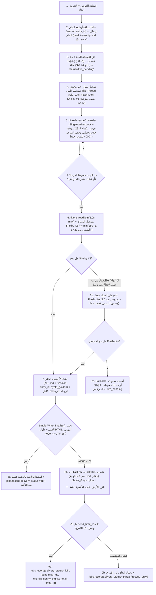

# 🗺️ خطة التنفيذ الهندسية الشاملة v2.11 (مغلقة بالكامل بعد اعتماد ومواءمة تقرير تدقيق الجولة الرابعة وتحسينات SRE 360° الحرفية على `A-test @ 0dd3be5d` / `366d7f2`)

> **المرجع الأساسي المحقق (`M0`):** الفرع `A-test` (`origin/A-test`) عند التزام الكود الفعلي `0dd3be5d45bfefb0f0a36cf45875a66fe848128c` (والوثائق `f122f23` ← `85ecdf6` (`v2.8`) ← `26d2b17` (`v2.9`) ← `366d7f2` (`v2.10`) ← `v2.11`؛ شجرة نظيفة `0` تعديلات متتبعة). **تنبيه مقصود:** كل ملفات `.py` لا تزال في وضع `READ-ONLY` قبل بدء `M1` عمداً، لذا بنود `M1..M5` غير منفذة بعد في الكود حتى إشارة `GO M1`. **شرط قبول بدء `M1` (`A-01`/`A-02`):** يجب أن يتحقق وكيل التنفيذ على `checkout` فعلي نظيف على `A-test` الحديث (أو فرع مرحلي متفرع منه؛ لا `f5b4bee` detached ولا `M start.sh`) وبوجود `pyflakes` فعّال في البيئة — الأرشيف المعزول لا يغني عن نظافة الـ `checkout`.
> **الجديد الحاسم في `v2.11` (بعد اعتماد تقرير الجولة الرابعة وتصويبات الصياغة والكود الدقيقة):** 
> 1. **حوكمة `Supervisor` وضبط الصياغة لـ `M2`:** إضافة `EXIT_CONFIG = 2` في `supervisor.py` مع استدعاء `self.write_reason("config_error", code, "خطأ إعداد — راجع TELEGRAM_BOT_TOKEN / WEB_ENABLED")` قبل الخروج لتسجيله في `restart_reason.json` ليراه المالك في `/status`. مع توضيح أن `start_new_session=True` (POSIX) و`creationflags=subprocess.CREATE_NEW_PROCESS_GROUP` (Windows) في `spawn()` هما **تمهيد معماري لقتل الشجرة بـ `killpg` في M2** دون المساس بالمشرف.
> 2. **تدقيق عزل كوتا `flash-lite` مع حماية `invalid`:** في `key_manager._model_blocked_until`، استثناء `invalid` ليبقى **حاجباً لجميع الموديلات بلا استثناء** (مفتاح باطل = باطل للكل)، بينما وسم `exhausted` يعزل حصة `gemini-3.5-flash-lite` (500 RPD) ويقفل فقط موديلات التفريغ الصوتي `Config.MODELS`.
> 3. **تنقيح أمني مركزي في `observability.check()`:** تنقيح استثناءات نداء `_check(fn)` بنقطة مركزية واحدة `return WARN, logkit.redact(...)` تغطي جميع فحوصات الطبيب الـ 12 دفعة واحدة وتحجب توكن البوت في `getMe` وغيره.
> 4. **تحصين `backup.py` بالسقف التراكمي والبادئات:** إضافة `SECRETPREFIXES = (".keys-", "keys.json.", "keys.txt.", ".env.")`، واستثناء `.env.example`، وفرض سقف فك الضغط التراكمي `RESTORE_MAX_BYTES = 512 * 1024 * 1024` (512MB) في `restore_test()`، وتخطي الوصلات الرمزية `islink()` في `build_zip()`.
> 5. **قفل التزامن في `watchdog.py`:** حماية `events` و`_l1_times` بقفل `self._lock = threading.Lock()` أثناء القراءة والتعديل لمنع التنافس مع `/health` و`/doctor`.
> 6. **اعتماد حزمة اختبارات `M1` الرسمية (`tests/test_m1_v210.py`):** 8 اختبارات محكمة تغطي بنود `M1` كاملة وتعمل في البيئة المعزولة.
> **النطاق الحصري:** بوت تليجرام فقط. **واجهة وخادم الويب مُعطَّلان ومُجمَّدان نهائياً افتراضياً (`WEB_ENABLED=0`) وممنوع تطويرهما**. أوضاع `off` / `merged` / `split` تبقى سليمة وتُحرس باختبارات انحدار.  
> **قاعدة التنفيذ الملزمة:** العمل على **فرع مرحلي متفرع من `A-test`** (`feat/synth-v2-m1`) عبر **مراحل مضبوطة (`M1 → M5`) ببوابات قبول وتقرير فحص ومراجعة `READ-ONLY` قبل أي انتقال — وممنوع المساس بـ `A-test` مباشرة أو الـ Push التلقائي.**

---

## 1️⃣ عقد المالك النهائي الملزم (13 بنداً معتمَداً + الضوابط الحاكمة)

| # | البند | القرار النهائي الملزم |
|---|---|---|
| **1** | **قائمة سماح النماذج الفعّالة + حارس وقت التشغيل (`A-04`) وحماية الحصة** | **قائمة سماح حصرية** لنماذج المساعد النصي (`ALLOWED_TEXT_ASSIST_MODELS = ("gemini-3.5-flash-lite",)` + شلبي محلياً). **ممنوع دخول `gemini-3.6-flash`** (أو `3.8-flash` أو أي موديل في `Config._ALL_MODELS` / `Config.MODELS`) عبر **حارس برمجي وقت التشغيل `assert_not_forbidden_assist_model(model=None)` يُستدعى فعلياً عند كل دخول لنموذج في الإنتاج (`generate()`, `polish()`, `polish_gemini()`, `synthesize()`, `synthesize_ex()`) — مع إبقاء `assert_not_transcription_model()` سليمة لتوافق الاختبارات القائمة — ويشمل تلقائياً `assistant.py` والعناوين والملخصات** حتى لو فُرض من `TEXT_ASSIST_MODEL`. **مع فك ارتهان `flash-lite` (500 RPD) عن استنفاد موديلات الصوت في `key_manager.py` (`status == "exhausted"` لا يقفل `flash-lite`، مع بقاء `status == "invalid"` حاجبة للكل).** |
| **2** | **التوازي الدائم في المرحلة 1 + المعادلة الرياضية للميزانية `420ث` *(قرار لا رجعة فيه)*** | **مهما يحصل — قرار نهائي لا رجعة فيه ولا يوجد أي مفتاح لإيقاف `شلبي #1`:** عند تهيئة `LOCAL_POLISH_CMD`، تبدأ المرحلة 1 **دائماً بالتوازي الكامل بين `flash-lite` + `شلبي #1` معاً** (+ `title_thread` غير مانع). *(فقط إذا كان `LOCAL_POLISH_CMD` فارغاً/غير مهيأ بيئياً أصلاً ينتقل لـ `flash-lite` منفرداً بلا رسالة انتظار مزدوج كاذبة).* **الميزانية الرياضية المطلقة (`SYNTH_TOTAL_BUDGET_SEC = 420ث` بعد التفريغ):** مرحلة 1 بحد أقصى (`45ث قفل + 180ث تنفيذ` محصورة داخل الميزانية) ← ثم `shelby2` (`<= min(180ث, remaining_after_lock)`) ← ثم احتياطي `flash-lite` (`<= remaining`). **عند نفاد الميزانية (`remaining <= 0` أو `< MIN_SHELBY_EXEC_SEC`) لا تُفتح محاولة جديدة أبداً.** |
| **3** | **السبّاك التالت هو شلبي ← واحتياطي فلاش عند `180ث` فقط *(قرار لا رجعة فيه)*** | **السبّاك التالت هو شلبي (`shelby2`) قولاً واحداً** بمهلة **`180ث`**. **فقط لا غير:** لو تأخر `shelby2` عن **`180ث` (`Time out`)** أو تعطل في خطوة السبك نفسها، يرد **`flash-lite` احتياطياً فقط**. *(وإن فشل `flash-lite` أيضاً ← ممنوع `3.6-flash` مطلقاً، فيرتد لإنقاذ أفضل مسودة متاحة من المرحلة 1 بوسمها، أو الخام عند `0` مسودات).* |
| **4** | **مهمة السبّاك + سقف البرومبت + عدم تعليقه بالعنوان (`A-05`)** | مُحرِّر ومُسبِّك يخرج **رسالة تالتة نهائية أقوى** بالخام (Ground Truth) + الدستور الـ 12 (`SYNTHESIZER_SYSTEM_PROMPT` القائم سليم ويُحفظ كما هو) + الدور + القاموس + `L2` + المسودات المتاحة؛ **تعديل شرط [`text_assist.py#L349`](../text_assist.py#L349) وإزالة الهروب المبكر في [`L351-354`](../text_assist.py#L351-L354) وتعديل `compose_synthesis_prompt` ليسبك فوق المتاح حتى لو سقط/تأخر أحد أو كلا مسودتي المرحلة 1**. **`title_thread` غير مانع** (`join(timeout=2.0)` كحد أقصى)، ومع سقف ذكي لمدخل السبك **`SYNTH_PROMPT_MAX_CHARS = 28000`** يختصر المسودتين أولاً مع إبقاء الخام والدستور بأولوية عليا. |
| **5** | **نبض `typing` (3.5ث) وكاتب الرسالة الحية الواحد (`Single-Writer`)** | نبض `typing` كل ~**`3.5ث`** *(هامش أمان دون انتهاء مهلة تليجرام `5ث` مع تأخير الشبكة)* + **تحديث الحية فور جاهزية مسودة `flash-lite` دون انتظار `join` شلبي!** وعند وصول شلبي تُعرض المسودتان معاً في نفس الحية عبر **كاتب تسلسلي واحد (`LiveMessageController`)** يضم القرار والشبكة الوسيطة (`retry_429=False`) معاً حتى يمتنع أي تحديث وسيط بعد `finalized=True`. قص ذيل العرض الحي عند الحد الموحّد فقط؛ **والسبّاك يستلم المسودتين كاملتين حتى حد السياق**. |
| **6** | **لحظة رد السبّاك** | تُستبدل **نفس الرسالة الحية بالكامل** بالنتيجة النهائية المسبوكة فقط، و**بدون أي أزرار لمسودات فلاش وشلبي**. |
| **7** | **حد الـ `4000` UTF-16 بعد تحليل الكيانات + توحيد `<pre>` + سقف `8` قطع *(حصراً لمخرجات السبّاك)*** | **يطبق حصراً على النتيجة النهائية المسبوكة من السبّاك (`synthesizer` + `dedup` لها):** **صفر ملفات `.md` تلقائية**. الحد التطبيقي الموحّد عبر النظام هو **`4000` وحدة UTF-16** يتحقق على **النص بعد فك الوسوم والكيانات (`parsed_utf16 <= 4000` وحراسة الخام)** لمطابقة قاعدة تليجرام `4096`. الزائد يُقسّم عبر `_html_chunks` فتظهر **جميع القطع (`chunk_0..chunk_last`) بتنسيق `<pre>` الموحد وبوسوم متوازنة**، تحل الأولى مكان الحية وتُرسل التكملة تحتها **بحد أقصى `MAX_FINAL_CHUNKS = 8` قطع في الشات** (بلا `.md` تلقائي، وإن زاد عن 8 تتوقف عند الثامنة مع تنبيه + الزر الأزرق). |
| **8** | **زر `.md` الأزرق (للنتيجة المسبوكة `> 4000` فقط) + كاش ذري 24س (`0o700`/`0o600`) + تفويض المجموعات (`A-18`)** | **حسم نهائي قاطع:** يظهر الزر الأزرق `[📄 تحويل لملف .md]` (`style="primary"`) **فقط للنتيجة المسبوكة من السبّاك (`synth_golden`) عندما تتجاوز `4000` وحدة UTF-16** (على **`chunk_last` فقط**). **لا يظهر للنتائج القصيرة (`<= 4000`) ولا لأي مسار غير نتيجة السبّاك.** يتدرج عند الضغط ← `[✅ تأكيد ملف .md]` (`style="success"`) + `[❌ إلغاء]` (`style="danger"`). *(الأمر `/md` بالرد على قطعة مسبوكة أو `entry_id` يبقى متاحاً).* الكاش كتابة ذرية بدون `symlink` وصلاحيات مقيدة (**`0o700`/`0o600`** على POSIX) حتى **`24 ساعة` (`86400ث`) أو سقف الحماية (`200 ملف / 50MB`)** مع استرجاع من الأرشيف `plaintext` عبر `entry_id` خلال الـ 24س لو أُخلي الكاش؛ **وتفويض إلزامي بمطابقة `chat_id` + `allowed_chat_id` + ربط صاحب الطلب في المجموعات (`user_id`).** |
| **9** | **النطاق وحماية الحدود (بقاء باقي الشغل كما هو 100% — `A-13`)** | التعديل مقتصر حصراً على مسار السبك المذكور في تليجرام (**ملاحظة دقة:** قياس `_utf16_len` في `telegram_bot.py` قائم مسبقاً لكل رسائل تليجرام لقاعدة `4096`, وحصر التغيير يعني **بقاء أوضاع `off` / `merged` / `split` في `delivery.py`, و`panel.py`, و[`prepare_for_web`](../delivery.py), وعتبة الخام `12000` بالحروف في `_send_long`, وكل ما عدا نتيجة السبّاك 100% كما هو بلا أي تغيير وظيفي** ومؤكداً باختبارات انحدار صريحة)، دون أي تطوير للويب. |
| **10** | **رسالة الخام الطويل (`> 12000` حرف) في `dual`** *(اعتماد المالك: خيار أ)* | منع `.md` التلقائي يطبق على **النتيجة النهائية المسبوكة فقط**؛ رسالة الخام `> 12000` حرف في `dual` تستمر عبر `_send_long` وترسل `transcript.md` كالمعتاد. |
| **11** | **محتوى ملف `.md` التصديري** *(اعتماد المالك: خيار أ)* | عند التأكيد أو `/md` يُرفع **النص الذهبي الصافي فقط** (`golden_text` بدون بانر أو ترويسة) باسم `golden_synthesized.md`. |
| **12** | **تجميد وتعطيل الويب نهائياً افتراضياً (`A-03`) ومواءمة المشرف (`Supervisor EXIT_CONFIG=2`)** | بقاء [`web_service.py`](../web_service.py) و`static/` و`prepare_for_web` **بلا حذف ولا تطوير**، وتعطيل الويب افتراضياً بـ **`Config.WEB_ENABLED = False`** (يشمل **تغليف تهيئة الويب بدالة قابلة للاختبار، ومنع `ensure_web_token()` وعدم توليد/طباعة التوكن وعدم بدء الخادم، وتنقيح أخطاء `/health`، وعرض `"web off"` في `preflight` — مع فحص `web_error` بدقة — ومنع إعادة تشغيل الويب في `_idle_loop()`**). **وفي `supervisor.py`: إضافة `EXIT_CONFIG = 2` وتدوين `write_reason` قبل الخروج الفوري دون إعادة تشغيل عند خروج `main.py` بكود `2` (مثل غياب التوكن مع `WEB_ENABLED=0`) بدلاً من حلقة الـ 20 محاولة المهدِرة للوقت والمولدة للحوادث الوهمية.** |
| **13** | **إقفال ملاحظات التدقيق الشامل (`M-1`, `L-2`, `L-1`, `N-1`, `A-10`, `A-15`, `A-18`, SRE Catches)** | **`M-1` + `A-10` الأمني:** تنقيح شامل عند المصدر (تنزيل الفويس، `voice_queue.py`، `jobs.ndjson`، `web_service.py /health`، `STATE["last_error"]`، `incidents.py`، ونقطة `observability.check()` المركزية، و`backup.py`)؛ **`Supervisor` SRE:** ضبط `start_new_session=True` / `CREATENEWPROCESSGROUP` في `spawn()` تمهيداً لـ M2؛ **`watchdog.py` SRE:** قفل تزامن للـ deques ونقل `l4_requested` بعد نجاح الطلب؛ **`backup.py` SRE:** منع symlinks وحماية `corrupt-*` و`.env.*` وسقف 512MB لفك الضغط؛ **`L-2`:** إصلاح `bg_wait`؛ **`L-1` + `A-15`:** التصريح التعاقدي بعدم إغلاق الأصل دون edit/delete؛ **`N-1`:** عزل `test_360_exhaustive.py` بـ 5 مسارات إضافية و`PYTEST_DISABLE_DOTENV=1`. |

---

## 2️⃣ مخطط تدفق المعالجة المحكم (`synthesizer`)

---

## 3️⃣ مصفوفة السيناريوهات وعقد الحالات (الحفظ vs التسليم الكامل/الجزئي)

| # | السيناريو | مسودة 1 / 2 | السبّاك (`shelby2` ثم احتياطي) | النتيجة في الشات + الأرشيف + `jobs.ndjson` |
|---|---|---|---|---|
| **1** | مثالي قصير (`<= 4000` UTF-16) | نجحا (أو إحداهما) | `shelby2` نجح | استبدال الحية بالذهبية فقط (بلا أزرار مسودات وبلا زر `.md` لأنها `<= 4000`) + أرشيف `entry_id` + `delivery_status="full"`, `synth_golden=True` (تُكتب **بعد** التسليم). |
| **2** | مثالي طويل (`> 4000` و`> 16000`) | كاملة للسبّاك (مقتطعة حياً فقط) | `shelby2` نجح | استبدال الحية بـ `chunk_0` + `chunk_1..last` تحتها (`parsed_utf16 <= 4000` و`raw <= 4096` لكل قطعة، صفر `.md` تلقائي) + الزر الأزرق على `chunk_last` + كاش ذري صافي `golden_synthesized.md` + `delivery_status="full"`, `chunks_sent==chunks_total`. |
| **3** | تعطل فلاش #1 أو شلبي #1 (مهلة / `No-Op` / `lock_wait` / `5xx`) | أحدهما فشل | `shelby2` يحاول ضمن المتبقي *(يُتخطى فقط في الخطأ البيئي الحتمي `401/403`/`FileNotFoundError` أو `remaining < MIN_SHELBY_EXEC_SEC`)* ← احتياطي `flash-lite` | خروج نسخة تالتة مسبوكة نهائية فوق المتاح (أو من الخام مباشرة) + استبدال الحية + وسم خفيف فقط لو استخدم احتياطي `flash-lite`. |
| **4** | الانهيار الكلي (`0` مسودات + فشل `shelby2` والاحتياطي) | فشلا | فشلا | عدم استدعاء `append_polished`؛ إغلاق الحية (أو إرسال الخام في `polished_only`)؛ تسجيل `delivery_status="sent_raw_only"` / `"failed"` والخروج من حالة `live_pending`. |
| **5** | سقوط `chunk_k` بعد نجاح `chunk_0` (أو تعطل كاش `.md`) | نجحت | نجح | الحفظ في الأرشيف تم بالفعل؛ لو سقطت `chunk_k` يؤكد `send_html_result` السقوط فتُرسل رسالة إنقاذ بالزر الأزرق ويُسجَّل **`delivery_status="partial"`** مع `chunks_sent < chunks_total` (لا يُسجَّل `"full"`!). لو فشل القرص في كاش `.md` يستمر التسليم النصي كاملاً بلا تعطيل! |
| **6** | `dedup` لنفس الفويس الطويل (`> 16000` حرف) | مخبأ | مخبأ | `process_job` يسترجع **الخام الكامل والمنظم الكامل** من **الأرشيف/الجلسات عبر `archive.get_entry_by_id(entry_id)`** مع فحص وسم `synth_golden` لتمييز المسبوك الذهبي عن المنظم العادي بدلاً من المبتور عند `16000`، ويُسلَّم بنفس مقسّم القطع والزر الأزرق بلا `.md` تلقائي. |
| **7** | `polished_only` + فشل الحية (`mid=None`) | قيد العمل | مستمر | حالة `status="live_pending"` غير النهائية تمنع `_finalize` من الفشل المبكر، ثم يسلّم الخيط الخلفي ويثبّت حالة `jobs.ndjson` النهائية مرة واحدة بعد التسليم. |
| **8** | أزرار `md:` أو `/md` + تفويض `chat_id` + `user_id` + انتهاء الكاش | - | - | التحقق من صيغة التوكن + منع symlink/`TOCTOU` + تطابق `chat_id` + `allowed_chat_id` + **`user_id` صاحب الطلب في المجموعات** + `expires_at` على الخادم؛ لو أُخلي الكاش بسبب السقف قبل 24س يُسترجع من الأرشيف `plaintext` عبر `entry_id`؛ وبعد `> 86400ث` تُزال الأزرار ويُنبَّه المستخدم. |
| **9** | **طابور `3 فويسات متتالية` تحت شلبي (`Queue UX`)** | `raw` يصل فوراً؛ فلاش يعرض فوراً في الحية عند جاهزيته | منسّق الصف العادل + `LOCAL_LOCK_WAIT_SEC` | فويس #1 يخلص ويسلم؛ فويس #2 و#3 يرى المستخدم رسالتهم الحية محدثة فوراً بفلاش + حالة `⏳ شلبي مشغول بمهمة سابقة`، ولا يتجوع فويس جديد ولا يسقط الخام؛ وإذا انتهت مهلة انتظار القفل أو لم يكفِ المتبقي من `420ث` ينتقل السبك لاحتياطي `flash-lite` وتُستبدل الحية. |
| **10** | **`LOCAL_POLISH_CMD` فارغ أو تجاوز `MAX_FINAL_CHUNKS = 8`** | مسار منفرد أو طويل جداً | لا يُستدعى شلبي / سقف شات | لو `LOCAL_POLISH_CMD` فارغ: يسير التنظيم عبر `flash-lite` مباشرة بلا كذب انتظار مزدوج أو سبك. ولو فاق المسبوك 8 قطع (`~32K` حرف): تُحجز مساحة التنبيه بالقطعة الثامنة قبل البناء وتنزل 8 قطع كحد أقصى بلا `.md` تلقائي + الزر الأزرق `[📄 تحويل لملف .md]` لاستخراج الملف كاملاً. |
| **11** | **انهيار / Restart مفاجئ (`SIGKILL`) وسط خيط خلفي (`N1` + `A-14`)** | توقفت بالذاكرة | توقف قسري | عند الإقلاع: يلتقط عبر **`jobs.live_pending_jobs()`** المهام بحالة **`status="live_pending"`** (غير موجودة في `TERMINAL` ومُستبعدة تماماً من `jobs.pending_jobs()`) الأحدث من `JOBS_RESUME_MAX_AGE_H` وتُنفَّذ `recover_interrupted_live_jobs()` **قبل `start_queue(resume=True)`** لإغلاق رسائلها الحية وحسم حالتها دون إعادة تفريغها صوتياً. |
| **12** | **فقد ردّ `200` على الشبكة (`ReadTimeout` عند فتح الحية ← `mid=None`)** | قيد العمل | مستمر | **ممنوع إعادة المحاولة العمياء لـ `sendMessage` عند `ReadTimeout`** (`netsession` بـ `max_retries=0`؛ إعادة المحاولة محصورة بفشل ما قبل الاتصال فقط) لمنع تكرار الحية؛ يكمل السبك بحالة `live_pending` ويسلّم النهائي في رسالة جديدة. |

---

## 4️⃣ خريطة التعديلات الهندسية التفصيلية (بأسماء الدوال والملفات)

### أ. حسم شلبي والأدابتر القياسي وحماية الأسرار (`pack_deploy.py` & `.local/`)
1. **المبدأ:** استبعاد `.local/` التام من Git وأرشيف النشر. توفير قالب قياسي للأدابتر في `tools/shelby_adapter.py` خالٍ من الأسرار، وتوثيق المتغيرات المطلوبة في `DEPLOY.md`.
2. دعم `total_deadline = time.monotonic() + total_timeout` داخل `iter_lines()` مع إغلاق فوري لـ `response.close()`.
3. أكواد فشل مهيكلة على `stderr`: `[SHELBY_REQ_FAIL:{status}]`, `[SHELBY_HTTP:{status}]`, `[SHELBY_DEADLINE]`, `[SHELBY_EMPTY]`.

### ب. محرك التنفيذ، حارس النماذج، وميزانية الـ 420ث: [`text_assist.py`](../text_assist.py)
1. **حارس قائمة السماح الحصرية (`A-04`):**
   - حصر المساعد النصي في `("gemini-3.5-flash-lite",)` وشلبي CLI، ورفض أي نموذج في `Config._ALL_MODELS` أو `Config.MODELS` مثل `3.6-flash`.
   - يُستدعى الحارس عند كل مدخل إنتاجي: `generate()`, `polish()`, `polish_gemini()`, `synthesize()`, `synthesize_ex()`. مع إبقاء `assert_not_transcription_model()` سليمة.
2. **عزل كوتا `flash-lite` في [`key_manager.py`](../key_manager.py#L396-L399,L507-L509):**
   - في `_model_blocked_until`: قفل `status == "invalid"` يظل حاجبياً لجميع الموديلات بلا استثناء.
   - بينما قفل `status == "exhausted"` يُطبَّق فقط على نماذج التفريغ `Config.MODELS` أو المفاتيح التي لا تملك قاموس `exhausted_models`، **ولا يحجب `gemini-3.5-flash-lite` (500 RPD) ولا `"antigravity"`** عند نفاد حصة الصوت اليومية.
3. **مسار `Popen` الموحد وحماية قتل الشجرة:**
   - ضبط `start_new_session=True` على POSIX و`creationflags=subprocess.CREATE_NEW_PROCESS_GROUP` على Windows في `_call_local_provider`.
   - قتل الشجرة بالكامل عند المهلة بـ `killpg` (POSIX) أو `taskkill /F /T /PID` (Windows).
4. **منسّق صف FIFO والميزانية المطلقة `420ث`:**
   - منسّق صف `_ShelbyQueueCoordinator` بسقف `MAX_WAITERS = 8` ومهلة انتظار قفل `LOCAL_LOCK_WAIT_SEC = 45.0ث` منفصلة.
   - قياس الميزانية من بداية التدفق: `remaining = total_budget_deadline - time.monotonic()`. إن كانت `remaining <= 0` أو `< Config.MIN_SHELBY_EXEC_SEC (5.0ث)`، يرتد فوراً للاحتياطي أو الإنقاذ دون فتح محاولة جديدة بمهلة وهمية.
5. **إصلاح فجوة سطر 349 وحذف أسطر 351-354 في `synthesize` (مرحلة M2):**
   - تعديل السطر 349: الشرط يصبح `if is_effective_empty(raw_text): return None, "نص فارغ"`، وحذف أسطر 351-354 الخاصة بالهروب المبكر عند غياب إحدى المسودتين، وتحديث `prompts.compose_synthesis_prompt` لتوليد برومبت السبك حتى مع مسودة واحدة أو الصفر مسودات (سبك من الخام مباشرة).

### ج. التسليم المتوازي، الكاتب الواحد، وحالة `live_pending`: [`delivery.py`](../delivery.py)
1. **المجمّع بضغط خلفي و`wait_background_threads()`:**
   - مجمّع `ThreadPoolExecutor` بسقف `SYNTH_BG_WORKERS = 6` و`BoundedSemaphore(12)`.
   - شمول `Future`s المجمّع داخل `wait_background_threads(timeout=bg_wait)`.
2. **كاتب الرسالة الحية الواحد (`LiveMessageController`):**
   - قفل `_writer_lock` تسلسلي يمنع التحديث بعد `finalized=True` ويدير الشبكة الوسيطة بـ `retry_429=False`.
   - تحديث الحية فور جاهزية `flash-lite` دون انتظار `shelby1`.
3. **حالة `status="live_pending"` غير النهائية واسترداد الإقلاع:**
   - تسجيل `"live_pending"` فور فتح الحية بـ `(chat_id, live_msg_id, entry_id)` وبدون حقل `"text"`.
   - استثناء `"live_pending"` من `jobs.pending_jobs()` حتى لا يعاد تفريغها صوتياً، وإنشاء `jobs.live_pending_jobs(max_age_h=None)`.
   - في `_deliver_synthesizer`: تمرير `job_id`, `entry_id`, `archive_entry`, `chat_id` وتعيين `result["_live_pending"] = True` تحت `res_lock` بصرف النظر عن نجاح كتابة القرص.
   - معالجة `entry_id=None` في `recover_interrupted_live_jobs()` وحسم الحالات المنتهية.
4. **تنسيق التسليم والحدود:**
   - قصر UTF-16 على مسار السبك حصراً، وبقاء `off`/`merged`/`split` وعتبة الخام `12000` دون أي تغيير.
   - تغليف القطع بـ `<pre>` متوازن حتى 8 قطع، والزر الأزرق على `chunk_last` فقط عند `> 4000` UTF-16.

### د. حوكمة الإقلاع، المشرف، المراقبة، والأمان الكامل (`A-10` + SRE):
1. **إصلاح حلقة انهيار `Supervisor` والموت الذاتي (`supervisor.py` & `main.py`):**
   - إضافة `EXIT_CONFIG = 2` في `supervisor.py`. عند خروج العامل بكود `2`، يُسجل `("config_error", 2)` ويستدعي `self.write_reason("config_error", code, "خطأ إعداد — راجع TELEGRAM_BOT_TOKEN / WEB_ENABLED")` ويخرج المشرف فوراً بكود `2` دون إعادة تشغيل أو تأخير.
   - في `supervisor.py:131`: ضبط `start_new_session=True` (POSIX) و`creationflags=subprocess.CREATE_NEW_PROCESS_GROUP` (Windows) في `spawn()` تمهيداً لـ M2 لقتل الشجرة بـ `killpg` دون إصابة المشرف.
   - في `main.py`: استدعاء `sys.exit(2)` عند خطأ الإعداد (مثل غياب التوكن مع `WEB_ENABLED=0`) **قبل** بدء نبضات العامل `start_worker_beat()` وقبل الطابور.
2. **إغلاق خريطة التنقيح عند المصدر (`A-10`):**
   - `observability.py`: تنقيح مركزي للأخطاء في `_check(fn)` عبر `return WARN, logkit.redact(f"تعذر الفحص ({type(e).__name__}: {e})")` يحمي الفحوصات الـ 12 تلقائياً.
   - `web_service.py:build_health:467,481` و`serve:536`: تنقيح الأخطاء عبر `logkit.redact()` على مسار `/health` غير المحمي.
   - `telegram_bot.py`: تنقيح أخطاء `_download_with_retry` (قبل `jobs.record` وقبل `raise`)، و`voice_queue.py:273,278,295` قبل تسجيل `job.error` وكتابة `jobs.ndjson`.
   - تنقيح `_on_job_failed` عبر حساب `safe_err = logkit.redact(str(err))` مرة واحدة وتمريره لـ `_set_last_error`، `incidents.on_job_result`، والطباعة ورسالة التليجرام.
   - تنقيح أخطاء `backup.py:run_weekly:419-420` قبل حفظها في `backup_state.json`.
   - تصحيح `logkit.py`: `_TG_RE` (`{30,}` مع `(?<!\d)` و`_`)، و`_BARE_BEARER_RE`، و`len(p_dir.rstrip("/\\")) >= 6`.
3. **تحصين `watchdog.py` و`backup.py` والأرشيف:**
   - في `watchdog.py`: إضافة `self._lock = threading.Lock()` لحماية `self.events` و`self._l1_times` من التنافس مع `/health` و`/doctor` أثناء `record`, `prune_l1`, و`snapshot`.
   - في `backup.py`: إضافة `SECRETPREFIXES = (".keys-", "keys.json.", "keys.txt.", ".env.")`، واستثناء `.env.example`، وفرض سقف فك ضغط تراكمي `RESTORE_MAX_BYTES = 512 * 1024 * 1024` في `restore_test()`، وتجاهل الوصلات الرمزية `islink()` في `build_zip()`.
   - في `telegram_bot.py:1068`: تصحيح مفتاح الترتيب في زر تتبع آخر فويس `L:r` ليستخدم `(j.get("last_ts") or j.get("first_ts") or 0)` بدلاً من `j.get("ts", 0)`.
   - في `archive.py` و`sessions.py`: حفظ واسترجاع وسوم `<!-- role:<id> -->` و`<!-- synth_golden:1 -->` ومعرّف `entry_id` لضمان صحة الـ `dedup > 16000`.
4. **تجميد الويب وعزل `test_360_exhaustive.py`:**
   - `preflight.py`: فحص `if web_error:` وإرجاع `web FAIL` بدقة، ثم `elif web_port is None:` لإرجاع `web off` عند `WEB_ENABLED=0`.
   - `test_360_exhaustive.py`: ضبط `PYTEST_DISABLE_DOTENV=1` قبل استيراد `Config`، وعزل الـ 5 مسارات الإضافية (`KEY_GROUPS_FILE`, `WORKER_BEAT_FILE`, `RESTART_REASON_FILE`, `PERSIST_PROBE_FILE`, `BACKUP_STATE_FILE`).

---

## 5️⃣ خطة التنفيذ المرحلية وحوكمة الوكيل (`M1 → M5`)

> **قواعد حوكمة الوكيل الإلزامية:** العمل على فرع مرحلي منفصل (`feat/synth-v2-m1`)؛ ممنوع الـ Push التلقائي على `A-test`؛ وممنوع الانتقال بين المراحل دون بوابة قبول وتقرير فحص ومراجعة `READ-ONLY`.

| المرحلة | نطاق الملفات والمهام | بوابة الخروج ومعيار القبول (`Gate`) |
|---|---|---|
| **M0** *(منجزة READ-ONLY)* | تثبيت الفرع `A-test @ 0dd3be5d...` نظيفاً، وجرد الملفات، واعتماد تدقيق الجولة الرابعة وفحص Elephant SRE الميكروسكوبي. | شرط بدء `M1`: التحقق من `checkout` نظيف ووجود `pyflakes`؛ خطة `v2.11` مغلقة 100%. |
| **M1 — الأساس والأمان، تجميد الويب، حوكمة المشرف وعزل الكوتا** | **نطاق مركز بدون تشويش تواقيع `Sender`:** 1. قياس خط الأساس (`pytest -q` و`pyflakes`). 2. تنقيح `A-10` الكامل في `logkit.py`, `observability.py` (نقطة `_check` المركزية), `web_service.py` (`/health`), `telegram_bot.py` (`_download_with_retry`, `_on_job_failed`, `last_error`), `voice_queue.py`, `incidents.py`. 3. تجميد الويب `WEB_ENABLED=0` وتصحيح `preflight.py` وتحديث `test_runtime_shutdown.py` لعقد الإقلاع. 4. مواءمة `Supervisor`: إضافة `EXIT_CONFIG=2` وكتابة `write_reason` وضبط `start_new_session=True` / `CREATENEWPROCESSGROUP` في `spawn()` واستدعاء `sys.exit(2)` المبكر في `main.py`. 5. عزل كوتا `flash-lite` في `key_manager.py` عند نفاد الصوت مع استمرار حظر `invalid`. 6. تحصين `backup.py` (`SECRETPREFIXES`, سقف `512MB` لـ `restore_test`, قفل التنافس، وتخطي symlinks). 7. تحصين `watchdog.py` بقفل التنافس `self._lock`. 8. عزل `test_360_exhaustive.py` بـ `PYTEST_DISABLE_DOTENV=1` والمسارات الـ 5. 9. حارس النماذج `assert_not_forbidden_assist_model` وتوافق `conftest.py` دون استبدال `generate` عالمياً. 10. اعتماد حزمة الاختبارات الرسمية `tests/test_m1_v210.py` (8 اختبارات). | نجاح 100% لاختبارات الحزمة القائمة دون أي انحدار + نجاح اختبارات `test_m1_v210.py` كاملة + خروج سريع للمشرف عند كود 2 مع تسجيل السبب + عزل كوتا `flash-lite` + `pyflakes = 0` + تقرير Gate Report ومراجعة READ-ONLY. |
| **M2 — محرك شلبي `Popen`، عدالة FIFO، ميزانية 420ث وسقف البرومبت** | حل مسار الأدابتر الخالي من الأسرار (`tools/shelby_adapter.py`) + مسار `Popen` الموحد مع قتل شجرة العمليات في `_call_local_provider` و`Supervisor._terminate()` + منسّق الصف العادل بمهلة `LOCAL_LOCK_WAIT_SEC = 45ث` + الميزانية الرياضية الصارمة `420ث` دون مهل وهمية + سقف البرومبت `28000` في `prompts.py` + تصحيح سطر 349 وحذف أسطر 351-354 في `text_assist.py` لآلة حالات `synthesize_ex` + دقة عدادات السبك. | اختبارات قتل الشجرة على النظامين + اختبارات ميزانية 420ث والارتداد الفوري + اختبارات `synthesize_ex` بالخام فقط + دقة المقاييس + Gate Report ومراجعة READ-ONLY. |
| **M3 — التسليم النصي، واجهة `Sender`، أزرار `.md`، الكاش و`dedup`** | **هنا فقط تُحدث واجهة `Sender` وتواقيع ملفات الاختبار الـ 8 لقبول `reply_markup=None`** + قصر UTF-16 على مسار السبك في `delivery.py` + نتيجة `send_html_result` التفصيلية وتسجيل `jobs.record` بعد التسليم الفعلي فقط + lexer/parser حقيقي في `_html_chunks` (إزالة `"code"` من `_VOID_TAGS`, حجز الرأس والتذييل وتنبيه 8 قطع) + كاش ذري 24س بدون symlink وبسقف سعة وتفويض `user_id` للمجموعات + دعم الزر الأزرق `style` وتحديث `COMMAND_PARITY` + `archive.get_entry_by_id` وحفظ وسوم `role` و`synth_golden` لاسترجاع `dedup > 16000`. | نجاح اختبارات UTF-16 للسبك فقط وعدم تأثر المسارات الأخرى + اختبارات القطع والزر الأزرق + اختبارات الكاش ومنع symlink وانتهاء الصلاحية + استرجاع `dedup` الكامل + Gate Report ومراجعة READ-ONLY. |
| **M4 — التوازي الثلاثي، الضغط الخلفي، الكاتب الواحد واسترداد `live_pending`** | مسار `LOCAL_POLISH_CMD` الفارغ المباشر + مجمّع الخيوط بضغط خلفي وشمول `Futures` في `wait_background_threads()` + التوازي الثلاثي الدائم مع `title_thread` المقيد بـ `(session_id, generation_token)` + كاتب الرسالة الحية الواحد (`LiveMessageController` + نبض typing 3.5ث) + منع تكرار `sendMessage` عند `ReadTimeout` + حالة `"live_pending"` غير النهائية وفصل `jobs.live_pending_jobs()` وتشغيل `recover_interrupted_live_jobs()` قبل الطابور. | نجاح مصفوفة السيناريوهات 1..12 كاملة + اختبارات ضغط المجمّع + اختبارات استرداد `live_pending` دون إعادة التفريغ الصوتي + السباقات الحتمية + Gate Report ومراجعة READ-ONLY. |
| **بوابة بشرية إلزامية (قبل `M5`)** | تجربة حيّة يجريها المالك على فويس حقيقي + شلبي GPU على بوت تجريبي معزول. | تحقق المالك بنفسه من زمن التسليم وجودة السبك ونظافة الشات قبل اعتماد الإطلاق. |
| **M5 — التوثيق والتدقيق الختامي وحزمة النشر** | تحديث `README.md`, `PROGRESS.md`, `DEPLOY.md`, وحزمة `pack_deploy.py --list` + تشغيل `test_360_exhaustive.py` الكامل والتأكد من نظافة بيئة الإنتاج. | تمرير كل بوابات التحقق وتقرير تسليم ختامي دون أي تعديل على ملفات الإنتاج الحية. |

---

## 6️⃣ خطة الاختبارات وتوزيع تحديث التواقيع

### أ. توزيع تحديث عقود الاختبارات حسب المراحل:
1. **في مرحلة `M1` (الأساس والأمان وحوكمة الإقلاع):**
   - **إضافة حزمة اختبارات M1 الجديدة [`tests/test_m1_v210.py`]():** وتضم 8 اختبارات متطابقة:
     - `test_supervisor_exit_config_stops_without_restart`
     - `test_supervisor_crash_code_still_restarts`
     - `test_spawn_uses_new_session_or_group`
     - `test_audio_exhaustion_does_not_block_flash_lite`
     - `test_invalid_key_blocks_every_model`
     - `test_doctor_check_redacts_token`
     - `test_backup_secret_variants`
     - `test_env_example_not_secret`
     - `test_restore_test_size_cap`
   - [`tests/test_runtime_shutdown.py#L168-L187`](../tests/test_runtime_shutdown.py#L168-L187): تحديث العقد لاختبار مساري `WEB_ENABLED=0` (عدم بدء الويب) و`WEB_ENABLED=1` (بدء الويب).
   - [`tests/conftest.py`](../tests/conftest.py): إضافة `TEXT_ASSIST_MODEL` و`WEB_ENABLED` لـ `ENV_KEYS` مع حظر استبدال `generate` عالمياً داخل `_no_network_polish` لحماية اختبارات `test_pipeline_phase3` و`test_phase7_assistant`.
   - [`tests/test_v2_debts.py#L171-L188`](../tests/test_v2_debts.py#L171-L188): التأكد من بقاء فحص `web FAIL` سليماً عند حدوث خطأ حتى مع `web_port=None`.
2. **في مرحلة `M2` (محرك العمليات والميزانية):**
   - [`tests/test_hardening_360.py#L156-L172`](../tests/test_hardening_360.py#L156-L172): تحديث اختبار `shell=False` ليحرس مسار `Popen` وقتل الشجرة بدلاً من `subprocess.run`.
3. **في مرحلة `M3` (التسليم النصي وتواقيع Sender):**
   - **تحديث موكات `Sender`/`send_text` في الـ 8 ملفات اختبار (11 استدعاءً لـ `delivery.Sender`):**
     - [`tests/test_dual_polish.py`](../tests/test_dual_polish.py), [`tests/test_synthesizer_p0.py`](../tests/test_synthesizer_p0.py), [`tests/test_wave2_resilience.py`](../tests/test_wave2_resilience.py), [`tests/test_wave3_resilience.py`](../tests/test_wave3_resilience.py), [`tests/test_pipeline_phase3.py`](../tests/test_pipeline_phase3.py), [`tests/test_sessions_phase4.py`](../tests/test_sessions_phase4.py), [`tests/test_phase4_polish.py`](../tests/test_phase4_polish.py), و[`tests/test_hardening_360.py`](../tests/test_hardening_360.py).
     - قبول `reply_markup=None` واختبارات عدم إرسال الزر للقصير `<= 4000` ووضعه على `chunk_last` فقط عند `> 4000`.

---

## 7️⃣ بوابات التحقق ومتطلبات تقرير التسليم النهائي

1. `pyflakes` على جميع ملفات الكود والاختبارات والأدوات = **`0`** أخطاء/تحذيرات.
2. `python -m py_compile` على كل الملفات = **نجاح كامل**.
3. `pytest -v` الشامل على بيئة معزولة = **عرض العدد الفعلي الدقيق (`passed / failed / skipped`)** + نسخ Python & pytest + `git status` النظيف.
4. [`python test_360_exhaustive.py`](../test_360_exhaustive.py) = نجاح زوايا الانحدار **`8/8`**، مع الفصل الصريح في التقرير بين نجاح الانحدار وبين فحص الطبيب المتوقع غياب مفاتيحه في بيئة الاختبار.
5. [`python tools/pack_deploy.py --list`](../tools/pack_deploy.py) = خلو تام من الأسرار و`.local/`.
6. **دليل عدم مس بيانات الإنتاج:** فحص أن ملفات `keys.json`, `settings.json`, `glossary.json`, و`state/` الحية لم تُمس، وتقديم خطة تراجع واضحة.
