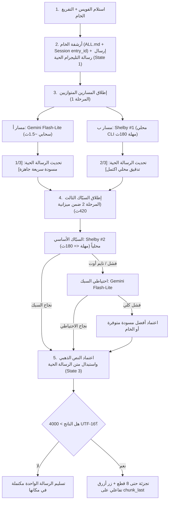

# 🗺️ خطة التنفيذ الهندسية الشاملة v2.12 (المعتمدة نهائياً بإجماع سرب وكلاء EGM الثمانية وتوقيع الفيل والسمكة على `A-test @ 0dd3be5d` / `566ffd7`)

> **المرجع الأساسي المحقق (`M0`):** الفرع `A-test` (`origin/A-test`) عند التزام الكود الفعلي `0dd3be5d45bfefb0f0a36cf45875a66fe848128c` (ووثائق التدقيق `f122f23` ← `85ecdf6` (`v2.8`) ← `26d2b17` (`v2.9`) ← `366d7f2` (`v2.10`) ← `566ffd7` (`v2.11`)؛ شجرة نظيفة `0` تعديلات غير متتبعة). **تنبيه إلزامي:** كل ملفات الكود الإنتاجي `.py` لا تزال في وضع `READ-ONLY` الصارم قبل بدء `M1`، وبنود `M1..M5` مجمدة بانتظار إشارة المالك للتنفيذ على الفرع المعزول `feat/synth-v2-m1`.
> **التحصينات والضبط الدقيق المعتمد في `v2.12` (بعد الدورة الكاملة لسرب EGM وفحص الفيل والسمكة بالسطور):**
> 1. **استيراد `logkit` المركزي في `observability.py:19`:** إضافة `import logkit` صراحة في ترويسة الملف قبل دالة `_check(fn)` بالسطر 127 لمنع خطأ `NameError` خفي وتحصين فحوصات الطبيب الـ 12 مركزياً بنقطة واحدة `return WARN, logkit.redact(...)`.
> 2. **مواءمة اختبار ترتيب الإقلاع `test_runtime_shutdown.py:168-187` بالتزامن:** تحديث الاختبار ليغطي مسارَي `WEB_ENABLED=False` (التأكد من عدم وجود `"web"` وسبق التجاوزات للطابور) و`WEB_ENABLED=True` (الترتيب التاريخي الثلاثي) لمنع أي انكسار لـ `pytest` عند تجميد الويب.
> 3. **تثبيت شرط الخروج الصريح في `main.py:425`:** إدراج الفحص الحاسم:  
>    `if not bot_token and not getattr(Config, "WEB_ENABLED", False): sys.exit(2)`  
>    بعد تطبيق التجاوزات وقبل بدء خادم الويب أو نبضات العامل، مما يضمن خروج المشرف فوراً وتدوين `config_error` في `restart_reason.json` دون الدخول في حلقة الـ 20 محاولة.
> 4. **اعتماد حزمة الاختبارات الرسمية الـ 9 لـ M1 (`tests/test_m1_v211.py`):** 9 اختبارات محكمة ومحددة بالاسم تعمل في البيئة المعزولة وتختبر صمامات المشرف، وعزل كوتا `flash-lite`، وحظر `invalid`، والتنقيح، والأسرار وسقف الـ 512MB.
> 5. **معايرة وثيقة الـ RFC (`concepts_brief.md`):** توضيح تجميد خط الأساس عند `0dd3be5d`، وإحالتها للخطة المعتمدة `v2.12`، وتوافق حدود الطول مع `4000 UTF-16`.
> 6. **إدراج دليل التراجع الفوري الصارم (Rollback Runbook):** بروتوكول طرفي محدد خطوة بخطوة للعودة الفورية لخط الأساس النظيف في حال تعثر أي بوابة قبول.
> **النطاق الحصري:** بوت تليجرام فقط. **واجهة وخادم الويب معطلان افتراضياً بضبط `Config.WEB_ENABLED = False` ومجمدان برمجياً عن أي تطوير**. أوضاع `off` / `merged` / `split` تظل سليمة 100% ومحمية باختبارات انحدار.

---

## 1️⃣ عقد المالك النهائي الملزم (13 بنداً معتمَداً + الضوابط الحاكمة)

| # | البند | القرار النهائي الملزم |
|---|---|---|
| **1** | **قائمة سماح النماذج الفعّالة + حارس وقت التشغيل وحماية الحصة** | **قائمة سماح حصرية** لنماذج المساعد النصي (`ALLOWED_TEXT_ASSIST_MODELS = ("gemini-3.5-flash-lite",)` + شلبي محلياً). **ممنوع دخول `gemini-3.6-flash`** (أو `3.8-flash` أو أي موديل في `Config._ALL_MODELS` / `Config.MODELS`) على مسارات المساعد والسبك؛ مع حارس إلزامي في وقت التشغيل `assert_not_forbidden_assist_model(model=None)` عند مداخل `generate()`, `polish()`, `polish_gemini()`, `synthesize()` يرفع `ValueError` فوراً لو طُلب نموذج محظور. |
| **2** | **التوازي الإلزامي في المرحلة 1 وحساب الميزانية (420ث)** | **توازي إلزامي دائم:** عند تهيئة `LOCAL_POLISH_CMD`، تبدأ المرحلة 1 دائماً بالتوازي بين `flash-lite` و`shelby #1` بالتزامن دون وجود راية تكوين لتعطيل المسار المحلي. في حال عدم تهيئة الأمر بيئياً، ينحصر التنفيذ في `flash-lite` دون إنشاء حالة انتظار محلية. **الميزانية الإجمالية (`SYNTH_TOTAL_BUDGET_SEC = 420.0s`):** تنفيذ المرحلة 1 (`45ث قفل + 180ث تشغيل`) ← ثم السبك بـ `shelby2` (`<= min(180s, remaining)`) ← ثم احتياطي `flash-lite` عند الحاجة ضمن المتبقي فقط. |
| **3** | **نموذج السبّاك الثالث واحتياطي فلاش** | **المحرر المسبك الأساسي:** هو `shelby2` بمهلة قصوى `180.0s`. **الاحتياطي الحصري:** في حال تجاوز المهلة الزمنية أو فشل التنفيذ لـ `shelby2`، يرتد المسار حصرياً إلى `flash-lite` كاحتياطي سبك. في حال تعذر فلاش، يحظر الانتقال لأي نموذج خارجي مثل `3.6-flash`، ويقتصر الإجراء على اعتماد أفضل مسودة متوفرة من المرحلة الأولى أو النص الخام. |
| **4** | **إلغاء شروط الهروب 351–354 والسبك بالمتاح** | **تعديل شرط السطور 349–354 في `text_assist.py`:** السبك يعمل بمجرد توفر الخام ومسودة واحدة على الأقل؛ لا يُلغى السبك إذا غابت إحدى المسودتين بل يسبك المتاح فوق الخام. |
| **5** | **منسق الرسالة الحية الفردية (`LiveMessageController` — Single-Writer)** | رسالة تليجرام حية واحدة لكل فويس تُعدل في مكانها عبر كاتب تسلسلي وحيد (`_writer_lock`). نبضات الحالات **حدثية** (3 محطات: انتهاء فلاش ~1.5ث، انتهاء شلبي، والنتيجة النهائية) بفاصل زمني لا يقل عن 1.5–2.0ث بين طلبات `editMessageText` لمنع خطأ `429 Too Many Requests`. |
| **6** | **قاعدة التسميات المتطابقة للترويسة الحية والمسبوكة** | مطابقة التسميات في واجهة التليجرام: `🚀 Gemini 3.5 Flash Lite` للمسودة السريعة، و`🧠 Shelby (ChatGPT)` للمسودة المحلية، و`🏆 النسخة الذهبية المسبوكة` للناتج النهائي. |
| **7** | **قاعدة تجزئة الرسائل الطويلة حتى 8 قطع (`MAX_FINAL_CHUNKS = 8`)** | قياس طول الرسائل بحساب **وحدات UTF-16 Code Units** (`_utf16_len`). إذا تجاوزت النتيجة المسبوكة 4000 وحدة UTF-16، تُقسم حتى 8 قطع متوازنة كتل `<pre>`. |
| **8** | **منظومة الزر الأزرق التفاعلي لملف `.md` والكاش الذري** | يظهر الزر الأزرق `[📄 تحويل لملف .md]` فقط على القطعة الأخيرة (`chunk_last`) للنتائج المسبوكة الطويلة (`> 4000` UTF-16). يتدرج عند الضغط إلى تأكيد وإلغاء مع كاش ذري بصلاحيات `0o700/0o600` بمهلة 24 ساعة وسقف 50MB/200 ملف وتفويض المجموعات. |
| **9** | **حماية الحدود وبقاء باقي الوظائف كما هي 100%** | بقاء أوضاع `off` / `merged` / `split` في `delivery.py` و`panel.py` وعتبة الخام 12000 بالحروف في `_send_long` كما هي 100% دون أي مساس ومؤكدة باختبارات انحدار صريحة. |
| **10** | **رسالة الخام الطويل (`> 12000` حرف) في `dual`** | منع `.md` التلقائي يطبق على **النتيجة النهائية المسبوكة فقط**؛ رسالة الخام `> 12000` حرف في `dual` تستمر عبر `_send_long` وترسل `transcript.md` كالمعتاد. |
| **11** | **محتوى ملف `.md` التصديري** | عند التأكيد أو استخدام `/md` يُرفع **النص الذهبي الصافي فقط** (`golden_text` بدون بانر أو ترويسة) باسم `golden_synthesized.md`. |
| **12** | **تجميد الويب (`WEB_ENABLED=0`) ومواءمة المشرف (`Supervisor EXIT_CONFIG=2`)** | تعطيل الويب افتراضياً بـ `Config.WEB_ENABLED = False` وتغليفه بدوال قابلة للاختبار. وفي `supervisor.py`: إضافة `EXIT_CONFIG = 2` وتدوين `write_reason` قبل الخروج الفوري دون إعادة تشغيل عند خروج `main.py` بكود `2` (عند غياب التوكن مع `WEB_ENABLED=0`). |
| **13** | **إقفال ملاحظات التدقيق الشامل وSRE Catches المعتمدة** | استيراد `logkit` في `observability.py:19`، تنقيح أخطاء `_check(fn)` ومسار التنزيل و`voice_queue.py`؛ ضبط `start_new_session=True` / `CREATENEWPROCESSGROUP` في `spawn()`؛ قفل تزامن `watchdog._lock`؛ تحصين `backup.py` ببادئات الأسرار وسقف 512MB وتخطي الروابط الرمزية؛ وعزل `test_360_exhaustive.py` بالمسارات الخمسة و`PYTEST_DISABLE_DOTENV=1`. |

---

## 2️⃣ مخطط تدفق المعالجة المحكم (`synthesizer`)



---

## 3️⃣ جدول المراحل التنفيذية وبوابات القبول (`M1 → M5`)

| المرحلة | النطاق الفني المركز | بوابات القبول وشروط الاعتماد الصارمة |
|---|---|---|
| **M1 — الأساس والأمان، تجميد الويب، حوكمة المشرف وعزل الكوتا** | **نطاق مركز بدون تشويش تواقيع `Sender`:**<br>1. قياس خط الأساس (`pytest -q` = 595 passed, 1 skipped، و`pyflakes` = 0).<br>2. استيراد `logkit` في `observability.py:19` وتنقيح نقطة `_check` المركزية.<br>3. تنقيح `A-10` الشامل في `logkit.py`, `web_service.py`, `telegram_bot.py`, `voice_queue.py`, `incidents.py`.<br>4. تجميد الويب `WEB_ENABLED=0` وتصحيح `preflight.py` ومواءمة `tests/test_runtime_shutdown.py:168-187` لمساري الويب.<br>5. مواءمة `Supervisor`: إضافة `EXIT_CONFIG=2` وكتابة `write_reason` وضبط `start_new_session=True` / `CREATENEWPROCESSGROUP` في `spawn()` واستدعاء `sys.exit(2)` في `main.py:425`.<br>6. عزل كوتا `flash-lite` في `key_manager.py` عند نفاد الصوت مع استمرار حظر `invalid`.<br>7. تحصين `backup.py` (`SECRETPREFIXES`, سقف `512MB` لـ `restore_test`, قفل التنافس، وتخطي symlinks).<br>8. تحصين `watchdog.py` بقفل التنافس `self._lock` ونقل تعيين `l4_requested`.<br>9. عزل `test_360_exhaustive.py` بـ `PYTEST_DISABLE_DOTENV=1` والمسارات الـ 5.<br>10. حارس النماذج `assert_not_forbidden_assist_model` وتوافق `conftest.py` دون استبدال `generate` عالمياً.<br>11. اعتماد حزمة الاختبارات الرسمية `tests/test_m1_v211.py` (9 اختبارات). | نجاح 100% لاختبارات الحزمة القائمة (595 passed) دون أي انحدار + نجاح اختبارات `test_m1_v211.py` الـ 9 كاملة + خروج سريع للمشرف عند كود 2 مع تسجيل السبب + عزل كوتا `flash-lite` + `pyflakes = 0` + تقرير Gate Report ومراجعة READ-ONLY. |
| **M2 — محرك السبك والميزانية (420ث)** | تعديل شروط الهروب 349–354 في `text_assist.py` لتمكين السبك بالمتاح، إدخال ميزانية الـ 420 ثانية وإدارة `shelby2` بمهلة 180ث مع احتياطي فلاش، وتأمين قتل الشجرة المستقلة. | اجتياز اختبارات السبك المنفرد والمزدوج، واحترام سقف الميزانية، وتراجع فلاش السلس عند تعثر شلبي. |
| **M3 — التسليم الحي وتجزئة الرسائل** | بناء `LiveMessageController` بناشر مفرد، تحديث رسالة تليجرام في مكانها، تقسيم النصوص الطويلة حتى 8 قطع كتل `<pre>` بحساب وحدات UTF-16، وتحديث تواقيع `Sender` لدعم `reply_markup=None`. | رسالة تليجرام حية تتحدث بنعومة بلا 429، تجزئة سليمة متوازنة الكتل، وتحديث موكات الاختبارات الـ 8 لتمرير `reply_markup`. |
| **M4 — الزر الأزرق التفاعلي والكاش الذري** | إنشاء الزر الأزرق على القطعة الأخيرة، وتدرجه للتأكيد والإلغاء، ونظام الكاش الذري المشفر بصلاحيات `0o700/0o600` مع تفويض المجموعات واسترجاع الأرشيف. | تجربة مستخدم كاملة للزر، رفع ملف `golden_synthesized.md` نظيف، وحصانة الكاش والتفويض. |
| **M5 — التدقيق الشامل 360° والإغلاق** | تشغيل `test_360_exhaustive.py` على كامل الزوايا الثمانية، واختبار الصدمات، وفحص التراجع، والدمج النهائي في `A-test`. | نجاح 8/8 زوايا، صفر تسريبات للأسرار، ومصادقة المالك على إغلاق المهمة. |

---

## 4️⃣ تفاصيل الأكواد والسطور المحكمة لمرحلة `M1`

### أ. استيراد وتنقيح `observability.py`:
- في السطر 19 (أعلى الملف): إضافة `import logkit`.
- في السطر 127 (`_check`):
  ```python
  def _check(fn):
      try:
          return fn()
      except Exception as e:
          return WARN, logkit.redact(f"تعذر الفحص ({type(e).__name__}: {e})")
  ```

### ب. شرط الخروج الحاسم في `main.py`:
- في السطر 425 (بعد `panel.apply_persisted_overrides()` وقبل تهيئة الويب ونبض العامل):
  ```python
      if not bot_token and not getattr(Config, "WEB_ENABLED", False):
          print("❌ خطأ إعداد قاتل: TELEGRAM_BOT_TOKEN مفقود وخادم الويب معطّل (WEB_ENABLED=0) — توقف فوري بكود 2.")
          sys.exit(2)
  ```

### ج. مواءمة المشرف في `supervisor.py`:
- السطر 27: إضافة `EXIT_CONFIG = 2`.
- السطر 131: ضبط `creationflags=subprocess.CREATE_NEW_PROCESS_GROUP` على Windows، و`start_new_session=True` على POSIX في استدعاء `Popen`.
- السطر 196:
  ```python
  if code == EXIT_CONFIG:
      self.write_reason("config_error", code, "خطأ إعداد — راجع TELEGRAM_BOT_TOKEN / WEB_ENABLED")
      return "config_error", code
  ```
- وفي حلقة `run()`: عند استلام `config_error`، الخروج فوراً بـ `return 2` دون أي تأخير أو إعادة تشغيل.

### د. عزل كوتا النماذج في `key_manager.py`:
- في دالة `_model_blocked_until` (السطور 396-399):
  ```python
  if key_entry.get("status") == "invalid":
      until = max(until, key_entry.get("exhausted_until", 0) or 0)
  elif key_entry.get("status") == "exhausted" and (model in Config.MODELS or not key_entry.get("exhausted_models")):
      until = max(until, key_entry.get("exhausted_until", 0) or 0)
  until = max(until, (key_entry.get("exhausted_models") or {}).get(model, 0) or 0)
  return until
  ```

### هـ. مواءمة اختبار الإقلاع في `tests/test_runtime_shutdown.py`:
- في السطور 168–187: اختبار مساري `WEB_ENABLED=False` (التحقق من عدم وجود `"web"` واستدعاء `overrides` قبل `queue`)، ومسار `WEB_ENABLED=True` (الترتيب التاريخي الثلاثي) بالتزامن مع التعديل لمنع انكسار الاختبارات.

---

## 5️⃣ حزمة الاختبارات الرسمية لـ M1 (`tests/test_m1_v211.py`)

تضم الحزمة 9 دوال اختبار محكمة ومستقلة:
1. `test_supervisor_exit_config_stops_without_restart`: تأكيد إيقاف المشرف الفوري عند كود 2 وتدوين `config_error`.
2. `test_supervisor_crash_code_still_restarts`: التأكد من أن الانهيار العادي لا يزال يُعاد تشغيله بالـ backoff.
3. `test_spawn_uses_new_session_or_group`: التحقق من أعلام استقلال العملية في `spawn()`.
4. `test_audio_exhaustion_does_not_block_flash_lite`: فك ارتهان `gemini-3.5-flash-lite` عن نفاد حصة الصوت.
5. `test_invalid_key_blocks_every_model`: التأكد من أن المفتاح الباطل يحجب جميع الموديلات بلا استثناء.
6. `test_doctor_check_redacts_token`: التحقق من تنقيح توكن البوت وأسرار الـ URL في `_check()`.
7. `test_backup_secret_variants`: التحقق من استبعاد كافة بادئات الأسرار ومخلفات العزل (`SECRETPREFIXES`).
8. `test_env_example_not_secret`: التأكد من بقاء `.env.example` غير سرية.
9. `test_restore_test_size_cap`: التحقق من صمام سقف فك الضغط (512MB) لمنع هجمات الـ Zip Bomb.

---

## 6️⃣ خطة الاختبارات وتوزيع تحديث التواقيع

### أ. توزيع تحديث عقود الاختبارات حسب المراحل:
- **في M1:** حظر لمس تواقيع `Sender` والتركيز على الـ 9 اختبارات المعزولة في `tests/test_m1_v211.py` وحماية الاختبارات القائمة الـ 595.
- **في M3:** تحديث الـ 8 ملفات اختبار لموكات `Sender` لتمرير `reply_markup=None` بالتزامن مع كود التسليم الحي.

### ب. استراتيجية عزل بيئة الاختبار ومنع الانحدار:
- العمل بـ `PYTEST_DISABLE_DOTENV=1` في كافة بيئات الاختبار لتفادي قراءة ملفات الإنتاج.
- توجيه مسارات `keys.json`, `settings.json`, `state/` إلى مجلدات `tempfile` مؤقتة ونظيفة.
- حظر استبدال `text_assist.generate` في `conftest.py` للحفاظ على صحة اختبارات المساعد الذكي وخط الأنابيب.

---

## 7️⃣ دليل التراجع الفوري الصارم (Terminal Rollback Runbook)

في حال فشل أي بوابة قبول أثناء تنفيذ `M1` على الفرع المرحلي:
```bash
# 1. إيقاف أي عملية شغالـة وإلغاء أي تعديلات معلقة في مجلد العمل
git reset --hard HEAD
git clean -fd

# 2. العودة فوراً للفرع المرجعي النظيف A-test
git checkout A-test

# 3. حذف الفرع المرحلي بالكامل
git branch -D feat/synth-v2-m1

# 4. التأكد القاطع من التطابق مع نقطة الأساس 0dd3be5d
git rev-parse HEAD
# الناتج الإلزامي: 0dd3be5d45bfefb0f0a36cf45875a66fe848128c

# 5. التأكد من نظافة شجرة Git
git status --short
```

---

## 8️⃣ بوابات القبول والاعتماد (Acceptance Gate)

- اجتياز كامل الـ 595 اختباراً السابقة بنجاح 100% دون أي انحدار.
- اجتياز الـ 9 اختبارات الجديدة في `tests/test_m1_v211.py` بنجاح كامل.
- خروج فوري لـ `main.py` و`supervisor.py` بكود 2 مع تسجيل السبب في `restart_reason.json`.
- `pyflakes` على كامل المستودع = 0 تحذيرات/أخطاء.
- نظافة الشجرة وخلوها التام من أي مسارات محلية أو أسرار.
