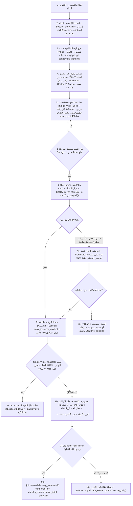

# 🗺️ خطة التنفيذ الهندسية الشاملة v2.9 (مغلقة بالكامل بعد تدقيق «السمكة الذهبية 360°» ومراجعة الجولة التانية والفحص الحرفي للكود والاختبارات على `A-test @ 0dd3be5d` / `26d2b17`)

> **المرجع الأساسي المحقق (`M0`):** الفرع `A-test` (`origin/A-test`) عند التزام الكود الفعلي `0dd3be5d45bfefb0f0a36cf45875a66fe848128c` (والوثائق `f122f23` ← `85ecdf6` (`v2.8`) ← `26d2b17` ← `v2.9`؛ شجرة نظيفة `0` تعديلات متتبعة). **تنبيه مقصود:** كل ملفات `.py` لا تزال في وضع `READ-ONLY` قبل بدء `M1` عمداً، لذا بنود `M1..M5` غير منفذة بعد في الكود حتى إشارة `GO M1`. **شرط قبول بدء `M1` (`A-01`/`A-02`):** يجب أن يتحقق وكيل التنفيذ على `checkout` فعلي نظيف على `A-test` الحديث (أو فرع مرحلي متفرع منه؛ لا `f5b4bee` detached ولا `M start.sh`) وبوجود `pyflakes` فعّال في البيئة — الأرشيف المعزول لا يغني عن نظافة الـ `checkout`.
> **الجديد الحاسم في `v2.9` (بعد المراجعة الحرفية الكاملة للجولة التانية + فحص الاختبارات الفعلية):** دمج تصويبات الجولة المؤكدة (`_BARE_BEARER_RE`, `p_dir.rstrip("/\\") >= 6`, `incidents.on_job_result`, `preflight web off`, حذف `text_assist.py#L351-354`, قتل شجرة `Supervisor._terminate`, حظر `symlink` داخل `backup.build_zip()`) + إغلاق **5 ألغام انحدار/تسمية** كُشفت بالفحص الميكروسكوبي: (1) إبقاء `text_assist.generate` غير مستبدل داخل `conftest._no_network_polish` لحماية **5 اختبارات قائمة**، (2) فحص `web_error` **قبل** `web_port is None` في `preflight` لحماية `test_v2_debts.py`، (3) تحديث عقد `tests/test_runtime_shutdown.py::test_main_applies_persisted_overrides_before_start_queue` لوضع `WEB_ENABLED=0`، (4) تصحيح اسم `Config._ALL_MODELS` (لا `ALL_MODELS`) + إبقاء `assert_not_transcription_model()` + اسم `_VOID_TAGS` (بـ `_`)، (5) استبعاد `"live_pending"` من `jobs.pending_jobs()` مع دالة `jobs.live_pending_jobs()` وتشغيل `recover_interrupted_live_jobs()` **قبل** `start_queue(resume=True)` لمنع إعادة تفريغ الصوتيات، وحسم أن `key_groups.json` مخزن ببصمات `sha256:` أصلاً مع تحصين إضافي.  
> **النطاق الحصري:** بوت تليجرام فقط. **واجهة وخادم الويب مُعطَّلان ومُجمَّدان نهائياً افتراضياً (`WEB_ENABLED=0`) وممنوع تطويرهما** (تُترك الملفات الحالية بلا حذف لحماية اختبارات الانحدار وإمكانية الاسترداد عند طلب المالك فقط). أوضاع `off` / `merged` / `split` تبقى سليمة وتُحرس باختبارات انحدار.  
> **قاعدة التنفيذ الملزمة:** التعامل دائماً مع **أسماء الدوال والوحدات الفعلية** (لا أرقام السطور وحدها)، والعمل على **فرع مرحلي متفرع من `A-test`** عبر **مراحل مضبوطة (`M1 → M5`) ببوابات قبول وتقرير فحص ومراجعة `READ-ONLY` قبل أي انتقال — وممنوع المساس بـ `A-test` مباشرة أو الـ Push التلقائي.**

---

## 1️⃣ عقد المالك النهائي الملزم (13 بنداً معتمَداً + الضوابط الحاكمة)

| # | البند | القرار النهائي الملزم |
|---|---|---|
| **1** | **قائمة سماح النماذج الفعّالة + حارس وقت التشغيل (`A-04`) وحماية الحصة** | **قائمة سماح حصرية** لنماذج المساعد النصي (`ALLOWED_TEXT_ASSIST_MODELS = ("gemini-3.5-flash-lite",)` + شلبي محلياً). **ممنوع دخول `gemini-3.6-flash`** (أو `3.8-flash` أو أي موديل في `Config._ALL_MODELS` / `Config.MODELS`) عبر **حارس برمجي وقت التشغيل `assert_not_forbidden_assist_model(model=None)` يُستدعى فعلياً عند كل دخول لنموذج في الإنتاج (`generate()`, `polish()`, `polish_gemini()`, `synthesize()`, `synthesize_ex()`) — مع إبقاء `assert_not_transcription_model()` سليمة لتوافق الاختبارات القائمة — ويشمل تلقائياً `assistant.py` والعناوين والملخصات** حتى لو فُرض من `TEXT_ASSIST_MODEL` — دون افتراض توفر حصة `flash-lite` دائماً (السقوط النظيف لو نفدت حصته). |
| **2** | **التوازي الدائم في المرحلة 1 + المعادلة الرياضية للميزانية `420ث` *(قرار لا رجعة فيه)*** | **مهما يحصل — قرار نهائي لا رجعة فيه ولا يوجد أي مفتاح لإيقاف `شلبي #1`:** عند تهيئة `LOCAL_POLISH_CMD`، تبدأ المرحلة 1 **دائماً بالتوازي الكامل بين `flash-lite` + `شلبي #1` معاً** (+ `title_thread` غير مانع). *(فقط إذا كان `LOCAL_POLISH_CMD` فارغاً/غير مهيأ بيئياً أصلاً ينتقل لـ `flash-lite` منفرداً بلا رسالة انتظار مزدوج كاذبة).* **الميزانية الرياضية المطلقة (`SYNTH_TOTAL_BUDGET_SEC = 420ث` بعد التفريغ):** مرحلة 1 بحد أقصى (`45ث قفل + 180ث تنفيذ` محصورة داخل الميزانية) ← ثم `shelby2` (`<= min(180ث, remaining_after_lock)`) ← ثم احتياطي `flash-lite` (`<= remaining`). **عند نفاد الميزانية (`remaining <= 0` أو `< MIN_SHELBY_EXEC_SEC`) لا تُفتح محاولة جديدة أبداً.** |
| **3** | **السبّاك التالت هو شلبي ← واحتياطي فلاش عند `180ث` فقط *(قرار لا رجعة فيه)*** | **السبّاك التالت هو شلبي (`shelby2`) قولاً واحداً** بمهلة **`180ث`**. **فقط لا غير:** لو تأخر `shelby2` عن **`180ث` (`Time out`)** أو تعطل في خطوة السبك نفسها، يرد **`flash-lite` احتياطياً فقط**. *(وإن فشل `flash-lite` أيضاً ← ممنوع `3.6-flash` مطلقاً، فيرتد لإنقاذ أفضل مسودة متاحة من المرحلة 1 بوسمها، أو الخام عند `0` مسودات).* |
| **4** | **مهمة السبّاك + سقف البرومبت + عدم تعليقه بالعنوان (`A-05`)** | مُحرِّر ومُسبِّك يخرج **رسالة تالتة نهائية أقوى** بالخام (Ground Truth) + الدستور الـ 12 (`SYNTHESIZER_SYSTEM_PROMPT` القائم سليم ويُحفظ كما هو) + الدور + القاموس + `L2` + المسودات المتاحة؛ **إزالة الهروب المبكر القائم في [`text_assist.py#L351-354`](../text_assist.py#L351-L354) (عند غياب مسودة واحدة) وتعديل `compose_synthesis_prompt` ليسبك فوق المتاح حتى لو سقط/تأخر/أعاد `No-Op` أحد أو كلا مسودتي المرحلة 1**. **`title_thread` غير مانع** (`join(timeout=2.0)` كحد أقصى)، ومع سقف ذكي لمدخل السبك **`SYNTH_PROMPT_MAX_CHARS = 28000`** يختصر المسودتين أولاً مع إبقاء الخام والدستور بأولوية عليا. |
| **5** | **نبض `typing` (3.5ث) وكاتب الرسالة الحية الواحد (`Single-Writer`)** | نبض `typing` كل ~**`3.5ث`** *(هامش أمان دون انتهاء مهلة تليجرام `5ث` مع تأخير الشبكة)* + **تحديث الحية فور جاهزية مسودة `flash-lite` دون انتظار `join` شلبي!** وعند وصول شلبي تُعرض المسودتان معاً في نفس الحية عبر **كاتب تسلسلي واحد (`LiveMessageController`)** يضم القرار والشبكة الوسيطة (`retry_429=False`) معاً حتى يمتنع أي تحديث وسيط بعد `finalized=True`. قص ذيل العرض الحي عند الحد الموحّد فقط؛ **والسبّاك يستلم المسودتين كاملتين حتى حد السياق**. |
| **6** | **لحظة رد السبّاك** | تُستبدل **نفس الرسالة الحية بالكامل** بالنتيجة النهائية المسبوكة فقط، و**بدون أي أزرار لمسودات فلاش وشلبي**. |
| **7** | **حد الـ `4000` UTF-16 بعد تحليل الكيانات + توحيد `<pre>` + سقف `8` قطع *(حصراً لمخرجات السبّاك)*** | **يطبق حصراً على النتيجة النهائية المسبوكة من السبّاك (`synthesizer` + `dedup` لها):** **صفر ملفات `.md` تلقائية**. الحد التطبيقي الموحّد عبر النظام هو **`4000` وحدة UTF-16** يتحقق على **النص بعد فك الوسوم والكيانات (`parsed_utf16 <= 4000` وحراسة الخام)** لمطابقة قاعدة تليجرام `4096`. الزائد يُقسّم عبر `_html_chunks` فتظهر **جميع القطع (`chunk_0..chunk_last`) بتنسيق `<pre>` الموحد وبوسوم متوازنة**، تحل الأولى مكان الحية وتُرسل التكملة تحتها **بحد أقصى `MAX_FINAL_CHUNKS = 8` قطع في الشات** (بلا `.md` تلقائي، وإن زاد عن 8 تتوقف عند الثامنة مع تنبيه + الزر الأزرق). |
| **8** | **زر `.md` الأزرق (للنتيجة المسبوكة `> 4000` فقط) + كاش ذري 24س (`0o700`/`0o600`) + تفويض المجموعات (`A-18`)** | **حسم نهائي قاطع:** يظهر الزر الأزرق `[📄 تحويل لملف .md]` (`style="primary"`) **فقط للنتيجة المسبوكة من السبّاك (`synth_golden`) عندما تتجاوز `4000` وحدة UTF-16** (على **`chunk_last` فقط**). **لا يظهر للنتائج القصيرة (`<= 4000`) ولا لأي مسار غير نتيجة السبّاك.** يتدرج عند الضغط ← `[✅ تأكيد ملف .md]` (`style="success"`) + `[❌ إلغاء]` (`style="danger"`). *(الأمر `/md` بالرد على قطعة مسبوكة أو `entry_id` يبقى متاحاً).* الكاش كتابة ذرية بدون `symlink` وصلاحيات مقيدة (**`0o700`/`0o600`** على POSIX) حتى **`24 ساعة` (`86400ث`) أو سقف الحماية (`200 ملف / 50MB`)** مع استرجاع من الأرشيف `plaintext` عبر `entry_id` خلال الـ 24س لو أُخلي الكاش؛ **وتفويض إلزامي بمطابقة `chat_id` + `allowed_chat_id` + ربط صاحب الطلب في المجموعات (`user_id`).** |
| **9** | **النطاق وحماية الحدود (بقاء باقي الشغل كما هو 100% — `A-13`)** | التعديل مقتصر حصراً على مسار السبك المذكور في تليجرام (**ملاحظة دقة:** قياس `_utf16_len` في `telegram_bot.py` (`_chunk_text`/`_html_chunks`) قائم مسبقاً لكل رسائل تليجرام لقاعدة `4096`, وحصر التغيير يعني **بقاء أوضاع `off` / `merged` / `split` في `delivery.py`, و`panel.py`, و[`prepare_for_web`](../delivery.py), وعتبة الخام `12000` بالحروف في `_send_long`, وكل ما عدا نتيجة السبّاك 100% كما هو بلا أي تغيير وظيفي** ومؤكداً باختبارات انحدار صريحة)، دون أي تطوير للويب. |
| **10** | **رسالة الخام الطويل (`> 12000` حرف) في `dual`** *(اعتماد المالك: خيار أ)* | منع `.md` التلقائي يطبق على **النتيجة النهائية المسبوكة فقط**؛ رسالة الخام `> 12000` حرف في `dual` تستمر عبر `_send_long` وترسل `transcript.md` كالمعتاد. |
| **11** | **محتوى ملف `.md` التصديري** *(اعتماد المالك: خيار أ)* | عند التأكيد أو `/md` يُرفع **النص الذهبي الصافي فقط** (`golden_text` بدون بانر أو ترويسة) باسم `golden_synthesized.md`. |
| **12** | **تجميد وتعطيل الويب نهائياً افتراضياً (`A-03`)** *(قرار المالك الإلزامي)* | بقاء [`web_service.py`](../web_service.py), [`static/`](../static), و`prepare_for_web` **بلا حذف ولا تطوير**، وتعطيل الويب افتراضياً بـ **`Config.WEB_ENABLED = False`** (يشمل **تغليف تهيئة الويب بدالة قابلة للاختبار، ومنع `ensure_web_token()` وعدم توليد/طباعة التوكن وعدم بدء الخادم، وعرض `"web off"` في `preflight` — مع فحص `if web_error:` قبل `elif web_port is None:` لحماية `test_v2_debts.py` — ومنع إعادة تشغيل الويب في `_idle_loop()`** وتحديث عقد اختبار الإقلاع، مع **الإبقاء على `Config.WEB_ACCESS_TOKEN` إن ورد من `.env` لأغراض `logkit.redact()` فقط**)، مع توثيق رسمي بالتجميد في الكود و[`README.md`](../README.md) و[`PROGRESS.md`](../PROGRESS.md). |
| **13** | **إقفال ملاحظات التدقيق (`M-1`, `L-2`, `L-1`, `N-1`, `A-10`, `A-15`, `A-18`)** | **`M-1` + `A-10` الأمني:** إصلاح `_TG_RE` (`{30,}` مع حفظ `(?<!\d)` و`_`) + `_BEARER_RE` + **`_BARE_BEARER_RE`** (لاقتناص `Bearer <tok>` بلا `[:=]` مع حفظ `_`) + رفع عتبة `p_dir.rstrip("/\\")` إلى **`>= 6`** لمنع مسح جذور الأقراص مثل `"D:/"` في [`logkit.py`](../logkit.py) + `logkit.redact()` **عند المصدر قبل التخزين/الإرسال** في التنزيل و`jobs.ndjson` و`_on_job_failed` (**شاملة `incidents.on_job_result(False, error=errs)`** وباقي مواضع `STATE["last_error"]`) و`_on_quota_deferral` والشبكة؛ **`A-18` النسخ الاحتياطي:** التحقق من أن `state/key_groups.json` يحفظ بصمات `sha256:` أصلاً مع إضافة `"key_groups.json"` إلى `backup.SECRET_BASENAMES` احتياطاً + رفض `os.path.islink()` داخل `backup.build_zip()`؛ **`L-2`:** إصلاح `bg_wait` شاملة futures المجمّع؛ **`L-1` + `A-15`:** المسار الثالث يرسل تنبيهاً مع التصريح التعاقدي باستحالة إغلاق الأصل دون `edit/delete`؛ **`N-1`:** تحديث الوثائق وتعليم الأسطر التاريخية + عزل `.env` داخل `test_360_exhaustive.py`. |

---

## 2️⃣ مخطط تدفق المعالجة المحكم (`synthesizer`)

---

## 3️⃣ مصفوفة السيناريوهات وعقد الحالات (الحفظ vs التسليم الكامل/الجزئي)

> **فصل المسؤوليات (`PLAN-05`):** الأرشفة الدائمة (`saved_in_archive=True`) مستقلة عن التسليم الشبكي (`delivery_status ∈ {"full", "partial", "rescue_only", "failed"}`). يُسجَّل في `jobs.ndjson` الحقول الدقيقة: `delivery_status`, `chunks_sent`, `chunks_total`, `sent_msg_ids`, `entry_id`, و`export_token` (اختياري) بحسم واحد لكل مهمة.

| # | السيناريو | مسودة 1 / 2 | السبّاك (`shelby2` ثم احتياطي) | النتيجة في الشات + الأرشيف + `jobs.ndjson` |
|---|---|---|---|---|
| **1** | مثالي قصير (`<= 4000` UTF-16) | نجحا (أو إحداهما) | `shelby2` نجح | استبدال الحية بالذهبية فقط (بلا أزرار مسودات وبلا زر `.md` لأنها `<= 4000`) + أرشيف `entry_id` + `delivery_status="full"`, `synth_golden=True` (تُكتب **بعد** التسليم). |
| **2** | مثالي طويل (`> 4000` و`> 16000`) | كاملة للسبّاك (مقتطعة حياً فقط) | `shelby2` نجح | استبدال الحية بـ `chunk_0` + `chunk_1..last` تحتها (`parsed_utf16 <= 4000` و`raw <= 4096` لكل قطعة، صفر `.md` تلقائي) + الزر الأزرق على `chunk_last` + كاش ذري صافي `golden_synthesized.md` + `delivery_status="full"`, `chunks_sent==chunks_total`. |
| **3** | تعطل فلاش #1 أو شلبي #1 (مهلة / `No-Op` / `lock_wait` / `5xx`) | أحدهما فشل | `shelby2` يحاول ضمن المتبقي *(يُتخطى فقط في الخطأ البيئي الحتمي `401/403`/`FileNotFoundError` أو `remaining < MIN_SHELBY_EXEC_SEC`)* ← احتياطي `flash-lite` | خروج نسخة تالتة مسبوكة نهائية فوق المتاح (أو من الخام مباشرة) + استبدال الحية + وسم خفيف فقط لو استخدم احتياطي `flash-lite`. |
| **4** | الانهيار الكلي (`0` مسودات + فشل `shelby2` والاحتياطي) | فشلا | فشلا | عدم استدعاء `append_polished`؛ إغلاق الحية (أو إرسال الخام في `polished_only`)؛ تسجيل `delivery_status="sent_raw_only"` / `"failed"` والخروج من حالة `live_pending`. |
| **5** | سقوط `chunk_k` بعد نجاح `chunk_0` (أو تعطل كاش `.md`) | نجحت | نجح | الحفظ في الأرشيف تم بالفعل؛ لو سقطت `chunk_k` يؤكد `send_html_result` السقوط فتُرسل رسالة إنقاذ بالزر الأزرق ويُسجَّل **`delivery_status="partial"`** مع `chunks_sent < chunks_total` (لا يُسجَّل `"full"`!). لو فشل القرص في كاش `.md` يستمر التسليم النصي كاملاً بلا تعطيل! |
| **6** | `dedup` لنفس الفويس الطويل (`> 16000` حرف) | مخبأ | مخبأ | `process_job` يسترجع **الخام الكامل والمنظم الكامل** من **الأرشيف/الجلسات عبر `archive.get_entry_by_id(entry_id)`** مع فحص وسم `synth_golden` لتمييز المسبوك الذهبي عن المنظم العادي بدلاً من المبتور عند `16000`، ويُسلَّم بنفس مقسّم القطع والزر الأزرق بلا `.md` تلقائي. |
| **7** | `polished_only` + فشل الحية (`mid=None`) | قيد العمل | مستمر | حالة `status="live_pending"` غير النهائية تمنع `_finalize` من الفشل المبكر، ثم يسلّم الخيط الخلفي ويثبّت حالة `jobs.ndjson` النهائية مرة واحدة بعد التسليم. |
| **8** | أزرار `md:` أو `/md` + تفويض `chat_id` + `user_id` + انتهاء الكاش | - | - | التحقق من صيغة التوكن + منع symlink/`TOCTOU` + تطابق `chat_id` + `allowed_chat_id` + **`user_id` صاحب الطلب في المجموعات** + `expires_at` على الخادم؛ لو أُخلي الكاش بسبب السقف قبل 24س يُسترجع من الأرشيف `plaintext` عبر `entry_id`؛ وبعد `> 86400ث` تُزال الأزرار ويُنبَّه المستخدم. |
| **9** | **طابور `3 فويسات متتالية` تحت شلبي (`Queue UX`)** | `raw` يصل فوراً؛ فلاش يعرض فوراً في الحية عند جاهزيته | منسّق الصف العادل + `LOCAL_LOCK_WAIT_SEC` | فويس #1 يخلص ويسلم؛ فويس #2 و#3 يرى المستخدم رسالتهم الحية محدثة فوراً بفلاش + حالة `⏳ شلبي مشغول بمهمة سابقة`، ولا يتجوع فويس جديد ولا يسقط الخام؛ وإذا انتهت مهلة انتظار القفل أو لم يكفِ المتبقي من `420ث` ينتقل السبك لاحتياطي `flash-lite` وتُستبدل الحية. |
| **10** | **`LOCAL_POLISH_CMD` فارغ أو تجاوز `MAX_FINAL_CHUNKS = 8`** | مسار منفرد أو طويل جداً | لا يُستدعى شلبي / سقف شات | لو `LOCAL_POLISH_CMD` فارغ: يسير التنظيم عبر `flash-lite` مباشرة بلا كذب انتظار مزدوج أو سبك. ولو فاق المسبوك 8 قطع (`~32K` حرف): تُحجز مساحة التنبيه بالقطعة الثامنة قبل البناء وتنزل 8 قطع كحد أقصى بلا `.md` تلقائي + الزر الأزرق `[📄 تحويل لملف .md]` لاستخراج الملف كاملاً. |
| **11** | **انهيار / Restart مفاجئ (`SIGKILL`) وسط خيط خلفي (`N1` + `A-14`)** | توقفت بالذاكرة | توقف قسري | عند الإقلاع: يلتقط عبر **`jobs.live_pending_jobs()`** المهام بحالة **`status="live_pending"`** (غير موجودة في `TERMINAL` ومُستبعدة تماماً من `jobs.pending_jobs()`) الأحدث من `JOBS_RESUME_MAX_AGE_H` وتُنفَّذ `recover_interrupted_live_jobs()` **قبل `start_queue(resume=True)`** لإغلاق رسائلها الحية وحسم حالتها دون إعادة تفريغها صوتياً. *(ملاحظة صدق: لو ضرب `SIGKILL` في اللحظة بين قبول تليجرام فتح الرسالة وحفظ `live_msg_id` على القرص فهي نافذة سباق فيزيائية موثقة لا يضمن مسحها 100%).* |
| **12** | **فقد ردّ `200` على الشبكة (`ReadTimeout` عند فتح الحية ← `mid=None`)** | قيد العمل | مستمر | **ممنوع إعادة المحاولة العمياء لـ `sendMessage` عند `ReadTimeout`** (`netsession` بـ `max_retries=0`؛ إعادة المحاولة محصورة بفشل ما قبل الاتصال فقط) لمنع تكرار الحية؛ يكمل السبك بحالة `live_pending` ويسلّم النهائي في رسالة جديدة *(ضياع الرد بعد التسليم احتمال فيزيائي نُقلّصه ولا ندّعي استحالته 100%)*. |

---

## 4️⃣ خريطة التعديلات الهندسية المعالجة لملاحظات `PLAN-01 .. PLAN-08` (بأسماء الدوال)

### أ. حسم `PLAN-01`: تسليم تعديلات شلبي خارج دورة الأسرار (`pack_deploy.py` & `.local/`)
1. **المشكلة المحققة في `M0`:** `.local/shelby_polish.py` (`11,004` بايت) يحتوي بيانات جلسة وتوكنات محلية ومستبعد عمداً في [`.gitignore#L6`](../.gitignore#L6) و[`tools/pack_deploy.py#L61-L66`](../tools/pack_deploy.py#L61-L66). **ممنوع `git add -f .local/` أو إدخال أسرار في `git` أو `ZIP`.**
2. **الحل الهندسي النظيف:**
   - توفير محرّك/أدابتر قياسي متتبّع خالٍ تماماً من الأسرار (أو تحديث `tools/shelby_adapter.py` / القالب القياسي + تحديث `KNOWN_ROOT_MODULES` في [`tools/pack_deploy.py`](../tools/pack_deploy.py#L47-L56) إن أُضيفت وحدة جديدة) يقرأ `PLAY_INTEGRITY_TOKEN` و`COOKIES` من `.local/` أو متغيرات البيئة، **ويدعم صراحة**:
     - `SHELBY_HTTP_TIMEOUT` (`180.0` افتراضياً) مع `read_timeout = min(30.0, remaining)` لكل استدعاء.
     - **`total_deadline = time.monotonic() + total_timeout`** المفروض داخل `iter_lines()` والمُغلِق الفوري لـ `response.close()` عند الانتهاء (`PLAN-03`: لا يعتمد على inactivity timeout وحده).
     - أكواد فشل مهيكلة على `stderr`: `[SHELBY_REQ_FAIL:{status}]`, `[SHELBY_HTTP:{status}]`, `[SHELBY_DEADLINE]`, `[SHELBY_EMPTY]`.
   - مع توثيق خطوة المزامنة/التحقق اليدوية الآمنة للسكربت المحلي `.local/shelby_polish.py` في **`DEPLOY.md` و`README.md` مع عقد CLI الرسمي الصريح** (`stdin`: `system\n\n===USER_INPUT===\nraw` ← `stdout`: النص فقط + متغيرات البيئة المطلوبة للـ Token/Cookies) وإظهار حالة جاهزية واضحة في `preflight`/`/doctor` (`local: ready` vs `missing`) بدون تسريب أي أسرار لـ Git أو الأرشيف (`BUG-01`).

### ب. حسم `PLAN-02`, `PLAN-03`, `PLAN-04`, وحارس النماذج + `A-04/05/06/07` + `BUG-02/03/04/08`: [`text_assist.py`](../text_assist.py)
1. **حارس قائمة السماح الفعلي وقت التشغيل (`assert_not_forbidden_assist_model` — `A-04`):**
   - فرض قائمة سماح حصرية (`ALLOWED_TEXT_ASSIST_MODELS = ("gemini-3.5-flash-lite",)` محلياً + شلبي CLI) مع رفض صريح لأي نموذج غير مدرج فيها أو موجود في **`Config._ALL_MODELS`** (الاسم الفعلي للسمة في `config.py#L49` — لا `ALL_MODELS`) أو **`Config.MODELS`**, مثل **`gemini-3.6-flash`**, `gemini-3.5-transcribe`, `gemini-3.8-flash`.
   - يُستدعى الحارس فعلياً وقت التشغيل عند **كل دخول لنموذج في الإنتاج**: `generate()`, `polish()`, `polish_gemini()`, `synthesize()`, و`synthesize_ex()` — **مع الإبقاء على `assert_not_transcription_model()` سليمة لتوافق [`tests/test_pipeline_phase3.py#L486`](../tests/test_pipeline_phase3.py#L486) — فيشمل تلقائياً `assistant.py` والعناوين والملخصات و`/polish` و`/ask` و`/chat` و`/plan` والسبك** حتى لو فُرض عبر متغير البيئة `TEXT_ASSIST_MODEL` في التشغيل!
2. **مسار `Popen` موحّد وقتل شجرة العمليات كاملة (`PLAN-02` + `A-06` + `BUG-04`):**
   - حذف استدعاء `subprocess.run` واستبداله بمسار **واحد فقط** في `_call_local_provider(system_text, raw_text, stage="polish", timeout=..., process_factory=None)`:
     - ينشئ العملية عبر `(process_factory or subprocess.Popen)(cmd_args, ..., shell=False, env=env)` مع **`start_new_session=True` على POSIX**، و**`CREATE_NEW_PROCESS_GROUP` (أو Win32 Job Object بحد `JOB_OBJECT_LIMIT_KILL_ON_JOB_CLOSE`) على Windows**.
     - عند تجاوز المهلة أو الإغلاق (`request_shutdown()` / `_stop_event`): **يقتل شجرة العمليات بالكامل قبل تفريغ الأنابيب و`proc.wait()`**: `os.killpg(os.getpgid(proc.pid), signal.SIGKILL)` على POSIX، و**على Windows تشغيل `taskkill /F /T /PID <pid>` (أو إغلاق Job Object) مع `proc.kill()` كإسناد** — لا الاكتفاء بـ `proc.kill()` الذي يترك الأبناء أحياء!
     - **توسيع قتل الشجرة ليشمل [`Supervisor._terminate()`](../supervisor.py#L135-L167)** عند فشل الإيقاف الرشيق تحت `SUPERVISED=1` حتى لا تبقى عملية شلبي تابعة للعامل يتيمة بعد قتل العامل وإعادة إطلاقه!
     - تحديث [`test_call_local_provider_does_not_use_shell_true`](../tests/test_hardening_360.py#L156-L172) واختبار فعلي يثبت موت العملية الابنة/الشجرة على المسار الإنتاجي وفي `Supervisor._terminate()`.
3. **منسّق صف FIFO محدود وعادل + المعادلة الرياضية المطلقة للميزانية (`PLAN-04` + `A-07` + `BUG-03`):**
   - بناء منسّق صف **`_ShelbyQueueCoordinator` في `text_assist.py` بنظام التذاكر العادل (`FIFO Ticket Lock`)**:
     - سقف للمنتظرين (`MAX_WAITERS = 8`) لمنع تراكم الخيوط، ومهلة انتظار قفل منفصلة **`LOCAL_LOCK_WAIT_SEC` (`45ث` افتراضياً)** مستقلة عن `LOCAL_POLISH_TIMEOUT` (`180ث`) — مع معالجة استجابة القفل في `_call_local_provider` بهذه المهلة بدلاً من `float(timeout)` الحالية (`text_assist.py#L162`) التي تضاعف الانتظار إلى `2×timeout`.
     - أولوية محدودة **فقط للفويس النشط الجاري إغلاق سبكه** (بحد أقصى تذكرة واحدة مضمونة) مع تصنيف `lock_wait` كازدحام مؤقت فقط لا خطأً بيئياً دائماً.
     - **المعادلة الرياضية لميزانية الـ `420ث` (إلغاء `max(1.0, ...)` المصطنعة):** تُقاس `total_budget_deadline = flow_start + Config.SYNTH_TOTAL_BUDGET_SEC` مرة واحدة بعد التفريغ وتغطي انتظاري القفل و`shelby1` و`shelby2` واحتياطي `flash-lite`: عند كل خطوة `remaining = total_budget_deadline - time.monotonic()`. **`lock_wait_budget = min(LOCAL_LOCK_WAIT_SEC, remaining)`**؛ ثم بعد حصول القفل **`remaining = total_budget_deadline - time.monotonic()`**. **إذا كانت `remaining <= 0` أو `< Config.MIN_SHELBY_EXEC_SEC` (`5.0ث`) ← لا تبدأ محاولة `shelby` جديدة ولا تستخدم مهلة دنيا مصطنعة، بل ارتد فوراً للاحتياطي ضمن المتبقي أو للإنقاذ (`A-07`).**
4. **آلة الحالات الصريحة لـ `synthesize_ex` (`A-05`) + دقة العدّادات (`BUG-08`) + عقود التوقيع (`A-17`):**
   - **عقد آلة الحالات الصريح:** `(P1_RUNNING: flash1 || shelby1 ضمن الميزانية)` ← `(SYNTH_SHELBY2: يتخطى shelby2 فقط في الخطأ البيئي الحتمي 401/403/FileNotFoundError أو نفاد الميزانية، لا في lock_wait!)` ← `(SYNTH_FLASH_FALLBACK: محروس ضد 3.6-flash وضمن المتبقي فقط)` ← `(RESCUE_DRAFT_OR_RAW)`، بناتج موحد يضم `{text, source_tag, fallback_used, error_reason}`. **إزالة الهروب المبكر من [`text_assist.synthesize#L351-354`](../text_assist.py#L351-L354)** عند غياب مسودة واحدة بحيث تُسبك النتيجة التالتة فوق الخام والمسودة المتاحة.
   - تحديث عدّادات `synth_calls`, `synth_ok`, `synth_fail`, و`synth_fallback_calls` بصدق عند كل محاولة (`BUG-08`).
   - **تصحيح خطأ `v2.6` بخصوص `inspect.signature` (`A-17`):** الفحص القائم في [`delivery.py#L1138-L1145`](../delivery.py#L1138-L1145) هو [`_accepts_context_summary`](../delivery.py#L1138-L1145) لتوافق دوال `polish_fn` المحقونة و**يبقى سليماً كما هو**؛ أما `reply_markup=None` في `Sender` فتُضاف بواجهة صريحة (وتُحدَّث موكات الـ 8 ملفات اختبار في `M1`) بلا أي `inspect.signature` على `Sender`.

### ج. حسم `PLAN-05`, `PLAN-07`, `PLAN-08`, `A-07/08/12/13/14/15/16`, `L-1`, `N1`, و`N3`: [`delivery.py`](../delivery.py) و[`prompts.py`](../prompts.py) و[`sessions.py`](../sessions.py)
1. **مسار غياب شلبي الصريح + مجمّع بضغط خلفي + تتبع `Futures` + كاتب الرسالة الحية الوحيد (`LiveMessageController` — `PLAN-07` + `A-07` + `A-14`):**
   - **عند فراغ `LOCAL_POLISH_CMD` منذ المرحلة 1:** يتخطى المنظّم التوازي المزدوج وقفل شلبي ومرحلة السبك الثالثة نهائياً، وينفّذ تنظيم `flash-lite` منفرداً مباشرة بلا رسالة انتظار مزدوج كاذبة.
   - **مجمّع خيوط محدود بضغط خلفي (`SYNTH_BG_WORKERS` + `BoundedSemaphore(SYNTH_MAX_QUEUED_BG)`):** بدلاً من طابور futures لا نهائي، يفرض المجمّع سقف قبول للمنتظرين ويرتد بأمان لو امتلأ؛ و**تشمل دالة `delivery.wait_background_threads()` جميع الـ `Future`s النشطة بجانب خيوط الخلفية عند الإغلاق (`A-07`).**
   - قفل تسلسلي وحيد (`_writer_lock`) يغطي **التحقق من `finalized` وتنفيذ مكالمة الشبكة الوسيطة معاً** حتى يستحيل عملياً إرسال تعديل حي بعد اعتماد التحديث النهائي (`retry_429=False` للوسيط).
   - **حالة `status="live_pending"` غير النهائية + فصل الاسترداد (`A-14`):** بدلاً من تسجيل `"sent"` (التي في `jobs.TERMINAL`) بعلامة `draft=True`، يُسجَّل فور فتح الحية حالة **`"live_pending"` غير النهائية** مع `(chat_id, live_msg_id, entry_id)` **وبدون وضع حقل `"text"` في هذا الحدث نهائياً** (دفاع مزدوج بجانب شرط `state == "sent"` في `jobs.find_recent_result` حتى لا يلتقطه `dedup`). **قيد الترتيب الحرج المكتشف بالفحص:** بما أن [`jobs.pending_jobs()`](../jobs.py#L137-L151) تعيد كل مهمة غير نهائية تملك `file_id` (والحقول التراكمية في `load_state()` تُبقي `file_id`), و[`VoiceQueue.resume()`](../voice_queue.py#L136-L150) يعيد إرسالها للتفريغ الصوتي من جديد — يجب: **(1) استثناء `state == "live_pending"` داخل `jobs.pending_jobs()`**، و**(2) إنشاء دالة مخصصة `jobs.live_pending_jobs(max_age_h=None)`**، و**(3) استدعاء `recover_interrupted_live_jobs()` في `main.py` قبل `telegram_bot.start_queue(resume=bool(bot_token))`** لمنع إعادة تفريغ مهام `live_pending` صوتياً مرتين! *(مع التوثيق الصريح باستحالة ضمان مسح رسالة إذا وقع `SIGKILL` في اللحظة بين قبول تليجرام والكتابة على القرص)*.
   - **تحديث فوري بلا حجب + حالة الطابور (`Queue UX`):** يُحدَّث العرض الحي **فور جاهزية `flash-lite` دون انتظار `join(shelby1)`**؛ وإذا كان شلبي مشغولاً بمهمة سابقة (سيناريو `#9`) يُعرض بوضوح `⏳ شلبي مشغول بمهمة سابقة`.
   - **قاعدة الأقفال الصارمة:** لا يُمسك `res_lock` أبداً أثناء الشبكة أو استدعاء النماذج، و**ممنوع استدعاء `thread.join()` أو `future.result()` أثناء حيازة `res_lock` أو `_writer_lock`.**
   - دالة `_live_dual_message_html`: تقتطع طرف الرد الأطول **قبل `html.escape`** عبر `_utf16_prefix_idx` عند تجاوز **`4000` UTF-16**، بينما يستلم السبّاك المسودتين كاملتين.
2. **خيط العنوان غير المانع + الحجز المرتبط بمعرّف الجيل (`A-16` + [`sessions.py`](../sessions.py)):**
   - تشغيل `title_thread`, `flash_thread`, `shelby_thread` بالتوازي في نفس اللحظة، و**`title_thread.join(timeout=2.0)` فقط** (خارج أي قفل).
   - ربط `claim_title_suggestion` / `release_title_suggestion` / `propose_title` بـ **`(session_id, generation_token / entry_id)`**: تحت القفل لا يُكتب `pending_title` إلا إذا ظل نفس الـ `session_id` وبقي الحجز/الجيل صالحاً ولم يسبقه قبول أو رفض أو فويس أحدث (`A-16`).
3. **سقف البرومبت + قصر UTF-16 على مسار السبك (`A-13`) + واجهة `reply_markup` (`A-12`) + تسليم `send_html_result` بعد التأكيد (`A-08`) + القيد التعاقدي (`A-15`):**
   - [`prompts.compose_synthesis_prompt`](../prompts.py#L276-L299): **الإبقاء على `SYNTHESIZER_SYSTEM_PROMPT` القائم سليماً** وتطبيق سقف **`Config.SYNTH_PROMPT_MAX_CHARS = 28000`**؛ عند التجاوز تُختصر المسودتان الوسيطتان مع حفظ **الخام (`raw_text`) والدستور الـ 12 والدور والقاموس**.
   - **إقفال تناقض النطاق لـ UTF-16 (`A-13`):** **توضيح دقيق:** دوال إرسال تليجرام في [`telegram_bot.py#L134-180`](../telegram_bot.py#L134-L180) (`_chunk_text`, `_html_chunks`) تقيس أصلاً بـ `_utf16_len` لكل الرسائل لفرض قاعدة Bot API `4096`؛ أما في `delivery.py` فيُطبَّق قياس `_utf16_len` على قرار الحد الطويل/الزر **حصراً داخل مسار السبك (`delivery.py:497, 508` + `_live_dual_message_html` + `synthesizer_final_message_html` + تمرير `use_utf16_limit=True` في `_replace_or_send` للسبّاك فقط)**. **تبقى أوضاع `off` / `merged` (`690, 700, 759, 784`) / `split` (`852, 873`)، وقصّات `panel.py`، وعتبة `_send_long` الخام (`12000` بالحروف في `delivery.py:1230`) 100% بلا أي تغيير وظيفي!**
   - **عقد `reply_markup` الصريح عبر كل الطبقات (`A-12`):** إضافة `style=None` لـ `panel.btn()`، وإضافة معامل اختياري `reply_markup=None` في [`delivery.Sender`](../delivery.py#L31-L40) (`send_text`, `edit_text`)، و[`telegram_bot.make_sender`](../telegram_bot.py#L410-L425)، و`_replace_or_send` بحيث تصل أزرار الكاش حصراً على `chunk_last` (عند `> 4000` UTF-16) أو رسالة الإنقاذ، و**`None` دائماً على القصير `<= 4000`**.
   - **توحيد التنسيق عبر كل القطع (`N3`) + سقف 8 قطع:** تغليف الذهبية بـ `<pre>` عبر `_html_chunks(..., limit=Config.SYNTH_MAX_EDIT_UTF16)` مع **حجز مساحة الترويسة والتذييل و`<pre>...</pre>` وتنبيه القطعة الثامنة قبل البناء** والتحقق النهائي (`parsed_utf16 <= 4000` و`raw <= 4096`) فتصل كافة القطع بـ `<pre>` متوازن، بلا `.md` تلقائي، وحتى **`MAX_FINAL_CHUNKS = 8` قطع**.
   - **واجهة `send_html_result` والترتيب بعد التسليم الفعلي (`A-08` + `BUG-06`):** يوفّر `Sender`/`telegram_bot` نتيجة مهيكلة `{"ok_all", "chunks_sent", "chunks_total", "sent_msg_ids", "failed_idx", "first_id"}` لكل القطع. الترتيب الصارم: الأرشفة الدائمة أولاً (`Outbox`: `entry_id`, `synth_golden`) ← الإرسال الشبكي ← **ثم فقط استدعاء `jobs.record(delivery_status=..., chunks_sent, chunks_total, sent_msg_ids, entry_id, synth_golden=...)` بناءً على نتيجة كل قطعة فعلياً**. لو سقطت قطعة بالمنتصف: تُرسل رسالة إنقاذ بالزر الأزرق ويُسجَّل `delivery_status="partial"`. (وإن تعذر كاش القرص يستمر التسليم النصي).
   - **القيد التعاقدي في `L-1` / `_replace_or_send` (`A-15`):** إذا فشل التعديل وغاب `delete_text` (أو فشلا معاً)، يرسل المسار الثالث رسالة النتيجة/التنبيه و**يُصرِّح تعاقدياً بأنه لا يضمن إغلاق `⏳` الأصلية تقنياً بدون `edit` أو `delete`** (لا يسجلها كمُغلَقة كذباً).
   - إبقاء `mode="dual"` للخام `> 12000` حرف عبر `_send_long` (`transcript.md`) وتجميد `prepare_for_web` بدون تطوير.

### د. حسم `PLAN-06`, `PLAN-08`, `A-09/10/11/12/18`, `N4`, و`M-1`: [`telegram_bot.py`](../telegram_bot.py), [`config.py`](../config.py), [`logkit.py`](../logkit.py), [`panel.py`](../panel.py), [`archive.py`](../archive.py), [`backup.py`](../backup.py)
1. **إصلاحات `telegram_bot.py` (`_html_chunks` بمحلّل حقيقي `A-11`) + منع تكرار `ReadTimeout` + كاش دعم `style` (`N4`, `A-12`) + سياسة `429`:**
   - **بناء tokenizer/lexer حقيقي لوسوم وكيانات HTML في `_html_chunks` (`A-11`):** إزالة `"code"` من **`_VOID_TAGS`** (الاسم الفعلي في `telegram_bot.py#L153` بـ `_` أمامية)، معاملة الكيانات `&...;` كوحدة ذرية لا تنقسم أبداً، **حجز مساحة الترويسة والتذييل و`<pre>...</pre>` وتنبيه القطعة الثامنة قبل الحساب**، قص النص المتصل بلا مسافات بدون كسر الكيان أو زوج الـ surrogate (UTF-16)، و**تحقق نهائي إلزامي على كل قطعة مبنية**: `parsed_utf16 <= limit` (4000) و`raw_utf16 <= 4096` (مع الحفاظ على توافق بقية مستدعي `_html_chunks` مثل `send_telegram_message`).
   - **منع إعادة المحاولة العمياء لـ `sendMessage` / `send_html_result` عند `ReadTimeout`** (`netsession` بـ `max_retries=0`) لتقليل خطر تكرار الرسالة الحية؛ وإعادة المحاولة محصورة بفشل ما قبل الاتصال فقط.
   - في `edit_telegram_message`: `retry_429=False` للحي يخرج فوراً؛ وفي النهائي `retry_429=True` يحترم `retry_after` ضمن سقف الميزانية.
   - دعم `style=None` في `panel.btn()` (مع الحفاظ على `panel.COMMAND_PARITY` وإضافة مفاتيح **`"md:ask": "/md"`, `"md:ok": "/md"`, `"md:no": "/md"`** المطابقة لدالة `panel.parity_key`). عند `HTTP 400`: إعادة المحاولة بدون `"style"` مع إبقاء `parse_mode="HTML"`, **ولا يُخزَّن `_BOT_API_STYLE_SUPPORTED = False` إلا إذا دلّ سبب `400` على `style`/`button` أو نجحت إعادة المحاولة الفورية بدون `"style"` (`A-12`)**؛ و`"message is not modified"` ← `True`.
2. **كاش التصدير الذري 24س + منع Symlink/TOCTOU + تفويض المجموعات `user_id` + تحصين `backup.py` (`PLAN-06` + `N5` + `A-18`):**
   - مسار الكاش في `DATA_DIR/exports_cache` (خارج `state/` ومعزول عن `/backup`), بصلاحيات مقيدة (`0o700` للمجلد، `0o600` للملفات على POSIX). كتابة ذرية (`tmp` داخل الكاش + `os.replace`) تحت قفل سعة (`Lock`) يفرض `200 ملف / 50MB`، وحظر `symlink`/`TOCTOU` (`lstat` + رفض الوصلات الرمزية و`O_NOFOLLOW` عند التوافر)، **وحفظ `expires_at`, `owner_user_id`, `chat_id`, `entry_id` داخل بيانات الكاش وتطبيق TTL فعلياً على الخادم.**
   - محتوى التصدير: **النص الذهبي الصافي فقط** (`golden_synthesized.md`) بدون بانر أو ترويسة.
   - **توقيت التنظيف (`N5`):** استدعاء `cleanup_expired_exports()` **عند بدء التشغيل (`main()`) + عند كل كتابة في الكاش** + احتياطياً في `_periodic_doctor`.
   - **تفويض إلزامي + تحصين `backup.py` (`A-18`):** `md:ask:<token>` / `md:ok:<token>` / `md:no:<token>` و`/md` تتحقق من regex التوكن + المسار الآمن بلا `symlink` + `chat_id` + `allowed_chat_id` + **التحقق من `owner_user_id` (`from.id`) في المجموعات** (وإن أُخلي الكاش بسبب السقف قبل 24س يُسترجع من الأرشيف `plaintext` عبر `entry_id`؛ مع توثيق أن الأرشيف نصوص Markdown غير مشفرة). وفي [`backup.py`](../backup.py): حسم التحقق من أن [`key_manager.py#L240-241, 338-351`](../key_manager.py#L240-L241) يكتب `state/key_groups.json` ببصمات `sha256:` أصلاً مع إضافة `"key_groups.json"` إلى `backup.SECRET_BASENAMES` كدفاع احتياطي، و**منع اتباع وكتابة الوصلات الرمزية داخل [`backup.build_zip()`](../backup.py#L44-L78)** عبر فحص `os.path.islink()` في كل من جذور المجلدات والملفات.
3. **إصلاح `dedup > 16000` للخام والمنظم كاملين عبر API موثق (`PLAN-05` + `A-09`):**
   - إضافة دالة موثقة **`archive.get_entry_by_id(entry_id)`** (تفهرس/تبحث في `ALL.md` مع دمج إضافات الجلسة و`sessions` كاحتياطي، وتحديث `last_entries`/`entries` لإرجاع `entry_id`) ترجع `{raw, polished, title, role_id, synth_golden}`.
   - حذف بتر `[:16000]` في `process_job` / `jobs.record` وتخزين **`entry_id` ووسم `synth_golden: bool`**؛ وعند `dedup` يسترجع النص الكامل للخام والذهبي عبر `archive.get_entry_by_id(entry_id)` ولا يخلط المسبوك الذهبي بالتنظيم العادي (`A-09`).
4. **إقفال `M-1` و`A-10` الأمني (تنقيح عند المصدر + إصلاح `Bearer` + حماية `p_dir`):**
   - تعديل [`logkit.py`](../logkit.py):
     - إصلاح `_TG_RE` إلى `(?<!\d)\d{8,10}:[A-Za-z0-9_\-]{30,}(?![A-Za-z0-9_\-])` (توسيع `{35}` إلى `{30,}` مع الإبقاء الصارم على `(?<!\d)` لحجب `/bot<token>/...` والإبقاء على `_` في فئة الحروف).
     - إصلاح `_BEARER_RE` + إضافة **`_BARE_BEARER_RE = re.compile(r"(?i)\bbearer\s+([A-Za-z0-9_\-\.]{16,})")`** ليلتقط أيضاً `Bearer <token>` سواء مع `[:=]` أم بدونه مع الإبقاء الصارم على `_` في التوكن.
     - رفع حد فحص مجلد المزود المحلي في `logkit.py#L44` إلى **`len(p_dir.rstrip("/\\")) >= 6`** (أدق من `len(p_dir) >= 6` لتجاهل `"D:/"` و`"C:\\"` والجذور القصيرة تماماً).
   - تمرير `logkit.redact(...)` **عند المصدر قبل التخزين/الطباعة/الإعادة/الإرسال**: في **`_download_with_retry` (قبل `jobs.record("download_fail", ...)` وقبل `raise`)، `_on_job_failed` (`STATE["last_error"]` + `print` + `incidents.on_job_result(False, error=errs, queue=QUEUE)` + رسالة تليجرام)، `_on_quota_deferral`، وباقي مواضع `STATE["last_error"]` في `telegram_bot.py` (`L898, 1159, 1187, 1251, 2264, 2272, 2339, 2352, 2359`)**، و`send_telegram_message`، `send_html_result`، `edit_telegram_message`، `register_commands`، `_send_document` (`A-10`).

### هـ. تجميد الويب (`A-03`) + حالة `live_pending` (`A-14`) + عزل `test_360_exhaustive.py` + `config.py` + `L-2` + `Audit N-1`: [`main.py`](../main.py), [`jobs.py`](../jobs.py), [`web_service.py`](../web_service.py), [`preflight.py`](../preflight.py), [`test_360_exhaustive.py`](../test_360_exhaustive.py), [`README.md`](../README.md), [`PROGRESS.md`](../PROGRESS.md)
- `config.py`: `WEB_ENABLED = os.environ.get("WEB_ENABLED", "0").strip() in ("1", "true", "True")` (معطل افتراضياً) + `SYNTH_MAX_EDIT_UTF16 = 4000` + `MAX_FINAL_CHUNKS = 8` + `SYNTH_PROMPT_MAX_CHARS = 28000` + `LOCAL_LOCK_WAIT_SEC = 45.0` + `SYNTH_TOTAL_BUDGET_SEC = 420.0` + `MIN_SHELBY_EXEC_SEC = 5.0` + `TYPING_REFRESH_SECONDS = 3.5` + `SYNTH_BG_WORKERS = 6` + `SYNTH_MAX_QUEUED_BG = 12`.
- `main.py` & `jobs.py` (**`A-03` + `A-07` + `A-14` + `L-2`**):
  - **استخراج/تغليف كل مسار الويب بدالة قابلة للاختبار (`start_web_if_enabled()` / خلف `if Config.WEB_ENABLED:`):** يمتنع `ensure_web_token()` وعدم توليد أو طباعة أي توكن للويب ولا فتح الخادم ولا إعادة تشغيله في `_idle_loop()` عند `WEB_ENABLED=0` (`A-03`)، ويمرّر `_startup_ping` المعامل `web_port=(Config.WEB_PORT if Config.WEB_ENABLED else None)` — **مع بقاء أي `Config.WEB_ACCESS_TOKEN` قادم من `.env` محفوظاً في الذاكرة ليحجبه `logkit.redact()` لو ظهر في أي سجل**.
  - إصلاح **`L-2`** + **`A-07`** في `Runtime.shutdown`: `bg_wait = max(0.0, min(bg_cap, deadline - time.monotonic()))` + `text_assist.request_shutdown()` + شمول `Future`s المجمّع داخل `delivery.wait_background_threads(timeout=bg_wait)`.
  - **`recover_interrupted_live_jobs()` بحالة `"live_pending"` (`A-14`):** تعريف حالة `"live_pending"` غير النهائية (خارج `jobs.TERMINAL` **وبدون حقل `"text"` نهائياً**)، مع **فصل `jobs.live_pending_jobs(max_age_h=None)` واستثناء `"live_pending"` من `jobs.pending_jobs()`**, واستدعاء `recover_interrupted_live_jobs()` في `main.main()` **قبل `telegram_bot.start_queue(resume=bool(bot_token))`** حتى لا يعيد `VoiceQueue.resume()` تفريغ الفويس صوتياً من جديد (مع توثيق نافذة سباق `SIGKILL` قبل الكتابة). استدعاء `cleanup_expired_exports()` عند الإقلاع.
- `test_360_exhaustive.py`: إضافة **`os.environ.setdefault("PYTEST_DISABLE_DOTENV", "1")`** في أول الملف قبل `from config import Config` لضمان عدم تلوث بيئة التشغيل المعزولة بمفاتيح أو متغيرات `.env` الحي عند تشغيله بـ `python` مباشرة.
- `preflight.py` (**ترتيب إلزامي لحماية `test_v2_debts.py`**): فحص **`if web_error:` أولاً** (`details["web"] = {"ok": False, "text": f"web :{web_port or Config.WEB_PORT} FAIL"}` — حتى يظل `test_startup_ping_carries_generated_token_html_escaped` أخضر عند تمرير `web_error` مع `web_port=None`!), **ثم `elif web_port is None:`** ← `{"ok": True, "text": "web off"}` (`A-03`).
- `web_service.py`, `README.md`, `PROGRESS.md`: بانر وتوثيق واضح بتجميد وتعطيل الويب افتراضياً + توثيق كاش 24س وطبيعة الأرشيف `plaintext` + تعليم الأسطر التاريخية (`Audit N-1`).

---

## 5️⃣ خطة التنفيذ المرحلية وحوكمة الوكيل (`M1 → M5` + البوابة البشرية)

> **قواعد حوكمة الوكيل الإلزامية في كل مرحلة:**
> 1. **عزل الفرع:** العمل على فرع مرحلي متفرع من `A-test` (مثلاً `feat/synth-v2-m1..m5`)؛ **ممنوع الدفع على `A-test` مباشرة** أو أي تنفيذ بدون إذن `GO` صريح للمرحلة (`GO M1`, `GO M2`...).
> 2. **خط الأساس والانضباط:** قياس `pytest` قبل أي تعديل؛ أي اختبار قائم كان أخضر وصار أحمر خارج القسم `6️⃣ أ` = توقف وإبلاغ فوري.
> 3. **تقرير إغلاق المرحلة (Gate Report):** إجباري في نهاية كل مرحلة ويتضمن حصرياً: (أ) الملفات المعدلة، (ب) الاختبارات المضافة، (ج) الاختبارات المعدل عقدها وسببه (من `6️⃣ أ` فقط)، (د) أي بند مؤجل أو استثناء.

| المرحلة | نطاق الملفات والمهام | بوابة الخروج ومعيار القبول (`Gate`) |
|---|---|---|
| **M0** *(منجزة READ-ONLY)* | تثبيت الفرع `A-test @ 0dd3be5d...` نظيفاً (وملحقات الوثائق `f122f23` ← `85ecdf6` ← `26d2b17` ← **`v2.9`**)، جرد `.local/` و`pack_deploy.py`، وتدقيق «السمكة الذهبية 360°» (`A-01..A-18`) + مراجعة الجولة التانية الحرفية وفحص الاختبارات الفعلية. | شرط بدء `M1`: التحقق من `checkout` فعلي نظيف على `A-test` الحديث (بلا detached HEAD أو ملفات معدلة مثل `start.sh`) وتوفر `pyflakes`؛ الخطة **`v2.9`** مغلقة 100%. |
| **M1 — خط الأساس والأمن وتجميد الويب وتحديث الموكات** | **أولاً (قبل أي تعديل):** توثيق `git status`/`HEAD` و**`pytest -q`** + `pyflakes`. ثم تحديث موكات `Sender`/`send_text` في **الـ 8 ملفات اختبار** (`**kwargs`/`reply_markup=None`؛ مع إبقاء `_accepts_context_summary` لـ `polish_fn` كما هو)، وتحديث [`tests/test_runtime_shutdown.py`](../tests/test_runtime_shutdown.py#L168-L187) لعقد `WEB_ENABLED=0` و`1`، وتحديث `tests/conftest.py` (**`ENV_KEYS` لتشمل `TEXT_ASSIST_MODEL`/`WEB_ENABLED` + إبقاء `_no_post` على `requests.post` دون استبدال `text_assist.generate` عالمياً**) + عزل `test_360_exhaustive.py` عبر `PYTEST_DISABLE_DOTENV=1` قبل `Config` + توسيع `M-1`/`A-10` (`_TG_RE {30,}`, `_BEARER_RE`, `_BARE_BEARER_RE` مع حفظ `_`, `len(p_dir.rstrip("/\\")) >= 6`, و`redact` في `_download_with_retry`, `_on_job_failed` شاملة `incidents`, `_on_quota_deferral`, وباقي مواضع `STATE["last_error"]`) + تحصين `backup.py` (`"key_groups.json"` في `SECRET_BASENAMES` + منع `os.path.islink()` في `build_zip`) + `L-2` (`main.py`) + القيد التعاقدي `L-1`/`A-15` (`delivery.py`) + `WEB_ENABLED=0` (تغليف `start_web_if_enabled()`, حجب `ensure_web_token()` وطباعته، منع إعادة التشغيل في `_idle_loop`, `preflight` يفحص `web_error` قبل `web_port is None` مع حفظ `.env WEB_ACCESS_TOKEN` للـ redaction) + حارس `assert_not_forbidden_assist_model` على `Config._ALL_MODELS`/`Config.MODELS` (مع حفظ `assert_not_transcription_model`) + انحدار الويب والأوضاع (`off`/`merged`/`split`). | تثبيت خط الأساس + نظافة الـ checkout + نجاح كامل الاختبارات (شاملة **الـ 5 اختبارات الخاصة بـ `generate` بلا أي كسر**) + اختبارات `M-1`/`A-10` (`Bearer <tok>` + `{30,}` + `_` + `"D:/"` + `download_fail` + `_on_job_failed`/`incidents`/`last_error`) + عزل `.env` في `test_360_exhaustive.py` + `backup.build_zip` رفض `symlink` + `L-2` + `A-15` + `WEB_ENABLED=0` (`preflight web off` + `web_error` تحت `WEB_ENABLED=0` + `start_web_if_enabled` + حفظ `.env WEB_ACCESS_TOKEN`) + حارس `A-04` + `pyflakes = 0` + Gate Report + مراجعة READ-ONLY. |
| **M2 — طبقة شلبي والمحرك الموحد `Popen` وعدالة FIFO وسقف البرومبت** | حل `PLAN-01`/`BUG-01` (أدابتر نظيف خالٍ من الأسرار + عقد CLI الرسمي + `preflight`/`/doctor` + `pack_deploy`) + مسار `Popen` الموحد مع **`start_new_session + killpg` على POSIX و`taskkill /F /T /PID` أو Win32 Job Object على Windows** + **قتل شجرة العمليات في `Supervisor._terminate()`** (`A-06` + `BUG-04`) + منسّق صف `FIFO` المحدود بمهلة `LOCAL_LOCK_WAIT_SEC` مستقلة + **إغلاق ميزانية `420ث` رياضياً وإلغاء `max(1.0,...)`** (`A-07` + `BUG-03`) + سقف البرومبت **`SYNTH_PROMPT_MAX_CHARS = 28000`** (`prompts.py` مع صيانة `SYNTHESIZER_SYSTEM_PROMPT`) + حذف الهروب المبكر [`text_assist.py#L351-354`](../text_assist.py#L351-L354) + عقد آلة حالات `synthesize_ex` (`A-05` + `BUG-08` دقة العدّادات؛ `shelby2` أولاً `<= min(180ث, remaining)` ثم ارتداد `flash-lite`). | نجاح اختبارات `Popen` الحقيقي وقتل العملية الابنة/الشجرة (شاملة `Supervisor._terminate()`) على النظامين (`A-06`), اختبارات الميزانية الصارمة وعدم البدء بمهلة مصطنعة (`A-07`), آلة حالات `synthesize_ex` بلا هروب مبكر عند غياب مسودة واحدة (`A-05`), دقة `synth_calls`, قص المسودات دون الخام عند `28000`, تصنيف `lock_wait` كمؤقت + Gate Report + مراجعة READ-ONLY. |
| **M3 — التسليم النصي (`4000` UTF-16 حصراً للسبك) و`send_html_result` والكاش و`dedup`** | قصر تغيير UTF-16 في `delivery.py` على **مسار السبك فقط (`A-13`، بلا لمس `merged`/`split` ولا عتبة `12000` حرفاً في `_send_long`)** + **`send_html_result()` بالقطع التفصيلية وتسجيل `jobs.record` بعد التسليم الفعلي فقط (`A-08` + `BUG-06`)** + **واجهة `reply_markup=None` عبر `Sender`/`make_sender`/`_replace_or_send`** (`A-12`) + lexer/parser حقيقي في `_html_chunks` (`A-11`: إزالة `"code"` من `_VOID_TAGS` + كيانات ذرية + حجز الرأس/التذييل/`<pre>`/تنبيه 8 قطع + تحقق نهائي `parsed<=4000`, `raw<=4096`) + سقف `MAX_FINAL_CHUNKS = 8` + كاش ذري بدون `symlink`/`TOCTOU` وبسقف سعة و`expires_at` و`user_id` للمجموعات (`A-18`) + `style` بالتحقق الدقيق من سبب `400` (`A-12`, وإدراج `md:ask`/`md:ok`/`md:no` في `panel.COMMAND_PARITY`) + **`archive.get_entry_by_id(entry_id)`** ووسم `synth_golden` لاسترجاع `dedup > 16000` كاملاً (`A-09`) + توحيد عدم المس بالمسارات الأخرى. | نجاح اختبارات UTF-16 حول العتبات (`synthesizer` يتغير, `merged`/`split`/`12000` لا تتغير `A-13`), اختبارات `send_html_result` وتسجيل `"partial"` عند سقوط قطعة وسطى ورسالة الإنقاذ (`A-08`), اختبارات `_html_chunks` (`<code>` متوازن، ZWJ، بلا مسافات، كيان مبتور/طويل، تنبيه 8 قطع), قصير `<= 4000` بلا زر وطويل `> 4000` بالزر على `chunk_last` فقط, كاش `style` الآمن وتطابق `COMMAND_PARITY`, اختبارات منع `symlink`/انتهاء TTL/تفويض `user_id` بالمجموعات, واسترجاع `archive.get_entry_by_id` عند `dedup > 16000` وفقدان الكاش + Gate Report + مراجعة READ-ONLY. |
| **M4 — المنسق المتوازي، الضغط الخلفي للمجمع، الكاتب الواحد واسترداد `live_pending`** | مسار `LOCAL_POLISH_CMD` الفارغ المباشر + **`ThreadPoolExecutor` محدود بضغط خلفي (`BoundedSemaphore`) وشمول `Futures` في `wait_background_threads()` عند الإغلاق (`A-07`)** + التوازي الثلاثي الدائم (`flash-lite` + `shelby1` + `title_thread`) + **`title_thread` مقيد بـ `(session_id, generation_token)` (`A-16`)** + `LiveMessageController` (`Single-Writer` + تحديث فوري بـ `flash-lite` + حالة الطابور) + منع تكرار `sendMessage` عند `ReadTimeout` (`#12`) + **حالة `status="live_pending"` غير النهائية (`A-14`, بلا حقل `"text"` نهائياً) + فصل `jobs.live_pending_jobs()` واستثناء `"live_pending"` من `jobs.pending_jobs()` وتشغيل `recover_interrupted_live_jobs()` قبل `start_queue(resume=True)`** + نبض `typing` **`~3.5ث`** + منع `join()/future.result()` تحت أي قفل. | نجاح مصفوفة السيناريوهات **`1..12`** (شاملة تشبع المجمّع وضغطه الخلفي, إغلاق futures في `shutdown`, تزامن عنوان متأخر مع قبول/رفض/فويس أحدث `A-16`, استرداد `status="live_pending"` عبر `live_pending_jobs()` دون إعادة تفريغها صوتياً عبر `pending_jobs()` `A-14`, طابور 3 فويسات, `ReadTimeout #12`, ونفاد حصة فلاش) + السباق الحتمي `threading.Event` + عينات الجودة + Gate Report + مراجعة READ-ONLY. |
| **بوابة بشرية إلزامية (قبل `M5`)** | تجربة حيّة يجريها المالك على **فويس حقيقي + شلبي GPU** + فويسين متتاليين على بوت تجريبي (بتوكن اختبار معزول). | تحقق المالك بنفسه من: (1) الزمن المحسوس للتسليم، (2) تفوّق جودة المسبوك على `flash-only` دون اختلاق أو سقوط أسماء، (3) نظافة الشات وتجربة التحديث الحي والزر الأزرق قبل اعتماد الإطلاق. |
| **M5 — التوثيق والتدقيق الختامي وحزمة النشر** | تحديث `README.md`, `PROGRESS.md`, `DEPLOY.md` (بعقد CLI الرسمي لـ `shelby_polish.py` وتوثيق طبيعة الأرشيف `plaintext` وكاش 24س — `A-18`), `.agents/memory/CHANGELOG_DECISIONS.md` (ومراجعة مصفوفة CI بإضافة Python `3.11` وفحص أسرار/coverage اختياري) + `tools/pack_deploy.py --list` + `test_360_exhaustive.py` + فحص نظافة بيئة الإنتاج. *(تأجيل تفكيك `telegram_bot.py` `TD-01` لما بعد استقرار هذا الإصدار تجنباً لمخاطر الانحدار).* | تمرير كل بوابات التحقق (`section 7`) وتقرير تسليم تفصيلي بدون أي تعديل على ملفات الإنتاج الحية. |

---

## 6️⃣ خطة الاختبارات وعينات جودة التحرير

### أ. اختبارات قائمة سيتغيّر عقدها وملفات تحديث التواقيع (`A-17`):
1. **[`tests/test_hardening_360.py`](../tests/test_hardening_360.py):** تحديث `test_call_local_provider_does_not_use_shell_true` لحراسة `shell=False` على مسار **`Popen` الإنتاجي الفعلي** (بدلاً من `subprocess.run`)، وتحديث توقيع `send_text` mock فيها.
2. **جميع ملفات الـ `Sender`/`send_text` mocks الثمانية (11 استدعاءً لـ `delivery.Sender` في 7 ملفات + `test_hardening_360.py`):**
   - [`tests/test_dual_polish.py`](../tests/test_dual_polish.py), [`tests/test_synthesizer_p0.py`](../tests/test_synthesizer_p0.py), [`tests/test_wave2_resilience.py`](../tests/test_wave2_resilience.py), [`tests/test_wave3_resilience.py`](../tests/test_wave3_resilience.py), [`tests/test_pipeline_phase3.py`](../tests/test_pipeline_phase3.py), **[`tests/test_sessions_phase4.py`](../tests/test_sessions_phase4.py), و[`tests/test_phase4_polish.py`](../tests/test_phase4_polish.py)**: تحديث التواقيع في `M1` لقبول `reply_markup=None` / `**kwargs` (مع إبقاء [`_accepts_context_summary`](../delivery.py#L1138-L1145) لـ `polish_fn` كما هو)، وتحديث اختبارات العتبة `> 4000` UTF-16 في مسار السبك لتثبيت `assert docs == []` والتقسيم النصي `<pre>` الموحد والزر الأزرق على `chunk_last` فقط.
3. **[`tests/conftest.py`](../tests/conftest.py):** إضافة `TEXT_ASSIST_MODEL` و`WEB_ENABLED` إلى `ENV_KEYS`، وإبقاء `_no_post` على `text_assist.requests.post` لحجب الشبكة، **مع التحذير الصارم من عدم استبدال `text_assist.generate` عالمياً داخل `_no_network_polish`** *(لأن 5 اختبارات قائمة في `test_pipeline_phase3.py#L492-558` و`test_phase7_assistant.py#L77-105` و`test_wave3_resilience.py#L291-313` تختبر `text_assist.generate()` الحقيقي عبر ترقيع `requests.post`؛ وتقتصر الحراسة الإضافية على `synthesize`/`synthesize_ex` عند إضافتها مع الحفاظ على تمرير `_no_post`)*.
4. **[`tests/test_runtime_shutdown.py`](../tests/test_runtime_shutdown.py#L168-L187) (`test_main_applies_persisted_overrides_before_start_queue` — `A-03`):** تحديث العقد ليختبر مسارين صريحين: `(أ)` `WEB_ENABLED=True` يثبت ترتيب `overrides < web < queue`، و`(ب)` الافتراضي `WEB_ENABLED=False` يثبت `overrides < queue` مع عدم بدء الويب أو استدعاء `ensure_web_token()`.

### ب. اختبارات جديدة إلزامية وعينات جودة:
1. **اختبارات `M1` (`A-03`, `A-04`, `A-10`, `A-15`, `A-18`, `L-2`):** عزل `.env` داخل `test_360_exhaustive.py` بضبط `PYTEST_DISABLE_DOTENV=1` قبل استيراد `Config`؛ حجب `ensure_web_token()` وعدم توليد/طباعة التوكن وعدم إعادة تشغيل الخادم عند `WEB_ENABLED=0` + `web off` في `preflight` + **استمرار إرجاع `web FAIL` (`ok=False`) إذا وُجد `web_error` حتى مع `web_port=None` لحماية [`tests/test_v2_debts.py#L171-188`](../tests/test_v2_debts.py#L171-L188)** + استمرار حجب `WEB_ACCESS_TOKEN` إن وُجد في `.env` + انحدار `WEB_ENABLED=1` و`off`/`merged`/`split`؛ تنقيح `/bot<token>/` (بأطوال `{30,}` وحفظ `_`) و`Authorization: Bearer <token>` و**`_BARE_BEARER_RE` (`Bearer <token>` بدون `[:=]`)** وعدم مسح جذور الأقراص القصيرة مثل `"D:/"` (`len(p_dir.rstrip("/\\")) >= 6`) ومصادر `_download_with_retry` (`jobs.ndjson` + `raise`), `_on_job_failed` (**شاملة `STATE["last_error"]` + `incidents.on_job_result(False, error=...)`**), `_on_quota_deferral`, وباقي مواضع `STATE["last_error"]` (`M-1`/`A-10`)؛ رفض `os.path.islink()` داخل `backup.build_zip()` وحماية `"key_groups.json"`؛ `SHUTDOWN_GRACE` (`L-2`)؛ التصريح التعاقدي لـ `L-1`/`A-15` بلا `edit/delete`؛ وحارس قائمة السماح ضد `Config._ALL_MODELS` و`Config.MODELS` في `generate/polish/polish_gemini/synthesize/synthesize_ex` (شاملة `assistant.py` و`/polish` مع بقاء `assert_not_transcription_model()`).
2. **اختبارات `M2` (`A-05`, `A-06`, `A-07`, `BUG-03/04/08`):** `shell=False` وموت العملية الابنة/الشجرة فعلياً عبر `taskkill /T` أو Job Object (Windows) و`killpg` (POSIX) في `_call_local_provider` **وفي `Supervisor._terminate()`** عند المهلة و`SIGTERM` (`A-06`)؛ `total_deadline` أثناء تقطير SSE؛ عدالة `FIFO` وفصل `LOCAL_LOCK_WAIT_SEC`؛ الميزانية المطلقة `420ث` وإثبات عدم بدء محاولة جديدة بمهلة مصطنعة عند نفاد الميزانية (`A-07`)؛ تصنيف `lock_wait` كمؤقت؛ آلة حالات `synthesize_ex` بلا هروب مبكر عند غياب مسودة واحدة (`text_assist.py#L351-354` محذوفة) ودقة `_state["synth_calls"]` (`A-05`)؛ و`SYNTH_PROMPT_MAX_CHARS = 28000` مع صيانة الخام و`SYNTHESIZER_SYSTEM_PROMPT`.
3. **اختبارات `M3` (`A-08`, `A-09`, `A-11`, `A-12`, `A-13`, `A-18`):** مقارنة `off`/`merged`/`split` وعتبة `12000` حرفاً حول حدود Unicode وUTF-16 لإثبات عدم تأثرها في `delivery.py` (`A-13`)؛ حراسة إيموجي حول `4000` في مسار السبك فقط؛ `send_html_result` وتسجيل `jobs.record` **بعد** الإرسال الفعلي وكتابة `delivery_status="partial"` + الإنقاذ عند سقوط قطعة وسطى (`A-08`)؛ تمييز قصير `<= 4000` بلا زر وطويل `> 4000` بالزر على `chunk_last` فقط؛ محاليل `_html_chunks` (**إزالة `"code"` من `_VOID_TAGS`**, إيموجي ZWJ، نص بلا مسافات، كيان مبتور/طويل، تنبيه 8 قطع محجوز المساحة، وتحقق `parsed<=4000`/`raw<=4096`) (`A-11`)؛ عدم تعطيل `_BOT_API_STYLE_SUPPORTED` على `400` غير مرتبط بالـ `style` (`A-12`)؛ `panel.COMMAND_PARITY` (`md:ask`, `md:ok`, `md:no`)؛ منع `symlink`/TOCTOU + التنظيف الذري + `0o700`/`0o600` + `expires_at` + تفويض `user_id` في المجموعات (`A-18`)؛ واسترجاع `archive.get_entry_by_id` + تمييز `synth_golden` عند `dedup > 16000` وتغيير الجلسة أو إخلاء الكاش (`A-09`).
4. **اختبارات `M4` (`A-07`, `A-14`, `A-16`):** مسار `LOCAL_POLISH_CMD == ""` الفوري؛ التوازي الثلاثي الدائم ثم `shelby2` (`<= 180ث` ضمن الميزانية) واحتياطي `flash-lite`؛ التحديث الفوري قبل `shelby1`؛ تشبع وضغط المجمّع الخلفي الخاطف + انتظار `Futures` في `wait_background_threads()` عند الإغلاق (`A-07`)؛ طابور 3 فويسات وحالة شلبي مشغول؛ **فصل `jobs.live_pending_jobs()` عن `jobs.pending_jobs()` وإثبات عدم إعادة تفريغ مهمة `live_pending` صوتياً عند `start_queue(resume=True)` بعد استردادها + خلوّ سجلها من حقل `"text"` وعدم التقاطها بـ `find_recent_result` (`A-14`)**؛ `#12 ReadTimeout`؛ نفاد حصة فلاش؛ نبض `~3.5ث`؛ تعليق `title_thread` وتزامن اقتراح متأخر مع قبول/رفض/فويس أحدث (`A-16`)؛ والسباق الحتمي `threading.Event`.
5. **عينات تحرير ثابتة (Quality Golden Samples):** مجموعة نصوص مرجعية (عامية مصرية + مصطلحات إنجليزية + أرقام + أسماء مثل زيزو/رحمة/سليم/كارما/كنده + تصحيحات ذاتية داخل الكلام) تمر على `compose_synthesis_prompt` للتأكد قبل التسليم من صيانة الأسماء والأرقام والمعنى المسبوك دون اختلاق أو إسقاط.

---

## 7️⃣ بوابات التحقق ومتطلبات تقرير التسليم النهائي

1. `pyflakes` على جميع ملفات `.py` والاختبارات والأدوات = **`0`** أخطاء/تحذيرات (إلزامي على أداة متاحة في البيئة لا UNVERIFIED).
2. `python -m py_compile` على كل الوحدات = **نجاح كامل**.
3. `pytest -v` الشامل على بيئة معزولة = **عرض العدد الفعلي الدقيق (`passed / failed / skipped` مع سبب أي skip)** + نسخ/إصدارات Python & pytest + `git status`/SHA الفعلي النظيف.
4. [`python test_360_exhaustive.py`](../test_360_exhaustive.py) = نجاح زوايا الانحدار **`8/8`**، **مع الفصل الصريح في التقرير بين نجاح الانحدار (`passed`) وبين حالة فحص الطبيب (`/doctor`) المحكوم بغياب مفاتيح Gemini في البيئة المعزولة (`worst == "fail"` متوقع بدون مفاتيح لا يُسوَّق كجاهزية مفاتيح حية)**.
5. [`python tools/pack_deploy.py --list`](../tools/pack_deploy.py) = ضم أي وحدة جديدة مصرح بها وخلوّ تام من الأسرار و`.local/`.
6. **دليل عدم مس بيانات الإنتاج:** فحص أن `keys.json`, `settings.json`, `glossary.json`, و`state/` الحية لم تُنشأ ولم تُعدل ولم يشتغل البوت على الإنتاج، وتقديم خطة تراجع (Rollback) واضحة عند التسليم.
