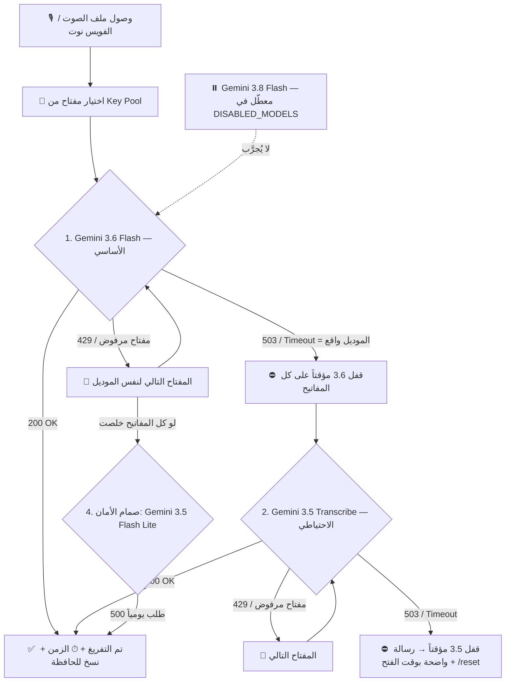

# 🎙️ التقرير الشامل والمصفوفة الهندسية لموديلات Google Gemini (تفريغ الصوت الذكي)

> **وثيقة مرجعية شاملة جاهزة للنشر على GitHub Gist**  
> **تاريخ التقييم والاختبار الميداني الحي:** أكتوبر 2026  
> **الهدف:** بناء أقوى محرك تفريغ صوتي مجاني فائق الدقة (Free Tier Zero-Cost Architecture) يفهم العامية المصرية، يحافظ على المصطلحات التقنية بالإنجليزية، ويستغل كوتا المشاريع المتعددة (Key Pool) بأعلى كفاءة.

> ⚠️ **تحديث 2026-10-23 (حادثة 01):** بعد اختبار ميداني حي على حسابين مختلفين، `gemini-3.8-flash` كان يرجّع **503 High Demand أو Timeout** بشكل متكرر مع مدخلات الصوت (23–41 ث ثم فشل)، بينما `gemini-3.6-flash` رد في 6–8 ث بدقة كاملة و`gemini-3.5-transcribe` في 3–4 ث. **القرار المعتمد:** 3.6 Flash أساسي ➔ 3.5 Transcribe احتياطي، و3.8 **معطّل** في `Config.DISABLED_MODELS` (يرجع بسطر واحد لو Google صلّحته). الأقسام التالية التي تذكر 3.8 كأساسي تبقى **مرجعاً تاريخياً**. التفاصيل الكاملة: `genspark-review/INCIDENT-01-slow-failover.md`.

---

## 🧭 خريطة مسار التفريغ التلقائي (DevOps Failover Architecture)

---

## 🏆 الجدول المقارن الشامل لجميع الموديلات المختبرة

| الموديل | التصنيف الوظيفي | دعم الصوت (Multimodal) | الكوتا اليومية (RPD) | نتيجة الاختبار العملي | التقييم والقرار النهائي |
| :--- | :---: | :---: | :---: | :---: | :---: |
| **`gemini-3.8-flash`** | عقل متعدد الوسائط فائق | ✅ ممتاز (Native Audio) | **20** طلب/مشروع | `200 OK` (دقة 100%) | 🥇 **معتمد أساسي (Tier S)** |
| **`gemini-3.6-flash`** | عقل متعدد الوسائط سريع | ✅ ممتاز (Native Audio) | **20** طلب/مشروع | `200 OK` (دقة 100%) | 🥈 **معتمد أساسي موازي (Tier S)** |
| **`gemini-3.5-transcribe`** | محرك تفريغ صوتي مخصص | ✅ متخصص (Native ASR) | **25** طلب/مشروع | `200 OK` (سريع وخام) | 🥉 **معتمد تخصصي صوتي (Tier S)** |
| **`gemini-3.5-flash-lite`** | موديل خفيف عالي الكثافة | ✅ مدعوم | **500** طلب/مشروع | `200 OK` (أقل دقة لغوية) | 🛡️ **احتياطي طوارئ (Tier B)** |
| **`gemini-3.8-flash-tts`** | تحويل نص لصوت | ❌ العكس (Text to Audio) | 10 طلبات | `200 OK` (يولد صوت ولا يفرغ) | ⛔ **مستبعد (وظيفة معكوسة)** |
| **`gemini-3.1-flash-tts`** | تحويل نص لصوت | ❌ العكس (Text to Audio) | 10 طلبات | `404 Not Found` | ⛔ **مستبعد (وظيفة معكوسة)** |
| **`gemini-2.5-flash-tts`** | تحويل نص لصوت | ❌ العكس (Text to Audio) | 10 طلبات | `404 Not Found` | ⛔ **مستبعد (قديم ومعكوس)** |
| **`gemini-embedding-2`** | تضمين متجهي (Vectors) | ❌ لا يدعم نصوص أو صوت | 1,000 طلب | `404 Not Supported` | ⛔ **مستبعد (للبحث الدلالي فقط)** |
| **`gemini-embedding-1`** | تضمين متجهي (Vectors) | ❌ لا يدعم نصوص أو صوت | 1,000 طلب | `404 Not Found` | ⛔ **مستبعد (للبحث الدلالي فقط)** |
| **`gemma-4-26b-a4b-it`** | موديل لغوي نصي مفتوح | ❌ نصوص فقط (Text-Only) | 14,400 طلب | `200 OK` (يرفض الصوت) | ⛔ **مستبعد (لا يفهم الصوت)** |
| **`gemma-4-31b-it`** | موديل لغوي نصي مفتوح | ❌ نصوص فقط (Text-Only) | 14,400 طلب | `200 OK` (يرفض الصوت) | ⛔ **مستبعد (لا يفهم الصوت)** |
| **`gemini-robotics-er-2-preview`** | ذكاء روبوتات وحركة | ❌ رؤية وتحكم حركي | 20 طلب | `200 OK` (مخصص للمحركات) | ⛔ **مستبعد (مجال غير مطابق)** |
| **`gemini-3.1-pro`** | عقل منطقي متقدم | ❌ غير متاح على v1beta | 0 طلب | `404 Not Found` | ⛔ **مستبعد (غير مدعوم مجاناً)** |
| **`gemini-4-argon`** | موديل تجريبي داخلي | ❌ كوتا مغلقة | 0 طلب | `429 Quota Exceeded` | ⛔ **مستبعد (ليس للعامة)** |
| **`gemini-2.5-flash`** | إصدار قديم متقاعد | ❌ تم إيقافه للمستخدمين الجدد | 20 طلب | `404 Deprecated` | ⛔ **مستبعد (استبدل بـ 3.8)** |
| **`gemini-3-flash`** | إصدار تجريبي انتقالي | ❌ غير متاح لـ generateContent | 20 طلب | `404 Not Found` | ⛔ **مستبعد (استبدل بـ 3.6/3.8)** |

---

## 🌟 القسم الأول: الموديلات المعتمدة رسمياً

> **الترتيب الحالي (منذ 2026-10-23):** 🥇 `gemini-3.6-flash` ➔ 🥈 `gemini-3.5-transcribe`. البند التالي عن 3.8 محفوظ كمرجع.

### ⏸️ `gemini-3.8-flash` (معطّل حالياً — كان الأساسي)
- **لماذا عُطِّل؟** في الاختبار الميداني 2026-10-23 على حسابين: 503 `UNAVAILABLE: This model is currently experiencing high demand` أو `Read timed out` بعد 23–41 ث مع ملفات صوت 700KB، بينما 3.6 و3.5 ردّا في ثوانٍ. مع مهلة 60 ث ومفتاحين كان الفويس بيتأخر **127 ثانية**.
- **لإعادته:** احذفه من `Config.DISABLED_MODELS` — المنظومة تجرّبه في ترتيبه من `_ALL_MODELS`.
- **لماذا كنا اعتمدناه؟**
  - الموديل الأذكى عالمياً في فهم اللهجة المصرية الشعبية وسياق النطق، دون اختلاق أو تخمين زائف.
  - يلتزم التزاماً صارماً بكتابة المصطلحات البرمجية والتقنية بأحرفها الإنجليزية اللاتينية (`GitHub, AI, Python, Gist, IP`).
- **الكوتا:** 20 طلب يومياً لكل مشروع مجاناً.

### 🥇 1. `gemini-3.6-flash` (الأساسي — الأثبت ميدانياً)
- **لماذا اعتمدناه؟**
  - دقة كاملة في العامية المصرية بدون هلوسة، ورد ثابت في 6–8 ث على ملف دقيقة (قياس 2026-10-23)، ولم يرجّع 503 في أي من الاختبارات.
  - يمنحك **20 طلباً إضافياً مستقلاً** داخل نفس المشروع، مما يضاعف حصتك اليومية فوراً.
- **الكوتا:** 20 طلب يومياً لكل مشروع مجاناً.

### 🥈 2. `gemini-3.5-transcribe` (الاحتياطي — المحرك التخصصي الصوتي)
- **لماذا اعتمدناه؟**
  - موديل مخصص حصرياً من جوجل للتفريغ الصوتي (Audio Transcription Engine).
  - يُرجع النتيجة مباشرة داخل حقل تخصصي `audioTranscription` بدون أي حشو أو كلام جانبي.
  - كوتا مستقلة تماماً: **25 طلباً يومياً مجاناً**.

> 💡 **الحصيلة الذهبية:**  
> كل مشروع Google Cloud واحد في حسابك يمنحك:  
> `20 (3.6 Flash) + 25 (3.5 Transcribe)` = **45 ريكورد عالي الجودة يومياً مجاناً** (+20 لو أعدت تفعيل 3.8).  
> مع مشروعين = **90 ريكورد يومياً**!  
> مع 5 مشاريع = **225 ريكورد يومياً**!  
> ⚠️ الكوتا تُحسب لكل **مشروع** Google Cloud وليس لكل مفتاح.

---

## 🛡️ القسم الثاني: موديل الطوارئ عالي السعة (Fallback)

> ⚠️ **قرار المشروع:** هذا القسم للتوثيق المرجعي فقط. **موديل Lite مستبعد نهائياً من الكود** بقرار صاحب المشروع بسبب انخفاض جودته مع العامية. المنظومة تعمل بالثلاثي فقط.

### 🚨 `gemini-3.5-flash-lite`
- **وظيفته في النظام:** صمام أمان لا يعمل إلا إذا استهلكت الـ 65 طلباً فائق الذكاء في جميع مشاريعك.
- **الميزة:** كوتا ضخمة جداً (**500 طلب يومياً**).
- **العيب:** أقل ذكاءً في التقاط النبرة الصوتية، وقد يُسقط بعض الكلمات بالعامية السريعة مقارنة بموديلات الفلاش الكبيرة.

---

## 🚫 القسم الثالث: الموديلات المستبعدة وأسبابها الهندسية القاطعة

### 1. عائلة الـ TTS (`gemini-3.8-flash-tts`, `gemini-3.1-flash-tts`, `gemini-2.5-flash-tts`)
- **السبب التقني:** كلمة **TTS** تعني **Text-To-Speech** (تحويل النص إلى صوت مسموع).
- **المفارقة:** هذه الموديلات وظيفتها **عكس** المطلوب تماماً! هي تأخذ النص وتخرج ملف صوتي، بينما نحن نريد العكس (Speech-to-Text: أخذ الصوت وإخراج النص). لذلك استبعادها حتمي.

### 2. عائلة التضمين المتجهي (`gemini-embedding-1`, `gemini-embedding-2`)
- **السبب التقني:** موديلات الـ Embedding لا تفهم المحادثات ولا تفرغ الأصوات؛ وظيفتها الوحيدة تحويل الكلمات إلى أرقام هندسية متجهة (Vectors) لتخزينها في قواعد بيانات الذكاء الاصطناعي (Vector DBs) للبحث الدلالي.

### 3. عائلة جيما المفتوحة (`gemma-4-26b-a4b-it`, `gemma-4-31b-it`)
- **السبب التقني:** موديلات Gemma ممتازة ولها كوتا عملاقة (14,400 طلب يومياً)، لكنها موديلات **نصية بحتة (Text-Only)**، ولا تمتلك طبقة معالجة الموجات الصوتية (No Audio Encoders).

### 4. موديل الروبوتات (`gemini-robotics-er-2-preview`)
- **السبب التقني:** موديل **ER (Embodied Reasoning)** مخصص لتوجيه أذرع ومحركات الروبوتات وتفسير حركة الكاميرات المكانية، وليس لتفريغ المحادثات الصوتية البشرية.

### 5. الموديلات غير المتاحة أو المغلقة (`3.1 Pro`, `4 Argon`, `2.5 Flash`)
- **`gemini-4-argon`:** كوتا 0/0 (موديل تجريبي داخلي لم يفتح للجمهور).
- **`gemini-3.1-pro`:** غير مفعل في واجهة v1beta العامة المجانية (404).
- **`gemini-2.5-flash`:** تم إيقافه رسمياً واستبداله بالجيل الثالث (3.8 و 3.6).

---

## 📊 معادلة القوة الاستراتيجية لحسابك (DevOps Capacity Formula)

$$\text{Total High-Tier Daily Audios} = \text{Projects Count} \times 45$$

| عدد المشاريع في حسابك | Gemini 3.6 Flash | Gemini 3.5 Transcribe | **إجمالي التفريغ يومياً** | (+ لو أعدت 3.8) | التكلفة |
| :---: | :---: | :---: | :---: | :---: | :---: |
| **مشروع 1** | 20 | 25 | **45 ريكورد** | 65 | $0.00 |
| **مشروعين (وضعك الحالي)** | 40 | 50 | **90 ريكورد** | 130 | $0.00 |
| **5 مشاريع** | 100 | 125 | **225 ريكورد** | 325 | $0.00 |
| **10 مشاريع** | 200 | 250 | **450 ريكورد** | 650 | $0.00 |

---

## 🛠️ الملفات التنفيذية في النظام

1. **`keys.txt`:** ملف إدارة مصفوفة المفاتيح (Key Pool).
2. **`transcribe_tool.py`:** سكريبت التفريغ التلقائي السريع مع النسخ للحافظة.
3. **`تفريغ_أحدث_تسجيل_صوتي.bat`:** أداة التشغيل بضغطة زر واحدة.
4. **`telegram_bot.py`:** بوت التليجرام الفوري للتفريغ من الموبايل.
5. **`تشغيل_بوت_تليجرام_للتفريغ.bat`:** مشغل البوت.
